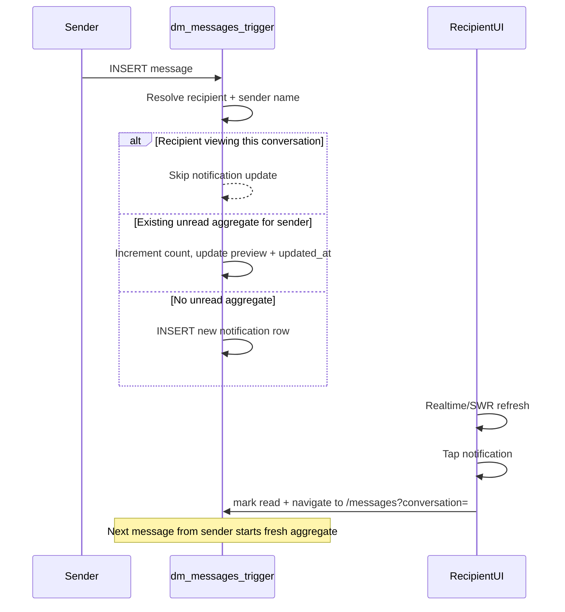

# Aggregate DM Notifications

## Current state

- DM sends only insert into [`dm_messages`](lib/messages/actions.ts) via `sendMessage()` — no notification side effects.
- The [`notifications`](supabase/migrations/20260826173000_member_invites.sql) table exists (invite/vouch only); the UI in [`components/notifications.tsx`](components/notifications.tsx) is ready for `kind: "message"` rows but [`data`](lib/notifications/actions.ts) is not exposed to the client.
- Inbox unread suppression while viewing a thread already works client-side in [`use-inbox-realtime.ts`](lib/messages/hooks/use-inbox-realtime.ts) via `activeConversationId` — but the DB has no equivalent signal yet.

## Target behavior



| Event                                         | Behavior                                                   |
| --------------------------------------------- | ---------------------------------------------------------- |
| Sender sends DM while recipient is away       | Upsert one unread `dm_message` notification per sender     |
| Sender sends more before dismiss              | Same row updates: count++, preview refreshes, bumps to top |
| Recipient is viewing that DM thread           | Trigger skips update entirely                              |
| Recipient taps notification                   | Mark read + navigate to conversation                       |
| Recipient opens conversation (inbox/deeplink) | Mark related DM notification read (dismiss)                |
| After dismiss                                 | Next message from that sender creates a **new** aggregate  |

**Display format**

- `title`: sender display name (from `profiles.full_name`, fallback `"Member"`)
- `body`: `"N new messages"` when `N > 1`; otherwise latest preview via existing [`message_preview_body()`](supabase/migrations/20260728200000_message_member_share_snapshot.sql)
- `time`: relative time from `updated_at` (not first message time)

---

## 1. Database migration

New file: `supabase/migrations/20260912180000_dm_message_notifications.sql`

### Schema additions

**`profiles.viewing_conversation_id`** (`uuid`, nullable FK → `dm_conversations`)

- Tracks which DM thread the user currently has open (server-visible pause signal).
- Cleared on leave/unmount.

**`notifications.updated_at`** (`timestamptz`, default `now()`)

- Bumped on each aggregate update so the row re-sorts to the top.

**Partial unique index** — enforces one active aggregate per recipient + sender:

```sql
create unique index notifications_dm_unread_sender_uidx
  on public.notifications (user_id, sender_profile_id)
  where kind = 'dm_message' and read = false;
```

Add explicit **`sender_profile_id uuid`** column (nullable, indexed) rather than relying on JSONB for uniqueness. Keep `data` for navigation payload:

```json
{ "conversationId": "...", "messageCount": 3, "latestMessageId": "..." }
```

### RPC: viewing state

`set_viewing_conversation(p_conversation_id uuid)` — security definer:

- Sets `profiles.viewing_conversation_id = p_conversation_id` for `auth.uid()` (null clears).
- Validates caller is a participant when non-null.

### RPC: dismiss on read

`dismiss_dm_notification(p_conversation_id uuid)` — marks `read = true` on unread `dm_message` rows for `auth.uid()` matching that conversation (via `data->>'conversationId'` or `sender_profile_id` lookup).

### Trigger: `upsert_dm_message_notification()`

`AFTER INSERT ON dm_messages FOR EACH ROW`:

1. Resolve recipient = other participant in `NEW.conversation_id` (skip if sender = recipient edge case).
2. **Pause check**: if recipient's `profiles.viewing_conversation_id = NEW.conversation_id` → return.
3. Build preview with `message_preview_body(NEW.body, NEW.job_id, NEW.shared_profile_id, NEW.member_share_snapshot)`.
4. Look up sender name from `profiles`.
5. **Upsert** unread row where `user_id = recipient AND sender_profile_id = NEW.sender_id AND kind = 'dm_message' AND read = false`:
   - On insert: `message_count = 1`, body = preview
   - On update: increment count in `data`, body = `"{count} new messages"` (or preview if count stays 1), set `updated_at = now()`
6. On conflict with unique index → update path above.

Use `security definer` + `set search_path = public` (same pattern as existing DM triggers).

### Query index tweak

Update [`listNotifications`](lib/notifications/actions.ts) ordering to `updated_at desc, created_at desc`.

---

## 2. Server actions

### [`lib/presence/actions.ts`](lib/presence/actions.ts) or new [`lib/messages/viewing-actions.ts`](lib/messages/viewing-actions.ts)

- `setViewingConversation(conversationId: string | null)` → calls `set_viewing_conversation` RPC.

### [`lib/messages/actions.ts`](lib/messages/actions.ts)

Extend `markConversationRead()` to also call `dismiss_dm_notification(conversationId)` so opening a thread from the inbox dismisses the aggregate.

### [`lib/notifications/actions.ts`](lib/notifications/actions.ts)

- Extend `AppNotification` mapping to include `data` fields needed for navigation (`conversationId`, `messageCount`).
- Add `dismissDmNotificationForConversation(conversationId)` wrapper if needed for explicit client calls.

---

## 3. Client: viewing state sync

### [`components/messages/messages-view.tsx`](components/messages/messages-view.tsx)

In the existing effect that sets `activeConversationId`, also call `setViewingConversation(persistedUuidOrNull)`:

- Only pass a real UUID (use `isUuid()`); stub `person-{uuid}` ids clear viewing until persistence resolves, then re-set.
- Cleanup on unmount: `setViewingConversation(null)`.

This mirrors the inbox realtime pattern but gives the DB trigger a server-side pause signal.

---

## 4. Client: notification UI

### [`lib/notifications-data.ts`](lib/notifications-data.ts)

- Map DB kind `dm_message` → display kind `"message"` (Mentions tab).
- Add helper `isDmNotification(n)` / `getDmConversationId(n)`.

### [`components/notifications/notification-list.tsx`](components/notifications/notification-list.tsx)

- Accept optional `onItemClick(item)` in addition to `onToggleRead`.
- DM rows: single click = dismiss + navigate (not toggle-unread loop).

### [`components/notifications.tsx`](components/notifications.tsx)

- Replace `toggleRead` for DM items with `handleDmNotificationClick`:
  1. Optimistic mark read
  2. `markNotificationRead(id, true)`
  3. Close sheet
  4. `router.push(`/messages?conversation=${conversationId}`)`
- Keep existing toggle behavior for non-DM notifications.

---

## 5. Realtime refresh

Add [`lib/notifications/hooks/use-notifications-realtime.ts`](lib/notifications/hooks/use-notifications-realtime.ts):

- Subscribe to `notifications` INSERT/UPDATE for current user (same pattern as [`use-inbox-realtime.ts`](lib/messages/hooks/use-inbox-realtime.ts)).
- On event → `mutate(notificationsKey)`.

Wire into [`components/notifications.tsx`](components/notifications.tsx) when sheet is open (alongside existing 30s polling in [`use-notifications.ts`](lib/notifications/hooks/use-notifications.ts)).

Also invalidate `notificationsKey` from [`use-inbox-realtime.ts`](lib/messages/hooks/use-inbox-realtime.ts) when a message arrives for the active conversation and gets auto-read — keeps badge in sync.

---

## 6. Edge cases

| Case                                                 | Handling                                                                                                                           |
| ---------------------------------------------------- | ---------------------------------------------------------------------------------------------------------------------------------- |
| Share-only messages (job/member cards)               | Reuse `message_preview_body()` in trigger                                                                                          |
| Sender messages themselves                           | Trigger skips (no notification for own sends)                                                                                      |
| Stub `person-{uuid}` conversation before persistence | Viewing RPC only accepts UUIDs; pause may lag briefly until conversation persists — acceptable, matches existing realtime behavior |
| Multiple tabs                                        | Last `setViewingConversation` wins; leaving any tab clears if unmount runs — acceptable for v1                                     |
| "Mark all read"                                      | Existing `markAllNotificationsRead()` already covers DM aggregates                                                                 |

---

## Files to change (summary)

| Layer         | Files                                                                                                                     |
| ------------- | ------------------------------------------------------------------------------------------------------------------------- |
| Migration     | `supabase/migrations/20260912180000_dm_message_notifications.sql`                                                         |
| Server        | `lib/messages/actions.ts`, `lib/notifications/actions.ts`, new viewing action                                             |
| Types/helpers | `lib/notifications-data.ts`                                                                                               |
| UI            | `components/notifications.tsx`, `components/notifications/notification-list.tsx`, `components/messages/messages-view.tsx` |
| Realtime      | new `use-notifications-realtime.ts`, touch `use-inbox-realtime.ts`                                                        |

---

## Test plan

1. User A sends 1 DM to User B (B away) → B sees 1 notification with message preview.
2. A sends 4 more before B dismisses → B sees **one** row: "5 new messages", bumped to top.
3. B opens thread from inbox → notification disappears (marked read); A sends 2 more while B is viewing → no new/updated notification.
4. B leaves thread; A sends 1 more → new aggregate "1 new message" appears.
5. B taps notification → lands on correct conversation, notification marked read.
6. Mentions tab shows DM aggregates; All tab includes them; unread badge counts them once each (not per message).

**Manual step:** Run the migration in Supabase SQL Editor (project convention — no auto-push).
