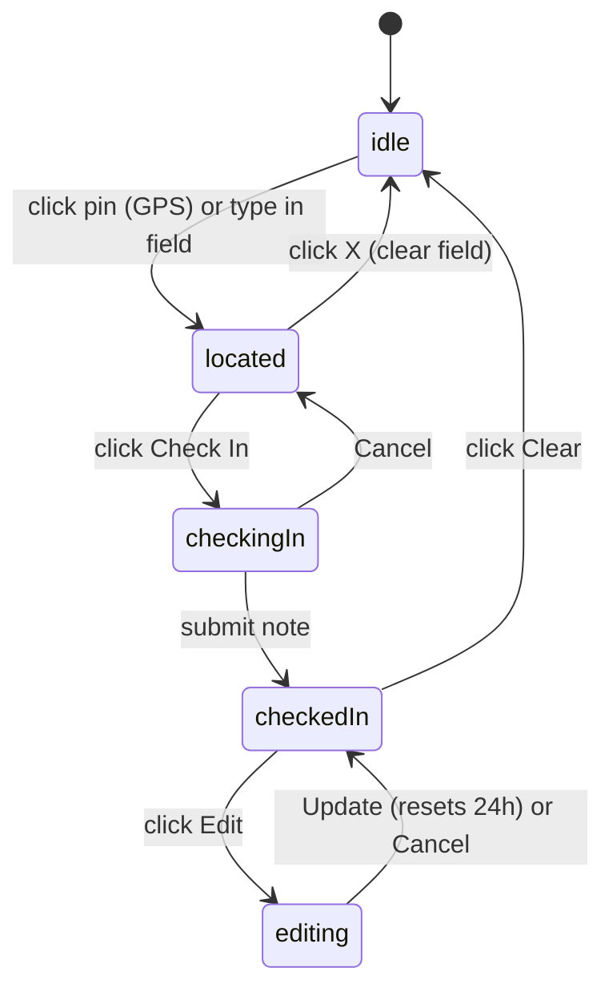

# Check-in Component Polish (Card + Dialog)

Rework the Now "Who's Around" component so the card and dialog share one state machine and one surface. Add search-based + GPS check-in, a note, an Edit/Clear checked-in header, a Map/List toggle, and clustered map bundles with zoom + popover fallback.

Confirmed decisions:

- Location: pin button = GPS then reverse-geocode to a city label; typing = free-text place geocoded to coordinates on check-in (no live autocomplete dropdown).
- Bundling: supercluster-style geographic clustering that changes with zoom. Click a bundle to zoom in; if members can't be separated, show the bundle-list popover.

## Current state (what changes)

- [`components/now/whos-around-card.tsx`](components/now/whos-around-card.tsx): renders `OnTheRoadSurface` for both the inline card and an "expand" dialog. Search `Input` is `disabled`; the "Check in here" `Button` calls GPS directly with no note/popover. The bottom-left overlay is a large card (city + count + member list). No view toggle, no clustering, no checked-in header, no edit/clear.
- [`components/now/now-map.tsx`](components/now/now-map.tsx): renders one `Marker` per member, no clustering, self shown as a small ping dot.
- [`lib/now/check-in.ts`](lib/now/check-in.ts) / [`lib/now/actions.ts`](lib/now/actions.ts): `ownCheckIn` lacks `checkedInAt`/`note`; no clear action; check-in takes only coords + optional city.
- [`supabase/migrations/20260923170700_create_check_ins.sql`](supabase/migrations/20260923170700_create_check_ins.sql): no `note` column.

## Target state machine (shared by card + dialog)

Card-specific: in `located`, clicking Check In opens the dialog with the check-in popover open. In `checkedIn`, Edit opens the dialog; single-member click keeps the current small `PersonCard` popover; bundle click opens the dialog zoomed (or with the bundle popover). Clear works inline.

## Data + server (Tasks 2-3)

- New migration `supabase/migrations/<ts>_add_check_in_note.sql` adding `note text` (<=80 chars) to `check_ins` (manual-run per existing header convention; RLS unchanged). Update the table comment.
- [`lib/now/check-in.ts`](lib/now/check-in.ts): add `note` to `CheckedInMember`; extend `ownCheckIn` (in `CheckInMapData`) to include `checkedInAt` and `note`; include them in `getCheckInMapData` and `buildCheckInMapDataFromCoords`; select `note` in `fetchFreshCheckInsInBox`. Location label shown in bundles/list = existing `city`.
- [`lib/now/actions.ts`](lib/now/actions.ts):
  - Extend `checkInAtLocation` to accept `note?: string` (trim, cap 80) and persist it (used by GPS + Edit).
  - Add `checkInBySearch({ query, note })`: server geocodes with `geocodePlace` from [`lib/now/geo.ts`](lib/now/geo.ts), then upserts + returns `mapData` (keeps the Mapbox token server-side; no raw geocode exposed).
  - Add `clearCheckIn()`: auth-guard, delete own `check_ins` row, return fresh home-base `mapData` (reuse `getCheckInMapData` path).
  - All actions keep the existing `getSessionUser` auth guard (Server Action auth rule).

## UI refactor (Tasks 4-9)

Lift shared state into [`components/now/whos-around-card.tsx`](components/now/whos-around-card.tsx) (`mapData`, `query`, `note`, `viewMode: "map" | "list"`, popover flags, `flyTo`, `dialogOpen` + `dialogIntent`) so the card and dialog stay in sync. Rename `OnTheRoadSurface` to a shared `CheckInSurface` driven by props/derived `phase`.

- Search bar: replace disabled `Input` with `InputGroup` from [`components/ui/input-group.tsx`](components/ui/input-group.tsx). `InputGroupAddon` leading search icon; trailing addon = pin `InputGroupButton` (`MapPin`) in `idle`, swapping to an `X` clear button once located/typed, with the `Check In` `Button` appearing beside it.
- Check-in popover + Edit popover: `Popover` anchored to the search bar / header. Check-in form = place label (e.g. "Los Angeles, CA") + note `Textarea` with a live `N / 80` counter + `Check in`/`Cancel`. Edit form = location `Input` (pin icon) + note `Textarea` + helper "Any change resets your 24h window." + `Update · reset 24h`/`Cancel`. New `components/now/check-in-form-popover.tsx`.
- Checked-in header chip: self `Avatar` (orange ring) + "{city} · {hoursLeft}h left" (derived from `checkedInAt` + 24h TTL from `CHECK_IN_TTL_MS`, refreshed on a 60s interval) + `Edit` + `Clear` buttons. Replaces the search bar when checked in.
- View toggle: `ToggleGroup` (top-right) from [`components/ui/toggle-group.tsx`](components/ui/toggle-group.tsx) with Map (`LayoutGrid`) and `List` items driving `viewMode`.
- List view: full-panel member list (avatar, "name · city"); rows open `PersonProfileDrawer` (reuse current list-row markup). Bottom-left becomes a compact "N checked in nearby" pill only.
- Map clustering: add `supercluster` dep; in [`components/now/now-map.tsx`](components/now/now-map.tsx) build clusters from `members` by zoom/bounds. Render white numbered bundle markers + individual avatars; render own check-in as a "YOU" orange-ring marker. Click bundle: if `getClusterExpansionZoom` increases zoom, `flyTo` and expand; else `onSelectBundle(members, cityLabel)` to show the bundle popover. New `components/now/check-in-bundle-popover.tsx` ("{city} · N crew" + member rows). Single-member click keeps `CheckInMemberPopover`.
- Card handoff: card map `onSelectBundle` and checked-in `Edit` open the dialog with the right `dialogIntent` (open bundle popover / zoom / edit).

## Verify

Exercise `/now` in the browser for both card and dialog: idle -> pin (GPS) and typed search both surface X + Check In; check-in popover note + counter submits and flips to checked-in header; Edit resets the window; Clear returns to idle + empty field + home-base map; Map/List toggle; clustered bundle zooms in, and a co-located bundle opens the list popover; card Check In / Edit / bundle correctly open the dialog.
