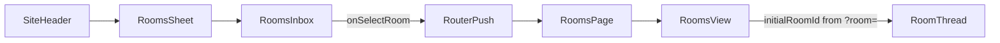

# Header Rooms Flyout

## Goal

Add a **Rooms** icon to the header action cluster (left of Messages) that opens a right-side sheet styled like [`components/messages.tsx`](components/messages.tsx). The sheet shows a searchable room list via existing [`components/rooms/rooms-inbox.tsx`](components/rooms/rooms-inbox.tsx). Clicking a room row navigates to the full [`/rooms`](<app/(app)/rooms/page.tsx>) page with that room open.

## Architecture



## Implementation

### 1. Create header Rooms sheet — [`components/rooms.tsx`](components/rooms.tsx) (new)

Mirror [`components/messages.tsx`](components/messages.tsx):

- **Icon:** `Hash` from `lucide-react` (matches sidebar Rooms nav in [`lib/nav.ts`](lib/nav.ts))
- **Trigger:** `Button variant="ghost" size="icon"` with unread badge when count > 0
- **Unread count:** `joinedRoomUnreadCount(rooms)` from [`lib/messages-data.ts`](lib/messages-data.ts) (counts joined rooms with `unread: true`)
- **Sheet shell:** Same classes as Messages/Notifications:
  - `inset-y-3! right-3! h-auto! w-full gap-0 overflow-hidden rounded-2xl border p-0 sm:max-w-md`
  - Header with title "Rooms" + optional `{n} new` pill
- **Body:** `<RoomsInbox rooms={sortedRooms} onSelectRoom={handleSelectRoom} onToggleJoin={toggleJoin} />`

**Local state** (same logic as [`components/rooms/rooms-view.tsx`](components/rooms/rooms-view.tsx) lines 30–68):

- `useState` for `rooms` (from `initialRooms`) and `joinOrder`
- `useMemo` + `sortRoomsForInbox(rooms, joinOrder)` for sorted list
- `toggleJoin` handler so Join/Joined buttons work in the flyout

**Navigation on row click:**

- Use controlled `Sheet` (`open` / `onOpenChange`) so the panel closes before navigation
- `useRouter().push(\`/rooms?room=${room.id}\`)`in`handleSelectRoom`
- Mark room unread as read when selecting (same as `selectRoom` in `RoomsView`)

### 2. Wire into header — [`components/site-header.tsx`](components/site-header.tsx)

Insert `<Rooms />` **before** `<Messages />`:

```tsx
<Rooms />
<Messages />
<Notifications />
```

### 3. Deep-link room selection on full page

**[`app/(app)/rooms/page.tsx`](<app/(app)/rooms/page.tsx>)**

- Accept `searchParams: Promise<{ room?: string }>`
- Pass `initialRoomId={params.room}` to `RoomsView`

**[`components/rooms/rooms-view.tsx`](components/rooms/rooms-view.tsx)**

- Add optional prop `initialRoomId?: string`
- On mount (or when `initialRoomId` changes), find the room in state and call `setActive(room)`; clear unread if joined + unread (reuse existing `selectRoom` logic)

This avoids `useSearchParams` + Suspense boilerplate and follows the existing server-page pattern used in [`app/login/page.tsx`](app/login/page.tsx).

## Files touched

| File                              | Change                                    |
| --------------------------------- | ----------------------------------------- |
| `components/rooms.tsx`            | **New** — header icon + sheet             |
| `components/site-header.tsx`      | Import and render `<Rooms />`             |
| `app/(app)/rooms/page.tsx`        | Read `?room=` search param                |
| `components/rooms/rooms-view.tsx` | Accept `initialRoomId`, open room on load |

## Out of scope (kept minimal)

- Shared hook extraction for join state (header and full page keep separate local state, like Messages header vs `/messages` page)
- Wiring sidebar badge `"2"` in [`lib/nav.ts`](lib/nav.ts) to live unread count
- Syncing URL when selecting rooms on the full page (only header → page deep link)
- Footer "View all rooms" link (Notifications has one; Messages does not — we match Messages)

## Verification

1. Header shows Hash icon with unread badge (mock data has joined unread rooms)
2. Clicking icon opens sheet with search + room list matching Messages sheet styling
3. Join/Joined toggles work in the flyout
4. Clicking a room row closes sheet and lands on `/rooms?room={id}` with that room's thread visible
5. Mobile: thread panel shows correctly (existing `RoomsView` responsive behavior)
