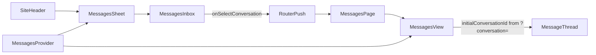

# Messages Flyout Navigation Sync

## Goal

Make the Messages header flyout navigate to the full Messages page with the selected thread open, and keep flyout + page state in sync the same way Rooms does today.

## Current vs target

| Concern           | Rooms (reference)                                                    | Messages (today)                                    |
| ----------------- | -------------------------------------------------------------------- | --------------------------------------------------- |
| Shared state      | [`RoomsProvider`](components/rooms/rooms-provider.tsx) in app layout | None — header and page each import static mock data |
| Flyout row click  | `router.push('/rooms?room={id}')` + close sheet                      | No `onSelectConversation` wired — clicks do nothing |
| Page deep link    | [`?room=`](<app/(app)/rooms/page.tsx>) → `initialRoomId`             | No search param support                             |
| Mark read on open | `markRoomRead` in flyout + page                                      | Unread never cleared                                |
| In-page selection | Local `active` state (URL not updated)                               | Local `active` + separate `conversations` state     |

## Architecture



Both the flyout and full page read/write the same conversation list and unread flags via `MessagesProvider`, matching how [`components/rooms.tsx`](components/rooms.tsx) and [`components/rooms/rooms-view.tsx`](components/rooms/rooms-view.tsx) share [`useRooms()`](components/rooms/rooms-provider.tsx).

## Implementation

### 1. Add `MessagesProvider` — [`components/messages/messages-provider.tsx`](components/messages/messages-provider.tsx) (new)

Mirror [`components/rooms/rooms-provider.tsx`](components/rooms/rooms-provider.tsx):

- Seed state from `directConversations` in [`lib/messages-data.ts`](lib/messages-data.ts)
- Expose:
  - `conversations` — live list (includes conversations started via "New message")
  - `unreadCount` — `conversations.filter(c => c.unread).length`
  - `markConversationRead(id)` — clear `unread` for matching conversation
  - `getConversation(id)` — lookup by id
  - `startConversation(person)` — move logic from [`messages-view.tsx`](components/messages/messages-view.tsx) lines 37–48: reuse existing by name or prepend `personToConversation(person)`
- Export `useMessages()` hook with provider guard

Optional small helper in [`lib/messages-data.ts`](lib/messages-data.ts): `directConversationUnreadCount(conversations)` (parallel to `joinedRoomUnreadCount`).

### 2. Wrap app layout — [`app/(app)/layout.tsx`](<app/(app)/layout.tsx>)

Nest `MessagesProvider` alongside the existing `RoomsProvider` so header flyout and `/messages` page share state:

```tsx
<RoomsProvider>
  <MessagesProvider>{/* sidebar, header, children */}</MessagesProvider>
</RoomsProvider>
```

### 3. Wire header flyout — [`components/messages.tsx`](components/messages.tsx)

Mirror [`components/rooms.tsx`](components/rooms.tsx):

- Controlled sheet: `useState` for `open` / `setOpen`
- `useRouter()` + `useMessages()` for `conversations`, `unreadCount`, `markConversationRead`
- `navigateToConversation(id)` → `setOpen(false)` → `router.push(\`/messages?conversation=${id}\`)`
- `handleSelectConversation(c)` → mark read if unread → navigate
- Pass props to inbox:

```tsx
<MessagesInbox
  conversations={conversations}
  onSelectConversation={handleSelectConversation}
/>
```

Badge and "N new" pill use live `unreadCount` from provider instead of static import.

### 4. Deep-link on full page

**[`app/(app)/messages/page.tsx`](<app/(app)/messages/page.tsx>)**

- Accept `searchParams: Promise<{ conversation?: string }>`
- Pass `initialConversationId={params.conversation}` to `MessagesView`

**[`components/messages/messages-view.tsx`](components/messages/messages-view.tsx)**

- Add optional `initialConversationId?: string` prop
- Replace local `conversations` state with `useMessages()`
- Add `selectConversation(c)` handler (mirror `selectRoom` in rooms-view):
  - `markConversationRead(c.id)` when unread
  - `setActive(getConversation(c.id) ?? c)`
- Add `useEffect` (mirror [`rooms-view.tsx`](components/rooms/rooms-view.tsx) lines 55–66):

```tsx
useEffect(() => {
  if (!initialConversationId) return;
  const conversation = conversations.find(
    (c) => c.id === initialConversationId,
  );
  if (!conversation) return;
  if (conversation.unread) markConversationRead(initialConversationId);
  setActive(conversation);
}, [initialConversationId, conversations, markConversationRead]);
```

- Derive `activeConversation = active ? (getConversation(active.id) ?? active) : null` so thread reflects provider updates (same pattern as `activeRoom` in rooms-view)
- Wire `startConversation` from provider into `NewMessageDrawer`
- Pass `conversations`, `activeId`, and `selectConversation` to `MessagesInbox`

No changes needed to [`components/messages/messages-inbox.tsx`](components/messages/messages-inbox.tsx) — it already accepts `conversations`, `activeId`, and `onSelectConversation`.

## Files touched

| File                                                                                     | Change                                       |
| ---------------------------------------------------------------------------------------- | -------------------------------------------- |
| [`components/messages/messages-provider.tsx`](components/messages/messages-provider.tsx) | **New** — shared conversation + unread state |
| [`app/(app)/layout.tsx`](<app/(app)/layout.tsx>)                                         | Wrap with `MessagesProvider`                 |
| [`components/messages.tsx`](components/messages.tsx)                                     | Controlled sheet, navigation, provider hooks |
| [`app/(app)/messages/page.tsx`](<app/(app)/messages/page.tsx>)                           | Read `?conversation=` search param           |
| [`components/messages/messages-view.tsx`](components/messages/messages-view.tsx)         | Provider + `initialConversationId` deep link |
| [`lib/messages-data.ts`](lib/messages-data.ts)                                           | Optional unread count helper                 |

## Out of scope (matches Rooms)

- Updating URL when selecting a conversation on the full page (only flyout → page deep link)
- Wiring the static sidebar badge in [`lib/nav.ts`](lib/nav.ts) to live unread count
- Real API/persistence for read state

## Verification

1. Header Messages icon shows live unread badge from shared provider
2. Clicking a conversation in the flyout closes the sheet and lands on `/messages?conversation={id}` with that thread open
3. Opening an unread conversation (flyout or page) clears its unread styling and decrements the header badge
4. Starting a "New message" on the full page adds the conversation to the flyout list
5. Selecting a conversation on the full page opens the thread locally (URL stays as-is, same as Rooms)
6. Mobile: thread panel + back button still work via existing responsive classes in `MessagesView`
