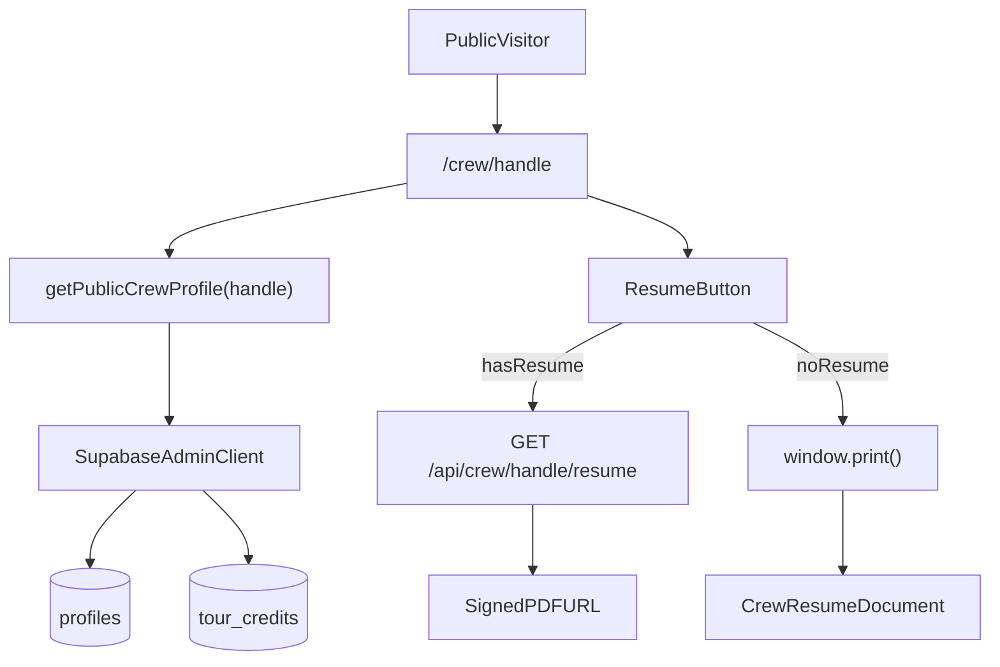

# Public Crew Profile Pages

## Shaping Summary

| Decision              | Choice                                                                                                     |
| --------------------- | ---------------------------------------------------------------------------------------------------------- |
| Access                | Public, no login required                                                                                  |
| URL                   | `/crew/[handle]` — auto-generated from name, editable later                                                |
| Layout                | Hybrid — dedicated dark public page; reuse data loaders and section logic from existing profile components |
| Section toggles       | Deferred — fixed v1 resume sections                                                                        |
| Resume sections (v1)  | Header, skills, bio, competencies, credits, links, work auth, experience                                   |
| Profile button wiring | My Account, user dropdown, member card Profile (preview **and** in-app live) → `/crew/{handle}` new tab    |

**Visual references provided:** Aubrey Wright public profile (mobile/desktop dark layout), print dialog with two-column white resume, account preview card with Resume button.

**Product alignment:** Matches [feature-migration-inventory.md](agent-os/product/misc/feature-migration-inventory.md) ("Public crew profile" for unauthenticated visitors) and accelerates [roadmap.md](agent-os/product/roadmap.md) Phase 2 SEO crew profiles.

**Standards:** `agent-os/standards/index.yml` is empty — no formal standards to apply.

---

## Architecture



**Why admin client for public reads:** Current RLS only allows authenticated reads (`profiles_select_active_members`). A server-side public fetch using `createAdminClient()` with a strict field whitelist avoids exposing email, RBAC fields, or inactive profiles — same pattern as [`getMemberResumeSignedUrl`](lib/people/actions.ts) today.

---

## Task 1: Save Spec Documentation

Create `agent-os/specs/2026-09-17-2008-public-crew-profiles/` with:

- **plan.md** — this plan
- **shape.md** — scope, decisions, visuals list, product alignment
- **standards.md** — note no standards index entries
- **references.md** — pointers below
- **visuals/** — copy the 4 provided screenshots into the folder

### Key references to document

| Reference                    | Location                                                                                           | Reuse                                                                   |
| ---------------------------- | -------------------------------------------------------------------------------------------------- | ----------------------------------------------------------------------- |
| Profile UI + resume download | [`components/people/person-profile-card.tsx`](components/people/person-profile-card.tsx)           | Resume button behavior, section content, `getMemberResumeSignedUrl`     |
| Account preview              | [`components/account/account-profile-preview.tsx`](components/account/account-profile-preview.tsx) | Preview parity target                                                   |
| Profile data mappers         | [`lib/account/profile-data.ts`](lib/account/profile-data.ts)                                       | `MEMBER_PROFILE_SELECT`, `toPersonFromProfile`, `toTourCreditsFromRows` |
| Resume upload (owner)        | [`components/account/resume-section.tsx`](components/account/resume-section.tsx)                   | Same `profiles.resume_url` source                                       |
| Disabled "My Profile"        | [`components/account/account-page-actions.tsx`](components/account/account-page-actions.tsx)       | Wire to public URL                                                      |
| Auth middleware              | [`lib/supabase/middleware.ts`](lib/supabase/middleware.ts)                                         | Add `/crew` to public prefixes                                          |

---

## Task 2: Database — Profile Handles

**Migration:** `supabase/migrations/YYYYMMDD_add_profile_handle.sql`

- Add `handle text` column to `profiles`
- Unique index on `handle` (case-insensitive via `lower(handle)`)
- Backfill existing active members: slugify `full_name` → `aubrey-wright`, dedupe with numeric suffix
- Add `lib/account/handle.ts` with `slugifyHandle(name)`, `generateUniqueHandle(name, excludeId?)`, validation regex (lowercase alphanumeric + hyphens, 3–40 chars)
- Trigger or server-side hook on profile name change to set handle if null (auto-gen only when empty — preserves future manual edits)

**Extend types:** Add `handle` to `MemberProfileRow`, `Person`, and `MEMBER_PROFILE_SELECT`.

---

## Task 3: Public Data Layer

**New file:** `lib/crew/public-profile.ts`

```typescript
// Public-safe subset — no email, role, status internals, viewing_* ids
export type PublicCrewProfile = { person: Person; tourCredits: TourCredit[]; handle: string }

export async function getPublicCrewProfile(handle: string): Promise<PublicCrewProfile | null>
export async function getPublicCrewProfileById(id: string): Promise<...> // for owner preview link
```

- Lookup by `lower(handle)`, require `status = 'active'`
- Fetch tour credits ordered like [`getMemberById`](lib/people/actions.ts)
- Omit connection/vouch extras not needed on public page (or include vouch counts on credits if shown in screenshots)
- Export `buildResumeData(profile)` helper for print document (competencies derived from `skills[]`, experience from `years_experience` + `venue_tiers[]`, work auth labels from existing enums)

---

## Task 4: Public Route + Middleware

**New route:** `app/(marketing)/crew/[handle]/page.tsx`

- Async server component: fetch profile, `notFound()` if missing
- `generateMetadata()` — title `{name} | AWN`, description from bio excerpt, `openGraph` with avatar
- Render `PublicCrewProfilePage` (new component)

**Middleware:** Add `"/crew"` to `PUBLIC_PREFIXES` in [`lib/supabase/middleware.ts`](lib/supabase/middleware.ts).

**404 handling:** Inactive or unknown handles return Next.js 404.

---

## Task 5: Public Profile Page UI (Dark Layout)

**New components in `components/crew/`:**

| Component                      | Purpose                                                                 |
| ------------------------------ | ----------------------------------------------------------------------- |
| `public-crew-profile-page.tsx` | Full-page dark layout matching Aubrey Wright screenshots                |
| `crew-profile-header.tsx`      | Banner/avatar, name, verified badge, role · location, availability pill |
| `crew-profile-sections.tsx`    | Skills tags, bio, tour credit cards, links, apply CTA footer            |
| `crew-resume-button.tsx`       | Client component — dual behavior (download vs print)                    |

**Layout notes (from screenshots):**

- AWN logo + wordmark header
- Full-width hero image with name overlay (serif heading)
- Department/skill pills
- Bio + "Core Competencies" bullet list (from skills)
- Tour credits grid (artist, role, date range — most recent highlighted)
- Links section (website)
- Footer CTA: "Apply for membership" → `/apply`
- Floating "Save as PDF" button bottom-right when no uploaded resume (optional UX enhancement matching screenshot)

**Reuse strategy:** Extract shared presentational bits from [`person-profile-card.tsx`](components/people/person-profile-card.tsx) where low-risk (availability badge, credit card markup, social links via [`getPersonSocialLinks`](lib/social-links.ts)). Do **not** reuse the full card — public page has different chrome, no connect/message/vouch actions.

---

## Task 6: Resume Download API (Public)

**New route:** `app/api/crew/[handle]/resume/route.ts`

- Resolve profile by handle (active only)
- If `resume_url` exists → return redirect to 10-min signed URL (admin client, same as member flow)
- If not → 404 (client falls back to print)
- Rate-limit consideration: keep simple for v1; no auth required per product decision

---

## Task 7: Generated Resume + Print Styles

**New components:**

| Component                  | Purpose                                                       |
| -------------------------- | ------------------------------------------------------------- |
| `crew-resume-document.tsx` | Print-only two-column white layout (matches print screenshot) |
| `crew-print.css` or module | `@media print` rules                                          |

**Print layout (v1 sections):**

| Section           | Source fields                                               |
| ----------------- | ----------------------------------------------------------- |
| Header            | avatar, name, title, city/home_base, availability, AWN logo |
| Skills            | `department`, `skills[]`                                    |
| Bio               | `bio` (fallback via `getPersonProfile`)                     |
| Core competencies | `skills[]` as bullet list                                   |
| Tour credits      | `tour_credits` rows                                         |
| Links             | website + social                                            |
| Work auth         | `work_auth[]` ("Touring passport" label)                    |
| Experience        | `years_experience`, `venue_tiers[]`                         |

**Print flow:**

1. `CrewResumeDocument` rendered in DOM, hidden on screen (`sr-only` or `hidden print:block`)
2. Screen profile hidden in print (`print:hidden` on main layout)
3. Resume button with no upload calls `window.print()` after brief layout settle
4. Recommend users disable "Headers and footers" in browser print dialog (document in UI hint if needed)

**Styles:** Light background, serif name, orange accent on dates/headers, two-column grid (sidebar: skills/links/work auth; main: bio/competencies/credits), footer with profile URL + "A Wright Network — By Invitation Only".

---

## Task 8: Wire Profile Links to Public URL

All four Profile entry points must link to `/crew/{handle}` and open in a **new tab** (`target="_blank"`, `rel="noopener noreferrer"`).

### Shared helper

Add `getCrewProfilePath(handle: string)` (and optionally `getCrewProfileUrl()` for absolute URLs) in [`lib/account/handle.ts`](lib/account/handle.ts). Use everywhere to avoid hardcoded paths.

**Prerequisite:** `handle` must flow through the full profile pipeline:

- DB → `MemberProfileRow` → `Person` (via `toPersonFromProfile`)
- Account context → `draft` in [`account-profile-provider.tsx`](components/account/account-profile-provider.tsx)
- People directory / drawer → `getMemberById` results
- App chrome → `SessionUser` / `NavUserData` for the user dropdown

### 1. My Account — "My Profile" button

**File:** [`components/account/account-page-actions.tsx`](components/account/account-page-actions.tsx)

Current state: button is **disabled** with tooltip "Public profile page coming soon".

Changes:

- Remove disabled state and placeholder tooltip
- Render as `<Button render={<Link href={getCrewProfilePath(handle)} target="_blank" />}>` (or equivalent link wrapper)
- Read `handle` from `useAccountProfile()` (add to provider alongside `draft`)
- If handle is missing (edge case before backfill): keep disabled with tooltip "Profile URL unavailable"

### 2. User dropdown — "My Profile" link

**File:** [`components/nav-user.tsx`](components/nav-user.tsx)  
**Used by:** header popover + mobile drawer ([`site-header.tsx`](components/site-header.tsx), [`app-sidebar.tsx`](components/app-sidebar.tsx))

Current state: nav links are `My Account`, `My Jobs`, `Settings`, `Support` — no public profile link.

Changes:

- Add **"My Profile"** nav item directly **below "My Account"** (above "My Jobs")
- Icon: `ExternalLink` from lucide-react (signals opens public page)
- Link to `getCrewProfilePath(handle)` with `target="_blank"` and `rel="noopener noreferrer"`
- Extend `NavUserData` with optional `handle?: string`
- Plumb handle from [`getSessionUser`](lib/auth/get-session-user.ts) → app layouts ([`(app)/layout.tsx`](<app/(app)/layout.tsx>), [`(popout)/layout.tsx`](<app/(popout)/layout.tsx>)) → `NavUser`
- If handle is missing: omit the link (or render disabled — prefer omit for cleaner menu)

Implementation note: the existing `links` array uses internal `Link` routes. "My Profile" is an external-facing public URL — either add an `external?: boolean` flag to the link config or render it as a separate item before/within the links block so `target="_blank"` is applied correctly.

### 3. Member card — Profile button (preview mode)

**File:** [`components/people/person-profile-card.tsx`](components/people/person-profile-card.tsx)  
**Used by:** [`account-profile-preview.tsx`](components/account/account-profile-preview.tsx) with `mode="preview"`

Current state: Profile button is **disabled** in preview; `PreviewTooltip` shows "Preview only".

Changes:

- **Enable Profile in preview mode** — viewing the live public page is valid while editing
- Remove `disabled` / `aria-disabled` from Profile button when `person.handle` exists
- Remove Profile button from `PreviewTooltip` wrapper (or only wrap when handle is missing)
- Link to `/crew/{person.handle}` in new tab
- Note: public page shows **saved DB state**, not unsaved draft edits — acceptable for v1

### 4. Member card — Profile button (interactive / in-app live)

**File:** [`components/people/person-profile-card.tsx`](components/people/person-profile-card.tsx)  
**Used by:** [`person-profile-drawer.tsx`](components/people/person-profile-drawer.tsx) with `mode="interactive"` (People directory, Messages, Jobs, etc.)

Changes:

- Same link behavior: `/crew/{person.handle}` in new tab
- Keep existing `JobActionTooltip` label "View full profile" for interactive mode
- Guard: if `person.handle` is missing, disable button with tooltip "Profile unavailable"

### Profile button implementation sketch

```tsx
// person-profile-card.tsx — Profile button
{
  person.handle ? (
    <Button
      variant="ghost"
      size="sm"
      nativeButton={false}
      render={
        <Link
          href={getCrewProfilePath(person.handle)}
          target="_blank"
          rel="noopener noreferrer"
        />
      }
    >
      <ExternalLink />
      Profile
    </Button>
  ) : (
    <Button variant="ghost" size="sm" disabled>
      <ExternalLink />
      Profile
    </Button>
  );
}
```

### Also in Task 8 (same pass)

| Location                                                                                                 | Change                                                                                                     |
| -------------------------------------------------------------------------------------------------------- | ---------------------------------------------------------------------------------------------------------- |
| [`person-profile-card.tsx`](components/people/person-profile-card.tsx)                                   | Resume button always visible — download if `hasResume`, else print fallback (separate from Profile wiring) |
| [`lib/account/profile-actions.ts`](lib/account/profile-actions.ts)                                       | Revalidate `/crew/[handle]` on profile/resume updates                                                      |
| [`account-profile-provider.tsx`](components/account/account-profile-provider.tsx)                        | Expose `handle` on context for account actions                                                             |
| [`nav-user.tsx`](components/nav-user.tsx)                                                                | Add "My Profile" dropdown link below My Account                                                            |
| [`lib/auth/get-session-user.ts`](lib/auth/get-session-user.ts)                                           | Include `handle` in session user select                                                                    |
| [`app/(app)/layout.tsx`](<app/(app)/layout.tsx>), [`app/(popout)/layout.tsx`](<app/(popout)/layout.tsx>) | Pass `handle` to `NavUser` via sidebar + header                                                            |

---

## Task 9: Handle Display in Account (Minimal)

- Show public URL on account profile page (read-only copy link) using member's handle
- Defer full handle editor UI — auto-generated handle only for v1; note in spec as follow-up

---

## Task 10: Manual Verification

- Visit `/crew/{handle}` logged out — page renders, SEO metadata present
- Member with uploaded resume — Resume downloads PDF
- Member without resume — Resume opens print dialog with clean layout
- **My Account → "My Profile"** opens `/crew/{handle}` in new tab
- **User dropdown → "My Profile"** opens `/crew/{handle}` in new tab (header + sidebar mobile drawer)
- **Account preview card → Profile** opens `/crew/{handle}` in new tab (not disabled)
- **People drawer / in-app card → Profile** opens other member's `/crew/{handle}` in new tab
- Profile button disabled gracefully when handle is missing
- Inactive member handle returns 404
- Profile/resume updates reflect after revalidation

---

## Out of Scope (Follow-ups)

- Member section visibility toggles (deferred per shaping)
- Handle editing UI
- Privacy settings enforcement (`privacy-settings-section.tsx` is local state only)
- SEO sitemap / structured data (can add `Person` JSON-LD later)
- Public resume access restrictions

---

## Key Files to Create/Modify

**Create:**

- `app/(marketing)/crew/[handle]/page.tsx`
- `app/api/crew/[handle]/resume/route.ts`
- `lib/crew/public-profile.ts`
- `lib/account/handle.ts`
- `components/crew/*` (page, header, sections, resume button, resume document)
- `supabase/migrations/..._add_profile_handle.sql`
- `agent-os/specs/2026-09-17-2008-public-crew-profiles/*`

**Modify:**

- [`lib/account/profile-data.ts`](lib/account/profile-data.ts) — handle field
- [`lib/supabase/middleware.ts`](lib/supabase/middleware.ts) — public prefix
- [`components/account/account-page-actions.tsx`](components/account/account-page-actions.tsx) — enable My Profile link
- [`components/nav-user.tsx`](components/nav-user.tsx) — add My Profile dropdown link
- [`lib/auth/get-session-user.ts`](lib/auth/get-session-user.ts) — include handle in session
- [`app/(app)/layout.tsx`](<app/(app)/layout.tsx>), [`app/(popout)/layout.tsx`](<app/(popout)/layout.tsx>) — pass handle to NavUser
- [`components/account/account-profile-provider.tsx`](components/account/account-profile-provider.tsx) — expose handle
- [`components/account/account-profile-preview.tsx`](components/account/account-profile-preview.tsx) — no logic changes if card receives handle via `draft`
- [`components/people/person-profile-card.tsx`](components/people/person-profile-card.tsx) — Profile link in preview + interactive modes
- [`components/people/person-profile-drawer.tsx`](components/people/person-profile-drawer.tsx) — verify person prop includes handle (via data loader)
- [`lib/people/actions.ts`](lib/people/actions.ts) — ensure `getMemberById` returns handle on Person
- [`lib/account/profile-actions.ts`](lib/account/profile-actions.ts) — revalidation paths
