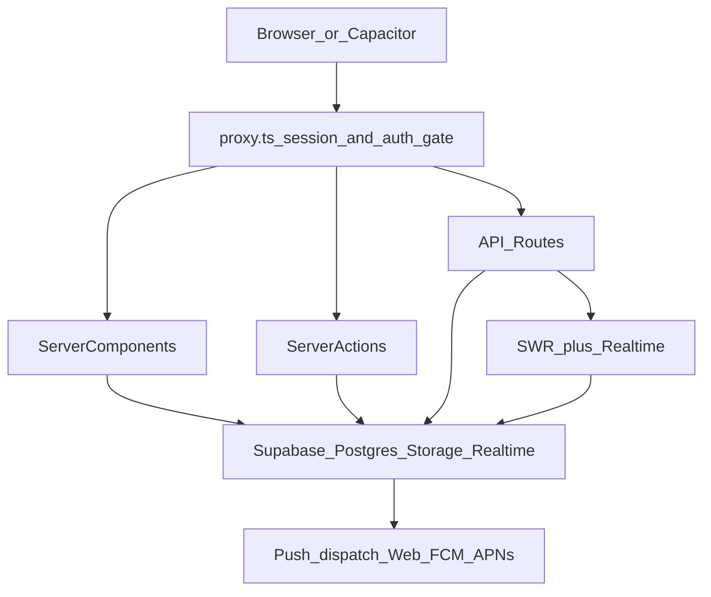

# A Wright Network - AWN

AWN is a private, invite-only professional network for touring live entertainment crew — tour managers, engineers, techs, lighting and video teams, and the many roles that keep a tour running.

It gives working crew a trusted place to signal availability, fill urgent callouts, share road knowledge, and build peer-verified credits. Crew stay free forever; employers pay for access to the network.

Production: [https://awrightnetwork.com](https://awrightnetwork.com)

This repo is the Next.js rebuild of AWN, focused on a modular codebase and a scalable design system.

## Features

- **Now** — live availability status, Help Now urgent callouts, and a "Who's around" map
- **Groups** — community chat rooms with realtime messaging
- **People** — searchable member directory with roles, availability, and tour credits
- **Jobs** — post and browse listings, apply, save, and manage applications
- **Messages** — direct messages with realtime updates
- **Admin** — member management, invites, application review, email broadcasts, error logs
- **Public profiles** — crew pages at `/crew/[handle]`
- **Onboarding** — invite-token signup (`/apply`) and public request-access flow

Planned features (Stripe billing, cron digests, analytics) are tracked in [`agent-os/product/roadmap.md`](agent-os/product/roadmap.md).

## Tech stack

- [Next.js 16](https://nextjs.org/) (App Router) + React 19 + TypeScript
- Tailwind CSS 4 + [shadcn/ui](https://ui.shadcn.com/) (`base-maia` style)
- [Supabase](https://supabase.com/) — Postgres, Auth, Realtime, Storage
- [SWR](https://swr.vercel.app/) + Supabase Realtime hooks for client data
- Server Actions + API routes for mutations
- [Resend](https://resend.com/) for transactional and broadcast email
- Web Push (VAPID), FCM (Android), and APNs (iOS) for notifications
- [Mapbox GL](https://www.mapbox.com/) for the Now page map
- [Capacitor 7](https://capacitorjs.com/) for iOS and Android native shells
- Hosted on [Vercel](https://vercel.com/)

## Project structure

```
app/(app)/       Authenticated shell (sidebar + header)
app/(marketing)/ Public landing, legal pages, /crew/[handle]
app/(popout)/    Detached message and group windows
app/api/         REST endpoints (jobs, push, presence, error logs)
components/      Feature components + shadcn/ui primitives
lib/             Auth, Supabase clients, domain logic, server actions, hooks
supabase/        Migrations, config, auth email templates
ios/, android/   Capacitor native projects
agent-os/        Product specs and roadmap
```

### Architecture



## Prerequisites

- [Node.js](https://nodejs.org/) 20+
- [pnpm](https://pnpm.io/) 9+ (preferred package manager)
- [Supabase CLI](https://supabase.com/docs/guides/cli) (optional, for local DB)

## Installation

```bash
# Clone the repository
git clone <repository-url>
cd awn-v0

# Install dependencies
pnpm install

# Copy env template and fill in values
cp .env.example .env.local

# Start the development server
pnpm dev
```

Open [http://localhost:3000](http://localhost:3000) in your browser.

## Environment variables

Create `.env.local` from [`.env.example`](.env.example).

### Required (core)

| Variable | Purpose |
| --- | --- |
| `NEXT_PUBLIC_SUPABASE_URL` | Supabase project URL |
| `NEXT_PUBLIC_SUPABASE_PUBLISHABLE_KEY` | Publishable (anon) key for browser + SSR clients |
| `SUPABASE_SERVICE_ROLE_KEY` | Service role key — server-only, never expose to the client |

### App

| Variable | Purpose |
| --- | --- |
| `NEXT_PUBLIC_APP_URL` | App origin (`http://localhost:3000` locally; `https://awrightnetwork.com` in production) |

### Email

| Variable | Purpose |
| --- | --- |
| `RESEND_API_KEY` | Resend API key for transactional and broadcast email |
| `EMAIL_FROM` | Sender address (default `AWN <onboarding@resend.dev>`) |

### Web push

| Variable | Purpose |
| --- | --- |
| `NEXT_PUBLIC_VAPID_PUBLIC_KEY` | VAPID public key for browser push |
| `VAPID_PRIVATE_KEY` | VAPID private key (server-only) |
| `VAPID_EMAIL` | VAPID contact email |

### Native push

| Variable | Purpose |
| --- | --- |
| `FIREBASE_SERVICE_ACCOUNT_JSON` | FCM service account JSON (Android) |
| `APNS_KEY_ID` | Apple Push Notification key ID |
| `APNS_TEAM_ID` | Apple Developer team ID |
| `APNS_KEY` | APNs auth key (`.p8` contents) |
| `APNS_BUNDLE_ID` | iOS bundle ID (default `com.awrightworld.awn.app`) |
| `APNS_USE_SANDBOX` | `true` for Xcode debug builds; `false` for TestFlight/App Store |

### Internal

| Variable | Purpose |
| --- | --- |
| `INTERNAL_API_SECRET` | Auth header for `/api/push/dispatch` webhook |

### Maps

| Variable | Purpose |
| --- | --- |
| `NEXT_PUBLIC_MAPBOX_TOKEN` | Mapbox token for the Now page "Who's around" map |

Email, push, and Mapbox vars are optional for basic local UI development. Supabase credentials are required.

## Supabase

The Supabase CLI in this repo is linked to the **AWN-v0** project. After cloning, run `supabase link --project-ref dpjsyhdzsragnatcxbic` if needed.

### Auth and route gating

[`proxy.ts`](proxy.ts) delegates to [`lib/supabase/middleware.ts`](lib/supabase/middleware.ts) on every matched request to:

- Refresh Supabase auth sessions
- Redirect unauthenticated users to `/login?next=...`
- Redirect authenticated but unapproved users to `/pending`

Public paths include `/`, `/login`, `/crew/*`, `/apply`, `/request-access`, and legal pages. The authenticated app layout in `app/(app)/layout.tsx` re-checks session and approval as a safety net.

### Supabase clients

| File | Usage |
| --- | --- |
| `lib/supabase/client.ts` | Browser client |
| `lib/supabase/server.ts` | Cookie-based SSR client |
| `lib/supabase/admin.ts` | Service role client (server-only) |

### Database and migrations

Schema lives in [`supabase/migrations/`](supabase/migrations/) (54 SQL files covering profiles, jobs, DMs, groups, push, email, onboarding, and more). Run migrations manually in the Supabase SQL Editor — check each file's header for instructions.

Storage buckets: `avatars`, `banners`, `resumes` (membership signup PDFs only).

### Roles

| Role | Access |
| --- | --- |
| `owner`, `admin` | Full admin panel |
| `manager`, `member` | Standard app features |
| `employer` | Reserved for future billing/paywall |

## Scripts

| Command | Description |
| --- | --- |
| `pnpm dev` | Start the Next.js dev server (Webpack) |
| `pnpm build` | Create a production build |
| `pnpm start` | Run the production server |
| `pnpm lint` | Run ESLint |
| `pnpm typecheck` | Run TypeScript without emitting files |
| `pnpm format` | Format TypeScript files with Prettier |
| `pnpm cap:sync` | Sync Capacitor native projects |
| `pnpm cap:open:ios` | Open the iOS project in Xcode |
| `pnpm cap:open:android` | Open the Android project in Android Studio |

## Mobile (Capacitor)

Native iOS and Android shells use **remote URL mode** — they load the live production site at `https://awrightnetwork.com` rather than bundling the web app locally.

- App ID: `com.awrightworld.awn.app`
- Config: [`capacitor.config.ts`](capacitor.config.ts)
- Push requires the platform-specific env vars listed above

After native project changes, run `pnpm cap:sync` before opening Xcode or Android Studio.

## Deployment

Hosted on Vercel. Set `NEXT_PUBLIC_APP_URL` to `https://awrightnetwork.com` in production environment variables.

## Development notes

- No automated test suite is configured
- No CI workflows (`.github/workflows` is absent)
- `typescript.ignoreBuildErrors: true` in [`next.config.mjs`](next.config.mjs) — TypeScript errors won't fail production builds
- Deeper product context: [`agent-os/product/roadmap.md`](agent-os/product/roadmap.md)
