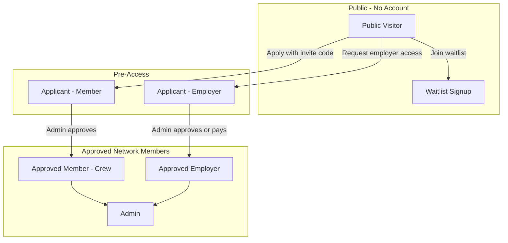
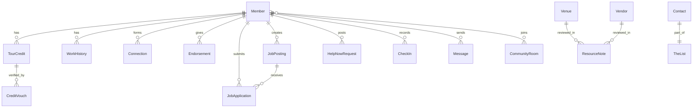

# AWN Feature Migration Inventory

This document captures **what the old app does for users**, not how it was built. Use it as the source of truth for rebuilding features in [awn-v0](/Users/royalnashef/Desktop/AWN/awn-v0) using the new architecture, design system, and standards defined in [agent-os/product/mission.md](/Users/royalnashef/Desktop/AWN/awn-v0/agent-os/product/mission.md) and [roadmap.md](/Users/royalnashef/Desktop/AWN/awn-v0/agent-os/product/roadmap.md).

---

## User Types in AWN

AWN is an **invite-only professional network** for touring live entertainment crew. There is one main app experience for approved members; differences between user types are about **access stage** and **business role**, not separate apps.

| User Type                  | Who They Are                                | Access                                                                   |
| -------------------------- | ------------------------------------------- | ------------------------------------------------------------------------ |
| **Public visitor**         | Anyone not logged in                        | Marketing pages, public crew profiles only                               |
| **Waitlist signup**        | Interested person without an invite code    | No app access; admin is notified                                         |
| **Applicant (member)**     | Touring pro who applied with an invite code | Can log in; sees "Application received" until approved                   |
| **Applicant (employer)**   | Company that requested hiring access        | Same pending gate until approved                                         |
| **Approved member (crew)** | Vetted touring professional                 | Full network: Now, Jobs, People, Messages, Intel, Profile                |
| **Approved employer**      | Production company, festival, venue, etc.   | Same app as crew + hiring-oriented workflows; intended to pay for access |
| **Admin**                  | AWN team member                             | All member features + admin panel                                        |

**Important distinctions (product, not permissions):**

- A member's **job title** (e.g. "FOH Engineer") is profile identity, not a system role.
- **Employer** is a business classification (`profile_type: employer`), not a separate app shell.
- **Admin** access is currently email-based in the old app; the new app should use proper RBAC (Owner / Admin / Manager / Member per [lib/users-data.ts](/Users/royalnashef/Desktop/AWN/awn-v0/lib/users-data.ts)).

---

## 1. Public Visitor Features

| Feature                     | User Story                                                                                               | How It Works                                                                                                                                                                                |
| --------------------------- | -------------------------------------------------------------------------------------------------------- | ------------------------------------------------------------------------------------------------------------------------------------------------------------------------------------------- |
| **Landing page**            | As a visitor, I want to understand what AWN is, so that I can decide whether to apply.                   | Shows AWN's value proposition (live availability, Help Now, peer-verified credits, Road Intel), live stats (member count, open roles), and links to apply, hire, or log in.                 |
| **Hire marketing page**     | As a hiring company, I want to learn why AWN is worth joining, so that I can request employer access.    | Explains how employers find available crew, post roles, use Help Now, message directly, and benefit from vetting. Links to the employer request form.                                       |
| **Member application**      | As a touring pro, I want to apply with an invite code, so that I can join the vetted network.            | User enters a valid invite code, submits name/email/reason for joining. Application goes into a review queue. User can create an account and log in, but cannot use the app until approved. |
| **Waitlist signup**         | As someone without an invite code, I want to express interest, so that I might get invited later.        | Simple form on the apply page. No account created. Admin is notified of interest.                                                                                                           |
| **Employer access request** | As a company, I want to request employer access without a crew invite code, so that I can hire from AWN. | Form on the hire page. Creates an employer-type application for admin review. No invite code required.                                                                                      |
| **Sign in**                 | As an existing user, I want to log in, so that I can access the app.                                     | Email/password or magic link. Forgot-password flow. After login, approved users go to the main app; pending users see the waiting screen.                                                   |
| **Public crew profile**     | As anyone, I want to view a member's public profile, so that I can evaluate them without joining AWN.    | Shareable URL (`/crew/[handle]`) showing bio, tour credits, work history, availability badge. Printable and SEO-friendly.                                                                   |
| **Legal / terms**           | As a visitor, I want to read policies, so that I understand terms of use.                                | Static legal page.                                                                                                                                                                          |

**New app status:** Not started (no public/marketing routes, no auth, no public profiles).

---

## 2. Applicant Features (Pending Approval)

| Feature                       | User Story                                                                                              | How It Works                                                                                       |
| ----------------------------- | ------------------------------------------------------------------------------------------------------- | -------------------------------------------------------------------------------------------------- |
| **Application status screen** | As a pending applicant, I want confirmation my application was received, so that I know what to expect. | Full-screen message: "Application received — review within 48 hours." No access to main tabs.      |
| **Check approval status**     | As a pending applicant, I want to refresh my status, so that I can enter the app when approved.         | "Check my status" button re-checks approval. If approved (or pre-invited), user enters onboarding. |
| **Sign out while waiting**    | As a pending applicant, I want to sign out, so that I can leave the waiting screen.                     | Sign out returns to login page.                                                                    |

**New app status:** Not started. Admin Applications page is a placeholder shell at [/applications](</Users/royalnashef/Desktop/AWN/awn-v0/app/(app)/applications/page.tsx>).

---

## 3. Approved Member (Crew) Features

Once approved, members complete a **5-step onboarding** (role, city, bio, photo, push notifications), then access all main tabs. Crew use the app **free forever**.

### 3A. Now Tab — Live Network Pulse

| Feature                     | User Story                                                                                                                  | How It Works                                                                                                                                                |
| --------------------------- | --------------------------------------------------------------------------------------------------------------------------- | ----------------------------------------------------------------------------------------------------------------------------------------------------------- |
| **Set availability status** | As crew, I want to signal whether I'm available, on tour, between tours, or unavailable, so that hirers see my real status. | Status picker updates profile. When becoming bookable, people who shortlisted or watch the member get notified.                                             |
| **Post Help Now**           | As anyone needing urgent crew, I want to post a 48-hour urgent request, so that available members respond fast.             | Modal: role needed, location, date, rate, description. Request is live for 48 hours. Available/between-tours members in that role get push + in-app alerts. |
| **Respond to Help Now**     | As available crew, I want to respond to urgent requests, so that I can pick up work quickly.                                | Browse open Help Now posts. Tap to message the poster with a pre-filled DM.                                                                                 |
| **Mark Help Now filled**    | As a poster, I want to close my request, so that the network knows it's resolved.                                           | Mark as filled or delete own requests.                                                                                                                      |
| **On The Road check-in**    | As crew on the road, I want to check in on a map, so that others know where I am.                                           | Map-based check-in: city + optional note. Appears in a list/map view. Others can "wave" as a lightweight social signal.                                     |
| **Network pulse dashboard** | As a member, I want a live snapshot of the network, so that I stay connected.                                               | Greeting, open roles count, Help Now feed, department members, recent joins/jobs, profile completeness nudges, invite/referral banner.                      |
| **Share invite code**       | As a member, I want to refer others, so that I grow the network.                                                            | Personal invite code with tracking of approved and pending referrals.                                                                                       |
| **Welcome / first actions** | As a new member, I want guided first steps, so that I complete setup quickly.                                               | Banner nudging first DM, status update, and profile completion.                                                                                             |
| **Quick-create FAB**        | As a member, I want fast access to common actions, so that I can post quickly.                                              | Floating button opens: Check In, Help Now, Post a Role.                                                                                                     |

**New app status:** [/now](</Users/royalnashef/Desktop/AWN/awn-v0/app/(app)/now/page.tsx>) is a placeholder shell. Availability toggle exists in sidebar UI only (local state).

---

### 3B. Jobs Tab — Posting and Applying

| Feature                    | User Story                                                                        | How It Works                                                                                                              |
| -------------------------- | --------------------------------------------------------------------------------- | ------------------------------------------------------------------------------------------------------------------------- |
| **Browse open roles**      | As crew, I want to browse jobs, so that I find work.                              | Filter/search by department, location, engagement type (touring, festival, one-off, etc.). View job details.              |
| **Apply to a job**         | As crew, I want to apply with a note and CV, so that posters can review me.       | Apply modal sends application to poster. Poster gets notified. Application status: pending → approved / maybe / declined. |
| **Track my applications**  | As crew, I want to see application status, so that I know where I stand.          | Profile → Applications sub-tab. Can withdraw pending applications.                                                        |
| **Post a role**            | As a member, I want to post hiring needs, so that available crew can apply.       | Post Job form: role, dates, location, rate, description. Triggers job alerts to matching crew (push + email).             |
| **Manage my postings**     | As a poster, I want to manage my roles, so that I can edit, fill, or delete them. | "My Posts" view: stats, applicant list, edit, mark filled, delete.                                                        |
| **Review applicants**      | As a poster, I want to review applicants, so that I can hire.                     | Approve, decline, or mark "maybe" on applications. Can message applicants directly.                                       |
| **Save job alerts**        | As crew, I want alerts for matching roles, so that I don't miss opportunities.    | Save search criteria (role, location, department, job type). Notified when new matching jobs post.                        |
| **Save crew to shortlist** | As someone hiring, I want to save promising people, so that I can return to them. | Shortlist tab in Jobs. Toggle from People profiles.                                                                       |
| **View job history**       | As a poster, I want to see past roles, so that I can reference previous posts.    | Filled/expired jobs in history section.                                                                                   |

**New app status:** [/jobs](</Users/royalnashef/Desktop/AWN/awn-v0/app/(app)/jobs/page.tsx>) has substantial UI (browse, filters, post dialog) with mock data. Apply, shortlist, alerts, and applicant review are not wired.

---

### 3C. People Tab — Member Directory

| Feature                       | User Story                                                                                  | How It Works                                                                                                                                 |
| ----------------------------- | ------------------------------------------------------------------------------------------- | -------------------------------------------------------------------------------------------------------------------------------------------- |
| **Search member directory**   | As a member, I want to find vetted crew, so that I can hire or connect.                     | Search by name, role, location, bio. Filters: department, city, availability, tour tier, work authorization, passport, day rate, date range. |
| **Availability strips**       | As a member, I want to see who's available or on tour right now, so that I can act quickly. | "Available now" and "On tour now" face strips at top of directory.                                                                           |
| **View member profile**       | As a member, I want rich profiles, so that I can evaluate fit.                              | Profile modal: credits, work history, endorsements, mutual connections/tours, reel, resume status.                                           |
| **Connect with members**      | As a member, I want to connect, so that I build my network.                                 | Send/accept/ignore connection requests. Connections appear on profile.                                                                       |
| **Endorse (vouch) members**   | As a member, I want to vouch for peers, so that trust builds in the network.                | Profile-level endorsement. Endorsed user gets notified.                                                                                      |
| **Vouch for tour credits**    | As a member, I want to verify someone worked a tour, so that credits are trustworthy.       | Per-credit vouch. Credit gets a "verified" badge at 2+ peer vouches.                                                                         |
| **Request CV/resume**         | As a hirer, I want to request someone's CV, so that I can evaluate them for a role.         | Resume request sent to member. Member approves or declines.                                                                                  |
| **Watch member availability** | As a hirer, I want alerts when someone becomes available, so that I can reach out in time.  | Watch toggle on profile. Notified when their status changes to bookable.                                                                     |
| **Message from profile**      | As a member, I want to DM someone from their profile, so that I can start a conversation.   | Opens Messages with pre-filled text.                                                                                                         |
| **Report member**             | As a member, I want to report bad behavior, so that the community stays safe.               | Report modal: fake profile, harassment, spam, etc. Goes to admin review queue.                                                               |
| **Suggested connections**     | As a member, I want connection suggestions, so that I grow my network faster.               | Algorithm based on department, location, mutual connections.                                                                                 |

**New app status:** [/people](</Users/royalnashef/Desktop/AWN/awn-v0/app/(app)/people/page.tsx>) has substantial UI (filters, grid/list, profile drawer). Vouch button exists but is not wired. Connections, watch, resume request, report not built.

---

### 3D. Messages Tab — DMs and Community Rooms

| Feature                   | User Story                                                                                         | How It Works                                                                                                                         |
| ------------------------- | -------------------------------------------------------------------------------------------------- | ------------------------------------------------------------------------------------------------------------------------------------ |
| **Direct messages**       | As a member, I want private 1:1 DMs, so that I can talk without platform noise.                    | Chat with read receipts. Push + email notification on new messages.                                                                  |
| **Join community rooms**  | As a member, I want discipline-specific rooms, so that I can talk shop with peers.                 | ~14 curated channels (Audio, Lighting & Video, Production, Road Life, Help Needed, recovery/mental health, etc.). Join/leave freely. |
| **Auto-join rooms**       | As a new member, I want relevant rooms pre-joined, so that I'm not starting alone.                 | Auto-join General on approval. Auto-join department channel based on primary role during onboarding.                                 |
| **Room activity preview** | As a member, I want to see where conversation is happening, so that I know which rooms are active. | Recent community messages surfaced on Now tab.                                                                                       |
| **Appear offline**        | As a member, I want privacy in chat, so that I'm not shown as online.                              | Toggle in profile settings.                                                                                                          |
| **Unread badges**         | As a member, I want unread counts, so that I don't miss messages.                                  | DM + room unread tracking in nav badges.                                                                                             |

**New app status:** [/messages](</Users/royalnashef/Desktop/AWN/awn-v0/app/(app)/messages/page.tsx>) has DM inbox + thread UI (local only). Room list with join/leave toggle exists; room threads not built. No realtime.

---

### 3E. Intel Tab — Road Intel / Atlas

| Feature                                 | User Story                                                                                                       | How It Works                                                              |
| --------------------------------------- | ---------------------------------------------------------------------------------------------------------------- | ------------------------------------------------------------------------- |
| **Community Q&A feed**                  | As a member, I want to ask the community road questions, so that I get real intel from people who've been there. | Post/search questions. Upvote helpful answers. Reply threads.             |
| **Browse vendors**                      | As a member, I want production vendors by market, so that I hire trusted suppliers on the road.                  | Vendor directory by category, country, city. Community reviews and notes. |
| **Browse venues**                       | As a member, I want venue intel, so that I know what to expect at each stop.                                     | Venue catalog with community notes, ratings, and tags.                    |
| **Lifestyle services**                  | As a member, I want wellness/glam/chefs/etc. on the road, so that I take care of myself while touring.           | Browse by city and category. Members can add entries.                     |
| **Partner perks**                       | As a member, I want partner deals, so that I save money on the road.                                             | Curated partner deals (e.g. MasterTour discount codes).                   |
| **The List (industry contacts)**        | As a member, I want a shared contact database, so that I find tour managers, agents, promoters.                  | Search/filter personal + shared contacts. Add, edit, bulk CSV import.     |
| **Apply to The List (vendor/business)** | As a business, I want to be listed, so that members find me.                                                     | Application form. Admin approves before listing.                          |
| **Add resource notes/reviews**          | As a member, I want to review venues/vendors, so that others benefit from my experience.                         | Rating, review text, tags on any venue or vendor.                         |

**New app status:** [/intel](</Users/royalnashef/Desktop/AWN/awn-v0/app/(app)/intel/page.tsx>) is a placeholder shell. Admin "The List" at [/the-list](</Users/royalnashef/Desktop/AWN/awn-v0/app/(app)/the-list/page.tsx>) is also a shell.

---

### 3F. Profile Tab — Your Touring Identity

| Feature                       | User Story                                                                                    | How It Works                                                                                                                           |
| ----------------------------- | --------------------------------------------------------------------------------------------- | -------------------------------------------------------------------------------------------------------------------------------------- |
| **Edit touring profile**      | As crew, I want a rich profile, so that I'm discoverable and credible.                        | Name, handle, role, company, bio, location, skills, work authorization, passport, union, day rate, reel, website, avatar, cover photo. |
| **Upload CV/resume**          | As crew, I want to share my CV, so that hirers can review me.                                 | Upload to storage. Automatically included in job applications.                                                                         |
| **Manage tour credits**       | As crew, I want to list tour credits, so that my experience is visible.                       | Credits: artist, role, years, tier. Tour name autocomplete from canonical tour database.                                               |
| **Work history**              | As crew, I want structured work history, so that my career timeline is clear.                 | Entries: artist, role, dates, type. Can auto-update availability from active tours.                                                    |
| **Profile strength meter**    | As crew, I want to know what's missing, so that I complete my profile.                        | Completeness percentage for photo, bio, CV, availability, reel.                                                                        |
| **Public profile link + QR**  | As crew, I want to share my profile externally, so that I can send it to hirers outside AWN.  | Copy link, QR code, open public view.                                                                                                  |
| **Manage connections**        | As a member, I want to accept connection requests, so that I grow my network.                 | Connection requests surfaced at top of profile.                                                                                        |
| **View profile visitors**     | As a member, I want to know who viewed me, so that I can follow up.                           | Recent visitors list. Notified when someone views profile.                                                                             |
| **Referrals dashboard**       | As a member, I want to see who used my invite code, so that I track my impact on the network. | Approved + pending referral list.                                                                                                      |
| **Notification preferences**  | As a member, I want control over alerts, so that I'm not overwhelmed.                         | Toggles: DMs, Help Now, job matches, morning brief, profile views, vouches.                                                            |
| **Enable push notifications** | As a member, I want mobile/web push, so that I get timely alerts.                             | Web Push subscription. Native token registration for mobile shells.                                                                    |
| **Submit product feedback**   | As a member, I want to report bugs or suggest features, so that the product improves.         | Feedback form: bug, feature request, or general.                                                                                       |
| **Sign out**                  | As a member, I want to sign out, so that I can secure my account.                             | Sign out from profile/settings.                                                                                                        |

**New app status:** Profile drawer UI exists in People. No dedicated Settings/Profile page with edit flows. [/settings](</Users/royalnashef/Desktop/AWN/awn-v0/app/(app)/settings/page.tsx>) is a placeholder.

---

## 4. Approved Employer Features

Employers use **the same app tabs** as crew. The product model: crew are free; employers pay for network access. In the old app, the paywall UI was largely disabled (Stripe wired but price set to $0).

| Feature                             | User Story                                                                                     | How It Works                                                                                                                      |
| ----------------------------------- | ---------------------------------------------------------------------------------------------- | --------------------------------------------------------------------------------------------------------------------------------- |
| **Apply without invite code**       | As an employer, I want to request access without a crew invite, so that I can join as a hirer. | Hire page form creates employer-type application. No invite code required.                                                        |
| **Employer subscription (billing)** | As an employer, I want to pay for access, so that I unlock the hiring network.                 | Stripe checkout on approval. Webhook auto-approves and activates employer status. (Paywall may activate post-launch per roadmap.) |
| **Employer digest email**           | As an employer, I want periodic hiring updates, so that I stay engaged.                        | Automated email: new available crew in my departments, new applications, open Help Now posts.                                     |
| **Hiring workflows**                | As an employer, I want to find and shortlist crew fast, so that I can staff tours and events.  | People search + filters, shortlist, resume requests, watch availability, review job applicants, post Help Now/roles.              |
| **Company on profile**              | As an employer, I want my company shown, so that crew know who I represent.                    | Company name on profile and job posts.                                                                                            |

**New app status:** [/employers](</Users/royalnashef/Desktop/AWN/awn-v0/app/(app)/employers/page.tsx>) is a placeholder. No employer vs. crew UX differentiation. No Stripe.

---

## 5. Admin Features

Admin panel is a separate section in navigation ([adminNav in nav.ts](/Users/royalnashef/Desktop/AWN/awn-v0/lib/nav.ts)). Old app used email allowlist; new app should use RBAC roles.

| Feature                         | User Story                                                                            | How It Works                                                                                                                                                                                          |
| ------------------------------- | ------------------------------------------------------------------------------------- | ----------------------------------------------------------------------------------------------------------------------------------------------------------------------------------------------------- |
| **Member management**           | As admin, I want to manage all members, so that the network stays curated.            | Search/filter (all/members/employers). Approve pending. Edit profile fields, profile type, employer access. Verify badge. Founding member flag. Admin notes. Remove member. Bulk approve. Export CSV. |
| **Application review**          | As admin, I want to review applications, so that I approve the right people.          | Filter pending/approved/rejected/waitlist. Approve (creates account + profile + welcome). Decline. Resend login link.                                                                                 |
| **Analytics dashboard**         | As admin, I want network metrics, so that I track growth.                             | Member counts, employers, verified, available, applications, posts/jobs/Help Now trends, referrers, event analytics.                                                                                  |
| **Invite code management**      | As admin, I want to create/manage invites, so that I control network growth.          | Create codes with max uses and notes. View usage counts.                                                                                                                                              |
| **Community groups management** | As admin, I want to manage chat rooms, so that channels exist and stay organized.     | Seed default department channels. Create/archive rooms. Auto-join all to General.                                                                                                                     |
| **Partnerships / perks**        | As admin, I want to manage partner deals, so that members get perks.                  | Search vendors/lifestyle entries. Attach/edit partner deal text.                                                                                                                                      |
| **The List applications**       | As admin, I want to vet vendor/list applicants, so that The List stays trusted.       | Review vendor applications. Approve/reject.                                                                                                                                                           |
| **Bulk intel seeding**          | As admin, I want to bulk-add vendors/lifestyle entries, so that Intel is populated.   | Bulk paste/import to vendor or lifestyle directories.                                                                                                                                                 |
| **Broadcast email**             | As admin, I want to email members, so that I communicate at scale.                    | Compose subject/body. Audience: all, members only, employers only.                                                                                                                                    |
| **Feedback triage**             | As admin, I want to review user feedback, so that I prioritize fixes.                 | View/respond/mark done on feedback submissions.                                                                                                                                                       |
| **Reports triage**              | As admin, I want to review member reports, so that I enforce community standards.     | View reports from member reporting flow.                                                                                                                                                              |
| **Direct member invite**        | As admin, I want to invite someone directly, so that they skip the application queue. | Creates pre-approved user account.                                                                                                                                                                    |
| **Send login link**             | As admin, I want to send magic login links, so that I help users access the app.      | Generates and emails magic link to user.                                                                                                                                                              |

**New app status:** [/users](</Users/royalnashef/Desktop/AWN/awn-v0/app/(app)/users/page.tsx>) has substantial UI (table, filters, bulk select) with mock data. All other admin pages are placeholder shells.

---

## 6. Cross-Cutting Platform Features

These span all approved user types and underpin the product:

| Feature                      | User Story                                                                                        | How It Works                                                                                                                  |
| ---------------------------- | ------------------------------------------------------------------------------------------------- | ----------------------------------------------------------------------------------------------------------------------------- |
| **Authentication**           | As a user, I want secure login, so that my account is protected.                                  | Password, magic link, forgot password, session persistence.                                                                   |
| **Approval gate**            | As AWN, I want to vet every member, so that the network stays trusted.                            | All main app routes require `is_approved`. Pending users see waiting screen.                                                  |
| **Onboarding flow**          | As a new member, I want guided setup, so that I have a complete profile before using the network. | 5 steps after first approval: role, background, photo, notifications, done. Auto-join department room.                        |
| **In-app notifications**     | As a member, I want a notification center, so that I see what happened while I was away.          | Events: DMs, Help Now, job applications, profile views, endorsements, connection requests, availability changes, CV approved. |
| **Push notifications**       | As a member, I want timely alerts on my phone, so that I don't miss urgent opportunities.         | Web Push + native token. Triggered by DMs, Help Now, job matches, profile views, vouches.                                     |
| **Email notifications**      | As a member, I want email for important events, so that I stay informed even when not in the app. | Application approval, login links, job alerts, weekly digest, employer digest, onboarding sequence, broadcast.                |
| **Automated email cadences** | As AWN, I want automated engagement emails, so that members stay active.                          | Weekly digest, employer digest, onboarding emails (Day 3/7), availability nudge.                                              |
| **PWA / mobile shells**      | As a member, I want AWN on my phone, so that I can use it on the road.                            | Installable PWA with service worker. Capacitor iOS/Android shells loading the web app.                                        |
| **Public SEO profiles**      | As crew, I want my profile findable on Google, so that hirers outside AWN can discover me.        | Public `/crew/[handle]` pages with OG images, sitemap, robots.txt.                                                            |
| **Feedback collection**      | As a member, I want to submit feedback, so that the product improves.                             | In-app form from profile.                                                                                                     |
| **Member reporting**         | As a member, I want to report bad actors, so that the community self-polices.                     | Report from profile modal. Admin triage queue.                                                                                |

**New app status:** Notifications sheet UI exists (mock). No auth, push, email, PWA, or SEO infrastructure.

---

## 7. Core Domain Concepts (Product Level)

These are the **things** users interact with — describe behavior in the new app, not old table names:

| Concept                              | What It Is                                                                                             |
| ------------------------------------ | ------------------------------------------------------------------------------------------------------ |
| **Member profile**                   | A vetted person's identity: role, bio, availability, credits, work history, skills, work authorization |
| **Availability status**              | One of: Available, Between Tours, On Tour, Unavailable — the live signal hirers rely on                |
| **Help Now request**                 | A 48-hour urgent crew callout with role, location, date, rate                                          |
| **Job posting**                      | A hiring need with role, dates, location, engagement type, rate                                        |
| **Job application**                  | A crew member's expression of interest in a job, with optional note and CV                             |
| **Tour credit**                      | A verified claim: "I worked [artist] as [role] during [years]" — peer-vouched for trust                |
| **Work history**                     | Structured career timeline entries that can auto-update availability                                   |
| **Connection**                       | A mutual network link between two members                                                              |
| **Endorsement**                      | A peer vouch at the profile level ("I'd work with this person again")                                  |
| **Credit vouch**                     | A peer verification of a specific tour credit (2+ = verified badge)                                    |
| **Shortlist**                        | A hirer's saved list of promising crew members                                                         |
| **Profile watch**                    | A subscription to be notified when a specific member becomes available                                 |
| **Resume request**                   | A hirer's request to see a member's CV, requiring member approval                                      |
| **Community room**                   | A discipline-specific group chat channel                                                               |
| **Direct message**                   | A private 1:1 conversation between two members                                                         |
| **Community intel**                  | A Q&A post where members ask and answer road questions                                                 |
| **Venue / Vendor / Lifestyle entry** | A directory item with community notes, ratings, and tags                                               |
| **The List contact**                 | An industry contact (TM, agent, promoter) in the shared database                                       |
| **Invite code**                      | A referral mechanism for controlled network growth                                                     |
| **Application**                      | A pending request to join AWN (member or employer type)                                                |

---

## 8. Migration Priority vs. New App

Recommended build order aligned with [roadmap.md Phase 1](/Users/royalnashef/Desktop/AWN/awn-v0/agent-os/product/roadmap.md):

| Priority | Feature Area                             | Old App Features                                       | New App Today                           |
| -------- | ---------------------------------------- | ------------------------------------------------------ | --------------------------------------- |
| **P0**   | Auth + onboarding + approval gate        | Public apply, login, pending screen, 5-step onboarding | Not started                             |
| **P0**   | Data layer + RBAC                        | All features depend on this                            | Mock data only                          |
| **P1**   | Now (availability + Help Now + check-in) | 9 features                                             | Placeholder shell                       |
| **P1**   | Jobs (post/apply/shortlist/alerts)       | 9 features                                             | Browse UI + post dialog (no backend)    |
| **P1**   | People (directory + trust graph)         | 11 features                                            | Browse UI + profile drawer (no backend) |
| **P2**   | Messages (DMs + rooms + realtime)        | 6 features                                             | DM UI local-only; rooms partial         |
| **P2**   | Profile + settings                       | 13 features                                            | Drawer UI only; no edit flows           |
| **P2**   | Notifications (in-app + push + email)    | Cross-cutting                                          | Mock notification sheet                 |
| **P3**   | Intel / Atlas                            | 8 features                                             | Placeholder shell                       |
| **P3**   | Admin panel                              | 12 features                                            | Users table UI only; rest shells        |
| **P3**   | Employer billing                         | Stripe checkout + digest                               | Not started                             |
| **P4**   | Public profiles + SEO                    | Public `/crew/[handle]`                                | Not started                             |
| **P4**   | PWA + mobile shells                      | Installable + Capacitor                                | Not started                             |

**Existing assets to preserve in awn-v0 (UI patterns only, not old architecture):**

- Navigation IA: [lib/nav.ts](/Users/royalnashef/Desktop/AWN/awn-v0/lib/nav.ts)
- Board/filter/card patterns: Jobs and People components
- Role taxonomy seed: [lib/jobs-data.ts](/Users/royalnashef/Desktop/AWN/awn-v0/lib/jobs-data.ts)
- Profile data model sketch: [lib/people-data.ts](/Users/royalnashef/Desktop/AWN/awn-v0/lib/people-data.ts)
- Design system standards: [agent-os/standards/](/Users/royalnashef/Desktop/AWN/awn-v0/agent-os/standards/)

---

## 9. Features Intentionally Not Carried Forward

Per product docs, these old-app elements are retired or deferred:

- **Social feed / posts** — replaced by Now tab as the live pulse
- **Bookmarks of feed posts** — legacy; saved content model TBD
- **Two Now layouts** (`/now` and `/now-2col`) — consolidate to one
- **Email-based admin access** — replace with proper RBAC in new app
- **Employer paywall at launch** — Stripe wired in MVP; activation deferred to Phase 2

---

## How to Use This Document

When rebuilding a feature in awn-v0:

1. **Read the user story and "How It Works"** for that feature — this is the requirement.
2. **Ignore old app file paths, API routes, and database schemas** — implement against awn-v0's architecture.
3. **Check the migration priority table** to sequence work.
4. **Reuse existing UI shells** where they exist (Jobs, People, Messages, Users) but wire them to real data and actions.
5. **Reference domain concepts** (Section 7) for data modeling discussions, not old table names.

This inventory covers **~80 distinct user-facing features** across 7 user types and 6 main product areas.
