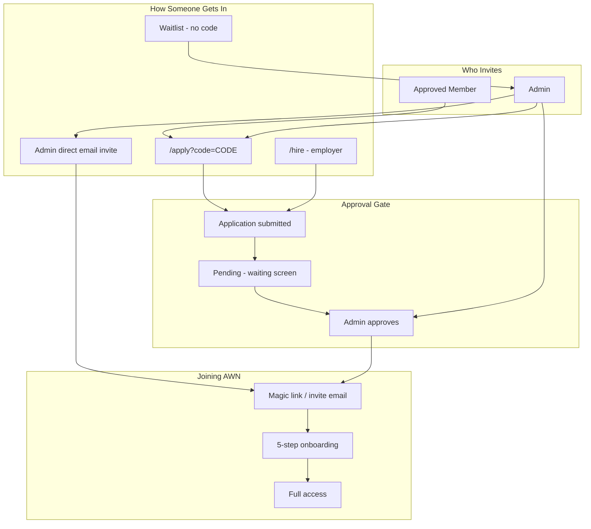

# AWN User Invitation Flow — User Stories & Flows

AWN is **invite-only**. Growth happens through **shareable invite codes** (referral links), while **admins** control who actually gets in via manual approval or direct email invites.

---

## The Big Picture

There are two layers:

1. **Getting someone in the door** — a member shares a link, an admin creates a code, or someone joins the waitlist.
2. **Letting them in** — an admin approves the application (or sends a direct invite), which triggers login/onboarding.

Even with a valid invite code, **every applicant still waits for admin approval** in the primary flow — except admin direct invites, which skip the application form and land pre-approved.

---

## Who Can Invite?

### Approved members (referral)

Any approved member gets a **personal invite code** auto-created when they load Profile or the Now tab. The code looks like `JOHN3XK2` (first 4 chars of name + random suffix). They share:

```
{site}/apply?code={CODE}
```

Members can see who used their code (approved + pending) but **cannot approve anyone** or access admin invite tools.

### Admins (full control)

Admin-only actions are gated by `requireAdmin()` — session token plus email matching `ADMIN_EMAIL` env var (default: `aubrey@awrightworld.com`).

Admins can:
- **Approve/decline** applications
- **Send direct email invites** (bypasses application form)
- **Create/manage invite codes** (optional max uses, notes)
- **Resend login links** and **remove members**

**Note:** The UI recognizes two admin emails (`aubrey@awrightworld.com`, `roy@royalnashef.com`), but API routes only honor the single `ADMIN_EMAIL` env var.

### Employers (special path)

Employers apply at `/hire` **without an invite code**. The system tags them with `invite_code: 'EMPLOYER'`.

---

## User Story 1: Member refers a friend

**As an approved member**, I want to invite someone I trust, so they can apply to join AWN.

### Flow

1. I open **Profile** or the **Now** tab.
2. The app auto-creates my personal invite code if I don't have one.
3. I copy my link: `/apply?code=MYCODE`.
4. I send it to my friend (text, email, etc.).
5. When admin **approves** my friend's application, I get a push notification: *"Your invite was accepted"*.

### What I see

- My invite link and code on Profile
- A referral dashboard: approved members + pending applications using my code
- Remaining slots if my code has a `max_uses` limit (member codes default to unlimited)

---

## User Story 2: Friend applies with my code

**As someone who received an invite link**, I want to apply to AWN.

### Flow (`/apply`)

| Step | Screen | What I do | What's collected |
|------|--------|-----------|------------------|
| 1 | Code | Enter code (or arrive via `?code=` in URL) | `invite_code` |
| 2 | Details | Fill in application | `full_name`, `email`, `why_join` (max 500 chars) |
| 3 | Confirm | Review and submit | — |
| 4 | Done | "You're on the list" — wait up to 48h | — |

### What happens behind the scenes

- Code validated against `invites` table (`is_active`, optional `max_uses`)
- `POST /api/applications/submit` creates:
  - An `applications_awn` row
  - A Supabase auth account (email pre-confirmed — no Supabase verification email)
  - A profile stub with `is_approved: false`
- Admin gets email + push notification about the new application
- Invite code `use_count` increments

### After I submit

- I wait. No app access yet.
- If I try to log in before approval, I see a **pending screen** with "Check my status."
- When approved, I get an email: *"You're approved — welcome to AWN"* with a magic login link.

---

## User Story 3: Admin reviews and approves

**As an admin**, I want to vet applicants and let the right people in.

### Flow (Applications tab)

1. I see pending applications (name, email, why they want to join, which invite code they used).
2. I click **Invite** on an application.
3. System:
   - Marks application `approved: true`
   - Creates/updates auth user + profile with `is_approved: true`
   - Auto-joins them to the **General** community
   - Sends Resend magic-link email
   - Sends push notification to the invitee
   - If they used a member's code (not `EMPLOYER`), notifies the referrer

### Other admin tools

- **Re-send** on already-approved apps → new magic link
- **Decline** → decline email, can restore later
- **Bulk approve** all pending from Members tab
- **Copy login link** / **Resend login email** for recovery

---

## User Story 4: Someone without a code (waitlist)

**As someone without an invite code**, I want to request access.

### Flow

1. On `/apply` step 1, I click *"Don't have a code? Request access"*.
2. I enter: `full_name`, `email`, `role` (optional).
3. I'm added to the `waitlist` table; admin gets notified.
4. Admin later clicks **Send Invite** from the Waitlist tab → direct email invite (Story 5).

---

## User Story 5: Admin direct invite (VIP / waitlist bypass)

**As an admin**, I want to invite someone directly without them filling out the application form.

### Flow

1. From **Waitlist** or via `POST /api/members/invite` with `{ email, name }`.
2. System calls `supabase.auth.admin.inviteUserByEmail()`.
3. Pre-creates profile with `is_approved: true`, `application_submitted: true`.
4. Supabase sends its own invite email (set-password flow).
5. Invitee lands on site **pre-approved**, skips pending screen.

### If they already have an account

- Profile is upserted as approved
- Returns `{ alreadyInvited: true }` — no new Supabase invite email

---

## User Story 6: Admin creates a shareable code

**As an admin**, I want to create invite codes for campaigns or events.

### Flow (Admin → Invites tab)

1. Set optional: custom code (auto-generates `AWN{RAND}` if blank), max uses, internal note.
2. Code inserted into `invites` table.
3. I copy link `/apply?code={CODE}` or toggle active/inactive.
4. Can bulk-deactivate unused codes.

---

## User Story 7: Invitee gets approved and joins

**As a newly approved member**, I want to set up my profile and start using AWN.

### Flow

1. I click the magic link in my approval email → `/auth/callback` → app.
2. If not yet approved: pending screen (shouldn't happen after approval).
3. If approved but no bio: **5-step in-app onboarding** triggers:

| Step | Name | What's collected |
|------|------|------------------|
| 1 | Your Profile | name, role, location |
| 2 | Background | skills, bio |
| 3 | Photo | avatar upload |
| 4 | Notifications | push opt-in |
| 5 | Done | availability |

4. I'm auto-joined to the **General** community.
5. **Day 3** and **Day 7** cron emails nudge me to complete setup (if not already sent).

---

## User Story 8: Employer applies

**As an employer**, I want to join AWN to hire crew.

### Flow (`/hire`)

1. I fill out employer application (includes `company`).
2. Submits to same `/api/applications/submit` with `role_type: 'employer'`, no invite code.
3. Same manual admin approval flow.
4. On approval: profile gets `profile_type: 'employer'`, `is_employer_active: true`.

---

## Information Collected — Timeline

| When | Fields | Where stored |
|------|--------|--------------|
| Code validation | `invite_code` | Client-side check against `invites` |
| Application submit | `full_name`, `email`, `why_join`, `invite_code`, `role_type` (+ `company` for employers) | `applications_awn` |
| Auth account creation | email, `user_metadata.full_name` | Supabase Auth |
| Profile stub (submit) | handle (derived), `is_approved: false`, `application_submitted: true` | `profiles` |
| Waitlist | `full_name`, `email`, `role` | `waitlist` |
| Approval | `is_approved: true`, `profile_type`, employer flags | `profiles` |
| Direct admin invite | email, name → handle, pre-approved | Auth + `profiles` |
| Onboarding | role, location, skills, bio, avatar, notifications, availability | `profiles` |

---

## Edge Cases & Operational Notes

| Scenario | Behavior |
|----------|----------|
| **Code expiry** | No time-based expiry — only manual deactivation or `max_uses` reached |
| **Duplicate email** | Pending → error; already approved → "Try signing in" |
| **Rate limiting** | 5 application submissions per IP per hour |
| **Magic link expired** | Login page handles `?expired=1` |
| **Resend invite** | Admin re-clicks Invite/approve → new magic link |
| **Decline** | Sets `declined: true`, sends email; can restore |
| **Remove member** | Soft (`is_approved: false`) or hard delete via admin API |
| **Referral CTA** | Now tab invite prompt hidden after 2 referrals or dismiss |

---

## Flow Diagram



---

## Key Files

| Area | Path |
|------|------|
| Apply UI | `src/app/apply/page.tsx` |
| Submit API | `src/app/api/applications/submit/route.ts` |
| Approve API | `src/app/api/applications/approve/route.ts` |
| Direct invite API | `src/app/api/members/invite/route.ts` |
| Admin UI | `src/features/admin/components/AdminTab.tsx` |
| Member invite UI | `src/features/profile/components/Profile.tsx` |
| Approval gate + onboarding | `src/features/shared/AppProvider.tsx`, `HomeApp.tsx` |
| Auth admin check | `src/lib/auth.ts` |

---

## Summary in One Sentence

**Members share referral links → applicants fill out a short form → admins manually approve → approved users get a magic-link email → 5-step in-app onboarding → full AWN access**, with admin shortcuts for waitlist/direct invites and a separate employer path at `/hire`.
