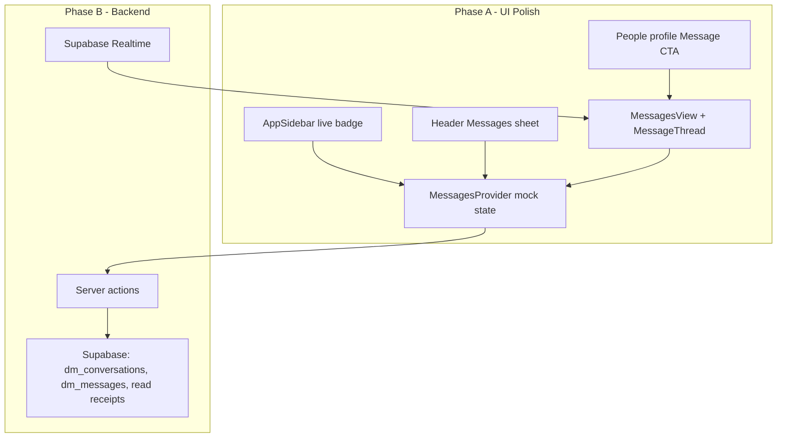

# Direct Messages Feature

## Current State

The DM **UI shell is largely built** with mock/local state:

| Area                                                                                       | Status                                    |
| ------------------------------------------------------------------------------------------ | ----------------------------------------- |
| [`app/(app)/messages/page.tsx`](<app/(app)/messages/page.tsx>)                             | Full page with `?conversation=` deep link |
| [`components/messages/messages-view.tsx`](components/messages/messages-view.tsx)           | Split-pane inbox + thread                 |
| [`components/messages/messages-inbox.tsx`](components/messages/messages-inbox.tsx)         | Searchable list, unread styling           |
| [`components/messages/message-thread.tsx`](components/messages/message-thread.tsx)         | Transcript + composer (local state only)  |
| [`components/messages/new-message-drawer.tsx`](components/messages/new-message-drawer.tsx) | People picker sheet                       |
| [`components/messages/messages-provider.tsx`](components/messages/messages-provider.tsx)   | Shared in-memory conversations            |
| [`components/messages.tsx`](components/messages.tsx)                                       | Header flyout with live badge             |
| [`lib/messages-data.ts`](lib/messages-data.ts)                                             | All mock data                             |

**Gaps:** no database/API, messages lost on refresh, static sidebar badge (`badge: "4"` in [`lib/nav.ts`](lib/nav.ts)), hardcoded `currentUser`, no profile→DM, no read receipts, no realtime.

User-provided mockups match the existing UI closely — Phase A is wiring and polish, not a redesign.

## Architecture (target)



## Scope Decisions

**In scope**

- Direct 1:1 messages only
- UI polish + live sidebar badge
- Supabase schema, server actions, realtime persistence
- Read receipts in thread UI (display + mark-read on open)
- Profile → start/open DM

**Out of scope (this spec)**

- Community rooms ([`/rooms`](<app/(app)/rooms/page.tsx>) is separate)
- Help Now → pre-filled DM
- Push/email notifications
- Appear offline toggle
- Voice/video call buttons (keep as inert placeholders)
- Message search, replies, attachments (Phase 2 roadmap)

**Product alignment:** Direct messages slice of Phase 1 MVP; defers cross-feature notification wiring.

---

## Task 1: Save Spec Documentation

Create [`agent-os/specs/2026-07-21-1500-direct-messages/`](agent-os/specs/2026-07-21-1500-direct-messages/) with:

- **plan.md** — this plan
- **shape.md** — scope, UI-then-backend sequencing, DMs-only boundary
- **standards.md** — full content of:
  - [`agent-os/standards/global/sidebar-nav.md`](agent-os/standards/global/sidebar-nav.md)
  - [`agent-os/standards/global/page-shell.md`](agent-os/standards/global/page-shell.md)
  - [`agent-os/standards/css/shadcn-ui.md`](agent-os/standards/css/shadcn-ui.md)
  - [`agent-os/standards/css/design-tokens.md`](agent-os/standards/css/design-tokens.md)
- **references.md** — pointers to Messages/Rooms patterns
- **visuals/** — copy user-provided screenshots from workspace assets

---

## Task 2: Wire Live Sidebar Badge

Mirror how the header flyout already uses `useMessages().unreadCount`:

1. Add optional `live?: boolean` handling in [`components/app-sidebar.tsx`](components/app-sidebar.tsx) — for Messages nav item, read `unreadCount` from `useMessages()` instead of static `item.badge`
2. Remove hardcoded `badge: "4"` from Messages entry in [`lib/nav.ts`](lib/nav.ts) (keep `badge` pattern for static admin counts)
3. Show badge only when `unreadCount > 0`, matching header flyout behavior

Reference: [`components/messages.tsx`](components/messages.tsx) lines 52–56 (badge rendering).

---

## Task 3: URL Sync on Full Page Selection

Extend the Rooms-style deep link pattern so **in-page** conversation selection also updates the URL (flyout already navigates to `?conversation=`):

1. In [`components/messages/messages-view.tsx`](components/messages/messages-view.tsx), use `useRouter` + `useSearchParams` (or `window.history.replaceState`) in `selectConversation` to set `/messages?conversation={id}` without full navigation
2. Clearing selection (mobile back) removes the param
3. Preserve existing `useEffect` deep-link handler for external entry (flyout, profile link)

This makes refresh and shareable thread URLs work from the full page, not just the header flyout.

---

## Task 4: Profile → Message Entry Point

Add a "Message" action on People profile UI that opens or creates a DM:

1. Identify profile detail component (likely under [`components/people/`](components/people/) or profile drawer)
2. Navigate to `/messages?person={id}` or `/messages?conversation={id}` after calling `startConversation` logic
3. Extend [`app/(app)/messages/page.tsx`](<app/(app)/messages/page.tsx>) to accept `?person=` — resolve via `getOrCreateConversation` (mock: existing `startConversation` + `personToConversation`)
4. Optional: support `?draft=` for future pre-fill (stub only, no Help Now wiring)

---

## Task 5: UI Audit Against Mockups

Compare existing components to provided mockups; apply minimal diffs:

- **Inbox rows** ([`messages-inbox.tsx`](components/messages/messages-inbox.tsx)): unread left bar + dot, online avatar dot, "You:" preview prefix — largely done; verify typography/spacing
- **New message drawer** ([`new-message-drawer.tsx`](components/messages/new-message-drawer.tsx)): role · location, Online/Offline pill — done
- **Header flyout** ([`messages.tsx`](components/messages.tsx)): "N new" pill — done
- **Empty state** ([`messages-view.tsx`](components/messages/messages-view.tsx)): matches screenshot
- **Thread**: add read receipt indicators (checkmarks on sent messages) as static UI prep for Phase B

No new parallel component systems — compose existing [`components/ui/message.tsx`](components/ui/message.tsx), [`bubble.tsx`](components/ui/bubble.tsx), [`message-scroller.tsx`](components/ui/message-scroller.tsx) per shadcn-ui standard.

---

## Task 6: Supabase Schema + RLS

Add migration under [`supabase/migrations/`](supabase/migrations/):

```sql
-- Conceptual tables (names TBD to match project conventions)
dm_conversations       -- id, created_at, updated_at (activity sort key)
dm_participants        -- conversation_id, profile_id, last_read_at
dm_messages            -- id, conversation_id, sender_id, body, created_at
```

Design notes:

- 1:1 conversations: unique pair constraint on participants (order-independent)
- `last_read_at` on participant row drives unread state
- RLS: users can only read/write conversations they participate in
- Index on `(conversation_id, created_at)` for thread fetch

Reference prior app messaging concepts noted in [`agent-os/product/tech-stack.md`](agent-os/product/tech-stack.md).

---

## Task 7: Server Actions + Data Layer

Create [`lib/messages/actions.ts`](lib/messages/actions.ts) (or `lib/dm/`) with authenticated server actions:

| Action                                    | Purpose                                    |
| ----------------------------------------- | ------------------------------------------ |
| `listConversations()`                     | Inbox with preview, time, unread flag      |
| `getConversationThread(id)`               | Paginated messages for thread              |
| `sendMessage(conversationId, body)`       | Insert message, bump conversation activity |
| `markConversationRead(id)`                | Update participant `last_read_at`          |
| `getOrCreateConversation(otherProfileId)` | Open existing or create new 1:1            |

Follow [`agent-os/standards/global/page-shell.md`](agent-os/standards/global/page-shell.md) chat exception: Messages page remains full-height inside layout, not standard PageShell.

Replace hardcoded [`currentUser`](lib/messages-data.ts) with session profile from existing auth helpers.

---

## Task 8: Refactor MessagesProvider for Real Data

Evolve [`components/messages/messages-provider.tsx`](components/messages/messages-provider.tsx):

1. Accept server-fetched initial conversations as prop (from layout or page RSC)
2. Replace mock mutations with server action calls + optimistic updates
3. Keep the same public API (`conversations`, `unreadCount`, `markConversationRead`, `startConversation`, `bumpConversation`) so flyout and page need minimal changes
4. [`components/messages/message-thread.tsx`](components/messages/message-thread.tsx): load thread from server on mount; remove local-only `useState` seed from mock `getThread()`

Pattern reference: [`components/rooms/rooms-provider.tsx`](components/rooms/rooms-provider.tsx) for provider shape; Messages provider already mirrors it.

---

## Task 9: Supabase Realtime

Subscribe to new messages for the active conversation:

1. Client subscription in `MessageThread` when conversation is open
2. Append incoming messages to thread state; call `bumpConversation` for inbox preview
3. On send: optimistic append → server action → reconcile on success/error
4. Mark read on thread open via existing `markConversationRead` (now persisted)

Use Supabase Realtime channels scoped per `conversation_id` per tech-stack guidance.

---

## Task 10: Read Receipts

1. Store `read_at` per message or derive from participant `last_read_at`
2. Display receipt state on sent bubbles in [`message-thread.tsx`](components/messages/message-thread.tsx) (sent / delivered / read)
3. Update receipts when recipient opens thread (realtime event or polling fallback)

---

## Task 11: Verification

Manual test checklist:

1. Sidebar Messages badge matches header flyout unread count
2. Full page: select thread → URL updates → refresh preserves selection
3. Profile Message button opens correct thread (new or existing)
4. Send message persists after refresh
5. Second user/browser receives message via realtime
6. Opening unread thread clears unread in flyout, page, and sidebar badge
7. New message drawer creates conversation visible in inbox and flyout
8. Mobile: back button clears thread, inbox visible

---

## Key Files

| File                                                                                     | Phase | Change                                            |
| ---------------------------------------------------------------------------------------- | ----- | ------------------------------------------------- |
| [`components/app-sidebar.tsx`](components/app-sidebar.tsx)                               | A     | Live Messages badge                               |
| [`lib/nav.ts`](lib/nav.ts)                                                               | A     | Remove static Messages badge                      |
| [`components/messages/messages-view.tsx`](components/messages/messages-view.tsx)         | A     | URL sync                                          |
| People profile component                                                                 | A     | Message CTA                                       |
| [`components/messages/message-thread.tsx`](components/messages/message-thread.tsx)       | A/B   | Read receipt UI; realtime + server fetch          |
| [`components/messages/messages-provider.tsx`](components/messages/messages-provider.tsx) | B     | Server-backed state                               |
| `supabase/migrations/*_dm_*.sql`                                                         | B     | Schema                                            |
| `lib/messages/actions.ts`                                                                | B     | Server actions                                    |
| [`lib/messages-data.ts`](lib/messages-data.ts)                                           | B     | Demote to types/helpers; remove runtime mock seed |

## References

- Completed flyout plan: [`.cursor/plans/messages_flyout_navigation_ae4eae1c.plan.md`](.cursor/plans/messages_flyout_navigation_ae4eae1c.plan.md)
- Rooms split spec: [`agent-os/specs/2026-07-20-1643-rooms-page/`](agent-os/specs/2026-07-20-1643-rooms-page/)
- Migration inventory §3D: [`agent-os/product/notes/feature-migration-inventory.md`](agent-os/product/notes/feature-migration-inventory.md)
