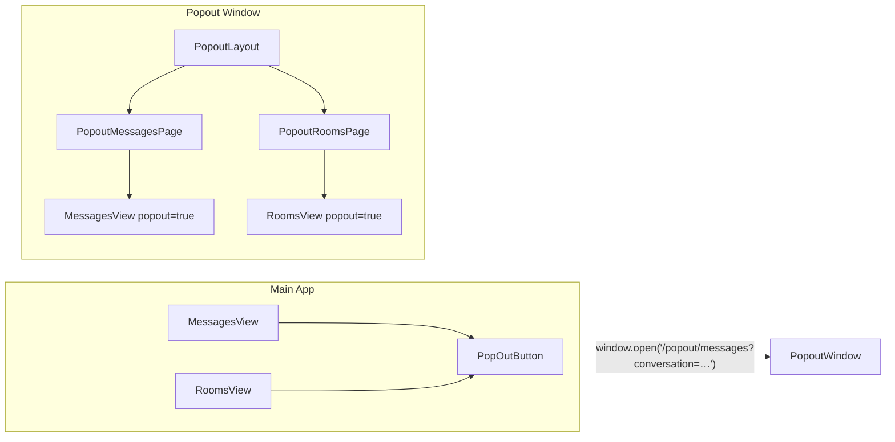

# Page Pop-out Window

## Shaping Summary

**Scope:** Let users pop the current page into a mobile-sized browser window via a trigger on the right side of page headers. Phase 1 targets **Messages** and **Rooms** — pages where members spend extended time chatting.

**Decisions:**

- **Mechanism:** `window.open()` — new same-origin browser window (~390×844, resizable)
- **Content:** Identical to current mobile screens — reuse `MessagesView` / `RoomsView` as-is, no popout-specific layout forks
- **Deep link:** Preserve `?conversation=` / `?room=` when a thread is active; otherwise open inbox
- **Chrome:** Dedicated `(popout)` route group — no sidebar, no `SiteHeader` (the only intentional difference from mobile)
- **Standards:** `global/page-shell` (header/actions pattern), `css/shadcn-ui` (button/icon styling)

**Visuals:** None beyond existing app screenshots (header placement reference).

---

## Mobile Parity Requirement

Popout pages **must look and behave like the current mobile screens** on Messages and Rooms. This is the core UX goal — the popout window is effectively "mobile AWN in its own window."

**What this means in practice:**

- Reuse the **same view components** ([`MessagesView`](components/messages/messages-view.tsx), [`RoomsView`](components/rooms/rooms-view.tsx), [`MessageThread`](components/messages/message-thread.tsx), [`RoomThread`](components/rooms/room-thread.tsx)) — do not create parallel popout layouts
- Window width stays **below the 768px `md` breakpoint** ([`hooks/use-mobile.ts`](hooks/use-mobile.ts)) so existing Tailwind responsive classes activate the mobile layout automatically
- **Single-column navigation:** inbox list full-width when no thread selected; thread full-width with back button when a conversation/room is active
- **Same mobile behaviors preserved:**
  - Page title + actions visible on inbox view; hidden when a thread is open (existing `hidden md:flex` logic)
  - Back button in thread header (`md:hidden`) returns to inbox within the popout
  - Search, "New" message drawer, join/leave room actions, realtime messaging — all unchanged
- **Do not add popout-only UI overrides** that change layout, spacing, or navigation beyond removing app chrome

**The only differences from mobile:**

1. No `AppSidebar` or `SiteHeader` (chromeless `(popout)` layout)
2. Full viewport height (`h-svh`) instead of `h-[calc(100svh-4rem)]` (no 4rem header offset)
3. Pop-out trigger hidden inside the popout window itself (can't pop out twice)

**Verification:** Side-by-side compare popout window (~390px) against the same page in Chrome DevTools mobile emulation — they should match.

---

## Architecture



The popout window opens at ~390px wide — below the 768px `md` breakpoint — so existing responsive classes in [`components/messages/messages-view.tsx`](components/messages/messages-view.tsx) and [`components/rooms/rooms-view.tsx`](components/rooms/rooms-view.tsx) render the **exact same mobile layout** as a phone viewport. No new responsive logic or layout variants needed.

Auth works via same-origin Supabase cookies ([`middleware.ts`](middleware.ts), [`app/(app)/layout.tsx`](<app/(app)/layout.tsx>)).

---

## Task 1: Save Spec Documentation

Create `agent-os/specs/2026-07-27-1530-page-popout-window/` with:

- **plan.md** — this plan
- **shape.md** — scope, decisions, product alignment (messaging as core crew communication)
- **standards.md** — full content of [`agent-os/standards/global/page-shell.md`](agent-os/standards/global/page-shell.md) and [`agent-os/standards/css/shadcn-ui.md`](agent-os/standards/css/shadcn-ui.md)
- **references.md** — pointers to Messages/Rooms views, header flyouts ([`components/messages.tsx`](components/messages.tsx), [`components/rooms.tsx`](components/rooms.tsx)), and existing flyout navigation plans
- **visuals/** — empty (none provided)

---

## Task 2: Pop-out utility and button component

Create [`lib/popout.ts`](lib/popout.ts):

```ts
export const POPOUT_WINDOW_FEATURES =
  "width=390,height=844,menubar=no,toolbar=no,location=no,status=no,resizable=yes"

export function buildPopoutUrl(path: "/popout/messages" | "/popout/rooms", params?: Record<string, string>) { … }
export function openPopoutWindow(url: string, windowName: string) { … }
```

Create [`components/popout-button.tsx`](components/popout-button.tsx):

- Ghost/icon `Button` with `SquareArrowOutUpRight` (lucide)
- Props: `href`, `windowName`, `aria-label` (e.g. "Pop out Messages")
- Tooltip: "Pop out"
- Uses shadcn `Button` + `Tooltip` per standards

Named windows prevent duplicate popouts for the same thread (`messages-popout`, `room-{id}`).

---

## Task 3: Chromeless `(popout)` route group

Create [`app/(popout)/layout.tsx`](<app/(popout)/layout.tsx>):

- Mirror auth guard from [`app/(app)/layout.tsx`](<app/(app)/layout.tsx>) (`getSessionUser()` + redirect)
- Include `MessagesProvider` + `RoomsProvider` (realtime state required)
- **Omit:** `SidebarProvider`, `AppSidebar`, `SiteHeader`, `PresenceHeartbeat` (avoid duplicate presence pings per window)
- Minimal wrapper: `<div className="h-svh bg-background">{children}</div>`

Create popout pages mirroring existing searchParams:

| File                                                                 | Reuses         | Params                            |
| -------------------------------------------------------------------- | -------------- | --------------------------------- |
| [`app/(popout)/messages/page.tsx`](<app/(popout)/messages/page.tsx>) | `MessagesView` | `conversation`, `person`, `draft` |
| [`app/(popout)/rooms/page.tsx`](<app/(popout)/rooms/page.tsx>)       | `RoomsView`    | `room`                            |

Page wrapper uses `h-svh` (not `h-[calc(100svh-4rem)]`) since there is no site header. Match mobile padding (`p-4`) on the page wrapper so spacing aligns with the main app's mobile view.

---

## Task 4: Wire popout pages with mobile parity

Popout pages render the **same components** as the main app — no layout forks.

Add optional `popout?: boolean` to [`MessagesView`](components/messages/messages-view.tsx) and [`RoomsView`](components/rooms/rooms-view.tsx) **only** to:

- Hide the `PopOutButton` inside the popout window (prevent recursive pop-out)
- Optionally hide the "New" button's popout neighbor — but **keep all other mobile UI intact**

**Do NOT:**

- Hide the page title row unconditionally (mobile shows title on inbox view)
- Change column widths, breakpoints, or navigation patterns
- Create separate popout-specific thread or inbox components

The existing mobile responsive logic handles everything else:

```tsx
// messages-view.tsx — already mobile-aware; popout window triggers these at ~390px
visibleActiveConversation && "hidden md:flex"; // title hidden when thread open
visibleActiveConversation && "hidden md:flex"; // inbox hidden when thread open
visibleActiveConversation ? "flex" : "hidden md:flex"; // thread full-width on mobile
```

Popout pages pass `popout={true}` plus the same `title`, `description`, and searchParams as the main app pages.

---

## Task 5: Add triggers to Messages and Rooms page headers

**Messages** — in the existing header row (right side, beside "New"):

```tsx
<div className="flex shrink-0 items-center gap-2">
  <PopOutButton
    href={buildPopoutUrl("/popout/messages", activeConversationId ? { conversation: activeConversationId } : undefined)}
    windowName={activeConversationId ? `msg-${activeConversationId}` : "messages-popout"}
    aria-label="Pop out Messages"
  />
  <Button …>New</Button>
</div>
```

**Rooms** — add the same pattern on the currently empty right side of the header:

```tsx
<PopOutButton
  href={buildPopoutUrl(
    "/popout/rooms",
    activeRoom?.id ? { room: activeRoom.id } : undefined,
  )}
  windowName={activeRoom?.id ? `room-${activeRoom.id}` : "rooms-popout"}
  aria-label="Pop out Rooms"
/>
```

Placement matches the screenshots: trigger on the far right of the page header row, not the global `SiteHeader`.

---

## Task 6: Smoke test

Manual verification checklist — **mobile parity is the primary acceptance criterion:**

1. **Side-by-side mobile comparison:** Open Messages in Chrome DevTools mobile emulation (~390px) and in a popout window — inbox view, thread view, and back navigation should match
2. Messages — pop out with no thread → inbox list looks identical to mobile (title, search, conversation rows, "New" button)
3. Messages — select a conversation, pop out → thread opens directly; title hidden, back button visible, same as mobile thread view
4. Messages — back button in popout returns to inbox list (same as mobile)
5. Rooms — same inbox/thread/back scenarios; join/leave buttons behave identically to mobile
6. Re-click pop-out with same thread → focuses existing window, no duplicate
7. Send/receive messages in popout — realtime works via shared providers
8. Session/auth — popout loads authenticated; expired session redirects to login inside popout

---

## Out of Scope (future)

- Pop-out trigger on other pages (Jobs, People, etc.)
- Pop-out from global header flyouts ([`components/messages.tsx`](components/messages.tsx))
- In-app floating panel (non-browser-window) variant
- Cross-window state sync beyond existing Supabase realtime
