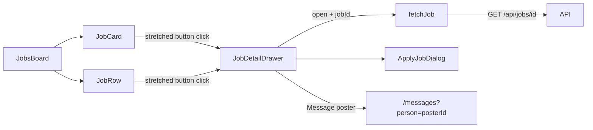

# Job Detail Flyout Drawer

## Shaping Summary

**Scope:** A job detail view as a right-side flyout drawer on the Jobs page, mirroring the member profile drawer pattern. Built as a reusable component for future pages (saved jobs, notifications, etc.).

**Decisions (from shaping):**

- **Content:** Full detail — badges, role, production, location, pay, dates, deadline, full description, poster info, applicant count; footer with Save + Apply, Message poster, Share, Report job
- **Data:** Fetch `GET /api/jobs/[id]` when drawer opens (not list-only)
- **Poster interaction:** Message poster button only — no nested `PersonProfileDrawer`
- **Standards:** `board-pattern`, `shadcn-ui`, `design-tokens`

**Visuals provided:**

- Member profile drawer reference (layout/structure target)
- Jobs grid page (integration target)

Copy visuals to spec folder: `agent-os/specs/2026-07-28-1600-job-detail-drawer/visuals/`

---

## Architecture

**Reference implementation:** `components/people/person-profile-drawer.tsx` — same Sheet shell (`side="right"`, floating rounded panel), hero + ScrollArea body + fixed footer, `initialFocus` on hero, sr-only title/description.

**Trigger pattern:** `components/people/person-card.tsx` — absolute inset-0 button at `z-0`; action buttons at `z-10` so Save/Apply don't open the drawer.

---

## Task 1: Save Spec Documentation

Create `agent-os/specs/2026-07-28-1600-job-detail-drawer/` with plan, shape, standards, references, and visuals.

---

## Task 2: Extend data layer for job detail fetch

**Files:** `lib/jobs/fetch.ts`, `lib/jobs/swr-keys.ts`, `lib/jobs-data.ts`, `lib/jobs/map.ts`, `app/api/jobs/[id]/route.ts`

- Add `JobDetailResponse` type: `{ job: Job; applicantCount: number; posterId: string }`
- Add `posterId` to `Job` interface (needed for Message poster navigation)
- Map `poster_id` in `mapJobPostingRow` (extend `JobPostingSource`)
- Add `fetchJob(jobId)` client helper and `jobDetailKey(jobId)` SWR key
- Include `posterId` in existing GET response

---

## Task 3: Build `JobDetailDrawer` component

**New file:** `components/jobs/job-detail-drawer.tsx`

Structure (mirroring member drawer):

| Section | Content |
|---------|---------|
| **Hero** | Muted banner strip; engagement/department/urgent badges + `postedAt`; role (h2), production, location with MapPin; pay rate (primary, `font-heading`) |
| **Scroll body** | Meta chips: date range, apply deadline, applicant count; full `details` (no line-clamp); poster row (avatar, name, role) |
| **Footer** | Primary row: Save (outline icon) + Apply (disabled if applied); secondary row: Message poster + Share (ghost, unwired); tertiary: Report job (ghost, unwired) |

---

## Task 4: Wire drawer to Jobs page cards and rows

Wire stretched-button click pattern in `JobCard` and `JobRow`.

---

## Task 5: Smoke-check

Manual verification on `/jobs` grid and list views.

---

## Out of Scope (deferred)

- URL/query param deep-linking (`?job=id`)
- Nested `PersonProfileDrawer` for poster
- Share and Report wiring
- Using drawer on other pages (component is reusable; wiring deferred)
- Dedicated `/jobs/[id]` page route
