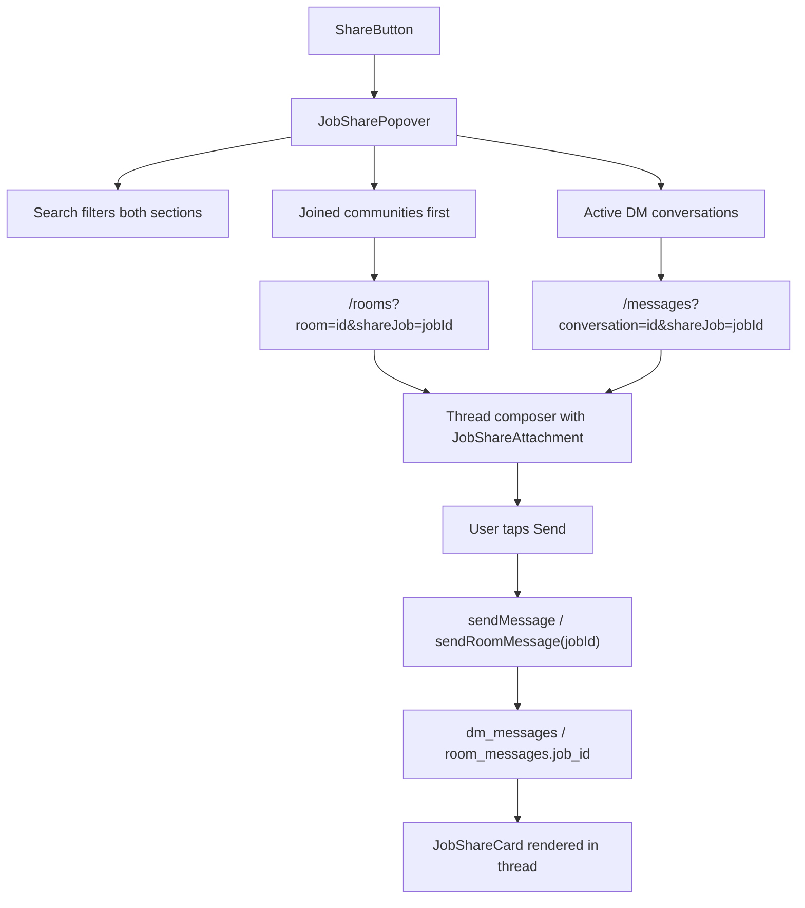

# Job Share to DMs and Rooms

## Shaping Summary

| Decision        | Choice                                                                     |
| --------------- | -------------------------------------------------------------------------- |
| Select behavior | Navigate to compose — open thread with job pre-attached; user taps Send    |
| Message format  | Rich job card embed in the message bubble                                  |
| Surfaces        | `JobCard`, `JobRow`, `JobDetailDrawer`                                     |
| Visuals         | Job card screenshot + Messages inbox screenshot (saved to spec `visuals/`) |
| Standards       | `css/shadcn-ui`, `css/design-tokens`, `global/board-pattern`               |

**Product alignment:** Supports P1 Jobs + Messages in [agent-os/product/roadmap.md](agent-os/product/roadmap.md) — members can recommend gigs to crew in DMs and discipline rooms.

---

## Architecture



---

## Task 1: Save Spec Documentation

Create `agent-os/specs/2026-07-28-1640-job-share-to-messages/` with:

- **plan.md** — this plan
- **shape.md** — scope, decisions, product alignment, deferred items
- **standards.md** — full text of the three confirmed standards
- **references.md** — pointers below
- **visuals/** — copy the two provided screenshots

---

## Task 2: Database — Job Share on Messages

Add nullable `job_id` FK to both message tables via new migration (e.g. `supabase/migrations/20260728180000_message_job_shares.sql`):

```sql
alter table public.dm_messages
  add column job_id uuid references public.job_postings(id) on delete set null;

alter table public.room_messages
  add column job_id uuid references public.job_postings(id) on delete set null;
```

- Relax body constraint: require `char_length(trim(body)) > 0 OR job_id IS NOT NULL`
- Update `get_dm_thread` and `get_room_thread` RPCs to return `job_id` plus denormalized job fields for rendering (role, production, location, pay_rate, start_date, end_date, engagement) — avoids N+1 fetches in threads
- Update inbox preview trigger / bump logic so job-only messages show preview like `Shared a job · {role}` when body is empty

---

## Task 3: Server Actions — Send with Job Attachment

Extend [lib/messages/actions.ts](lib/messages/actions.ts) and [lib/rooms/actions.ts](lib/rooms/actions.ts):

- `sendMessage(conversationId, body, options?: { jobId?: string })`
- `sendRoomMessage(roomId, body, options?: { jobId?: string })`
- Validation: at least one of trimmed `body` or `jobId` must be present
- Verify job exists and is viewable by sender before insert
- Map RPC rows → `ThreadMessage.jobShare?: JobSharePayload` in thread fetchers

Extend [lib/messages-data.ts](lib/messages-data.ts):

```typescript
export type JobSharePayload = {
  id: string;
  role: string;
  production: string;
  location: string;
  payRate: string;
  startDate: string;
  endDate: string;
  engagement: string;
};

export interface ThreadMessage {
  // ...existing fields
  jobShare?: JobSharePayload;
}
```

---

## Task 4: UI — Compact Job Share Card

Create [components/jobs/job-share-card.tsx](components/jobs/job-share-card.tsx):

- Compact horizontal card (role, production, location, pay, dates) using existing tokens from [components/jobs/job-card.tsx](components/jobs/job-card.tsx)
- Variants: `preview` (composer attachment, removable) and `message` (inside bubble, clickable)
- Click opens `JobDetailDrawer` via local state or navigates to `/jobs?job={id}` (add optional query param handling on jobs page — minimal, reuses existing drawer pattern)

Reuse [components/ui/attachment.tsx](components/ui/attachment.tsx) primitives for composer preview styling.

---

## Task 5: UI — Share Destination Picker

**Message share:** [`components/jobs/job-share-to-messages-button.tsx`](components/jobs/job-share-to-messages-button.tsx) navigates to `/messages?shareJob={jobId}&newMessage=1` and auto-opens the New Message drawer (member search → existing or new thread).

**Community share:** [`components/jobs/job-share-room-popover.tsx`](components/jobs/job-share-room-popover.tsx):

- **Trigger:** Hash button on card/row/drawer (Share2 button is for messages)
- **Search:** top `Input type="search"` — joined rooms only from `useRooms()`
- **On select:** `router.push('/rooms?room={id}&shareJob={jobId}')`; close popover
- Empty/loading states; keyboard accessible list items

---

## Task 6: Wire Share on Job Surfaces

| File                                                                           | Change                                                                                              |
| ------------------------------------------------------------------------------ | --------------------------------------------------------------------------------------------------- |
| [components/jobs/job-card.tsx](components/jobs/job-card.tsx)                   | Share2 → `JobShareToMessagesButton`; Hash → `JobShareRoomPopover`                                   |
| [components/jobs/job-row.tsx](components/jobs/job-row.tsx)                     | Same                                                                                                |
| [components/jobs/job-detail-drawer.tsx](components/jobs/job-detail-drawer.tsx) | Share ghost button → messages; Hash icon → `JobShareRoomPopover`                                    |

All Share buttons keep `pointer-events-auto relative z-10` so card click-to-open-drawer still works.

---

## Task 7: Messages — Compose with Pending Job Share

Extend URL plumbing:

- [app/(app)/messages/page.tsx](<app/(app)/messages/page.tsx>) — accept `shareJob?: string` search param
- [components/messages/messages-view.tsx](components/messages/messages-view.tsx) — pass `initialShareJobId`, sync/clear param after consume (mirror existing `draft` handling)
- [components/messages/message-thread.tsx](components/messages/message-thread.tsx):
  - Accept `initialShareJobId` + `onShareJobConsumed`
  - Fetch job summary via `fetchJob(shareJobId)` when param present
  - Show `JobShareCard` preview above composer using Attachment primitives
  - Allow optional text note alongside attachment
  - Enable Send when attachment OR text present
  - Pass `jobId` to `sendMessage` action; clear attachment after send
  - Clear `shareJob` from URL on consume

Popout messages page gets the same param.

---

## Task 8: Rooms — Compose with Pending Job Share

Mirror messages flow:

- [app/(app)/rooms/page.tsx](<app/(app)/rooms/page.tsx>) — accept `shareJob?: string`
- [components/rooms/rooms-view.tsx](components/rooms/rooms-view.tsx) — pass through to active thread
- [components/rooms/room-thread.tsx](components/rooms/room-thread.tsx) — same composer attachment + send with `jobId` pattern as DM thread

---

## Task 9: Render Job Share Cards in Threads

Update message bubble rendering in both threads:

- [components/messages/message-thread.tsx](components/messages/message-thread.tsx)
- [components/rooms/room-thread.tsx](components/rooms/room-thread.tsx)

When `message.jobShare` is set, render `JobShareCard variant="message"` above/below optional text body. Text-only messages unchanged.

Update realtime handlers ([lib/messages/hooks/use-inbox-realtime.ts](lib/messages/hooks/use-inbox-realtime.ts), rooms equivalent) to pass through `job_id` if present in payload.

---

## Task 10: Smoke Verification

Manual checklist (add `smoke-check.md` to spec):

1. Share from grid card → picker shows joined communities then DMs
2. Search filters both sections
3. Select community → `/rooms` opens with room selected + job attachment in composer
4. Select DM → `/messages` opens with conversation selected + job attachment
5. Send with attachment only, with note only, with both
6. Received bubble shows rich job card; tap opens job detail
7. Share works from list row and detail drawer
8. Inbox preview shows sensible text for job-only shares

---

## Key Files

| Area         | Files                                                                          |
| ------------ | ------------------------------------------------------------------------------ |
| Share picker | `components/jobs/job-share-room-popover.tsx`, `components/jobs/job-share-to-messages-button.tsx`, `lib/messages/share-navigation.ts` |
| Job embed    | `components/jobs/job-share-card.tsx` (new)                                     |
| Job surfaces | `job-card.tsx`, `job-row.tsx`, `job-detail-drawer.tsx`                         |
| Backend      | new migration, `lib/messages/actions.ts`, `lib/rooms/actions.ts`               |
| Thread UI    | `message-thread.tsx`, `room-thread.tsx`, `messages-view.tsx`, `rooms-view.tsx` |
| Types        | `lib/messages-data.ts`                                                         |

---

## Deferred (out of scope)

- Web Share API / native OS share sheet
- Message search indexing for job shares
- `/jobs/[id]` dedicated page (drawer + `?job=` query is sufficient for MVP)

## Addendum — Share to new messages (2026-07-29)

- Job message share uses the New Message drawer (`newMessage=1` URL param) instead of listing existing DMs
- Job community share uses a separate Hash button + `JobShareRoomPopover`
- Share params are preserved when selecting a recipient or existing inbox conversation
