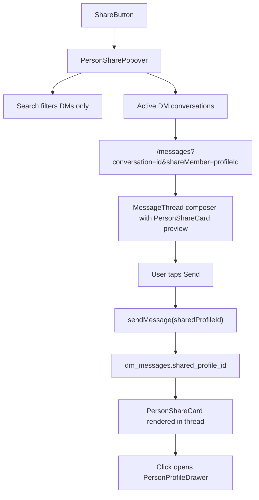

# Member Share to Messages

## Shaping Summary

| Decision        | Choice                                                                           |
| --------------- | -------------------------------------------------------------------------------- |
| Destinations    | **DM conversations only** — no Communities/rooms section in picker               |
| Select behavior | Navigate to compose — open thread with member pre-attached; user taps Send       |
| Message format  | Rich member card embed in bubble (optional text note alongside)                  |
| Surfaces        | `PersonCard`, `PersonRow`, `PersonProfileDrawer` (all three, matching job share) |
| Data model      | `shared_profile_id uuid` FK on `dm_messages` → `profiles(id)`; join at read time |
| Visuals         | Member card grid screenshot + profile drawer Share button (saved to spec `visuals/`) |

**Product alignment:** Supports P1 **People + Messages** in [agent-os/product/roadmap.md](agent-os/product/roadmap.md) — members can recommend crew to contacts in DMs.

**Prerequisite note:** People directory still uses mock `Person.id` values (`"1"`, `"2"`, …). With the chosen `profile_id` FK model, mock IDs must be migrated to real profile UUIDs (or People wired to Supabase) before end-to-end share works in dev. The implementation should treat `person.id` as the profile UUID going forward.

---

## Architecture



**Key difference from job share:** No `/rooms` routing, no `room_messages` column, no `RoomsView`/`RoomThread` changes.

---

## Task 1: Save Spec Documentation

Create `agent-os/specs/2026-07-28-1740-member-share-to-messages/` with:

- **plan.md** — this plan
- **shape.md** — scope, decisions (DMs-only, profile FK, all surfaces), product alignment, deferred items
- **standards.md** — full text of confirmed standards (see below)
- **references.md** — pointers to job share implementation
- **visuals/** — copy the two provided member card screenshots
- **smoke-check.md** — manual verification checklist

---

## Task 2: Database — Member Share on DM Messages

New migration (e.g. `supabase/migrations/20260728190000_message_member_shares.sql`):

```sql
alter table public.dm_messages
  add column shared_profile_id uuid references public.profiles (id) on delete set null;

create index dm_messages_shared_profile_id_idx
  on public.dm_messages (shared_profile_id)
  where shared_profile_id is not null;
```

- Extend `message_preview_body(body, job_id, shared_profile_id)` to return `"Shared a member · {name}"` when body is empty and member attachment present (keep existing job preview logic)
- Relax `dm_messages_body_check`: require `trim(body) > 0 OR job_id IS NOT NULL OR shared_profile_id IS NOT NULL`
- Enforce mutual exclusivity at app layer: a message may attach a job **or** a member, not both
- Update `get_dm_thread` RPC to LEFT JOIN `profiles` on `shared_profile_id` and return denormalized fields for rendering:
  - `shared_profile_id`, `shared_profile_name`, `shared_profile_title`, `shared_profile_avatar_url`, `shared_profile_home_base` (and any other fields needed for compact card)
- Update `bump_dm_conversation_updated_at` trigger to use extended preview helper
- Update inbox list RPC (`list_dm_conversations` / equivalent) if preview comes from a separate path

Reference: [supabase/migrations/20260728180000_message_job_shares.sql](supabase/migrations/20260728180000_message_job_shares.sql)

---

## Task 3: Types and Share Helpers

**Extend** [lib/messages-data.ts](lib/messages-data.ts):

```typescript
export type MemberSharePayload = {
  id: string;
  name: string;
  role: string;
  department?: string;
  homeBase?: string;
  availability?: string;
  avatar?: string;
  credits?: number;
  vouches?: number;
  yearsExperience?: number;
};

export interface ThreadMessage {
  // ...existing
  jobShare?: JobSharePayload;
  memberShare?: MemberSharePayload;
}
```

**Create** [lib/messages/member-share.ts](lib/messages/member-share.ts) mirroring [lib/messages/job-share.ts](lib/messages/job-share.ts):

- `MemberShareRpcRow`, `mapRpcMemberShare(row)`, `personToSharePayload(person: Person)`
- `sharePreviewText(memberShare)` → `"Shared a member · {name}"`
- Extend `messageDisplayPreview(text, jobShare?, memberShare?)` to prefer text, then job, then member

---

## Task 4: Server Actions — Send with Member Attachment

**Extend** [lib/messages/actions.ts](lib/messages/actions.ts):

- `sendMessage(conversationId, body, options?: { jobId?: string; sharedProfileId?: string })`
- Validation: at least one of trimmed `body`, `jobId`, or `sharedProfileId`; reject if both `jobId` and `sharedProfileId` set
- `fetchMemberSharePayload(profileId)` — verify profile exists and is `status = 'active'`, return `MemberSharePayload`
- Map RPC/insert rows → `ThreadMessage.memberShare` in `mapThreadRpcMessage` / `mapInsertedMessageRow`

No changes to [lib/rooms/actions.ts](lib/rooms/actions.ts).

---

## Task 5: UI — Compact Member Share Card

Create [components/people/person-share-card.tsx](components/people/person-share-card.tsx) mirroring [components/jobs/job-share-card.tsx](components/jobs/job-share-card.tsx):

- Compact horizontal card: avatar, name (`font-heading`), role/title, location, availability dot
- Optional stats row (credits / vouches / yrs) when payload includes them
- Variants: `preview` (composer attachment, removable X) and `message` (in bubble, clickable)
- Click on `message` variant opens `PersonProfileDrawer` (build minimal `Person` stub from payload or fetch by id)
- Reuse [components/ui/attachment.tsx](components/ui/attachment.tsx) primitives

Design reference: provided member card screenshot (department badge, avatar, name, role, location, availability, stats).

---

## Task 6: UI — Share Destination Picker (Messages Only)

Create [components/people/person-share-popover.tsx](components/people/person-share-popover.tsx) based on [components/jobs/job-share-popover.tsx](components/jobs/job-share-popover.tsx):

| Aspect      | Job share                                   | Member share                                               |
| ----------- | ------------------------------------------- | ---------------------------------------------------------- |
| Sections    | Communities + Messages                      | **Messages only**                                          |
| Placeholder | "Search communities and messages…"          | "Search messages…"                                         |
| Empty state | "Join a community or start a conversation…" | "Start a conversation to share this member."               |
| Navigation  | `/rooms?...` or `/messages?...`             | `/messages?conversation={id}&shareMember={profileId}` only |
| Footer      | "Sharing {role}"                            | "Sharing {name}"                                           |

- Props: `{ person: Person; children: ReactElement }`
- Data: `useMessages().conversations`, `useInbox({ enabled: open })`
- Client-side filter by name, role, preview
- No `useRooms()` import

---

## Task 7: Wire Share on People Surfaces

| File                                                                                       | Change                                                                                                                                                                                   |
| ------------------------------------------------------------------------------------------ | ---------------------------------------------------------------------------------------------------------------------------------------------------------------------------------------- |
| [components/people/person-card.tsx](components/people/person-card.tsx)                     | Add Share icon button between Connect and Message, wrapped in `PersonSharePopover` (match [job-card.tsx](components/jobs/job-card.tsx) pattern with `pointer-events-auto relative z-10`) |
| [components/people/person-row.tsx](components/people/person-row.tsx)                       | Add Share icon button after Message button                                                                                                                                               |
| [components/people/person-profile-drawer.tsx](components/people/person-profile-drawer.tsx) | Wire existing Share button via `PersonSharePopover person={person}`                                                                                                                      |

---

## Task 8: Messages — Compose with Pending Member Share

Extend URL plumbing (messages only — no rooms pages):

- [app/(app)/messages/page.tsx](<app/(app)/messages/page.tsx>) — accept `shareMember?: string` search param
- [app/(popout)/popout/messages/page.tsx](<app/(popout)/popout/messages/page.tsx>) — same
- [components/messages/messages-view.tsx](components/messages/messages-view.tsx) — pass `initialShareMemberId`, sync/clear param after consume (mirror `shareJob` handling)
- [components/messages/message-thread.tsx](components/messages/message-thread.tsx):
  - Accept `initialShareMemberId` + `onShareMemberConsumed`
  - Fetch member payload via new server action when param present
  - Show `PersonShareCard variant="preview"` above composer
  - Allow optional text note; enable Send when attachment OR text present
  - Pass `sharedProfileId` to `sendMessage`; clear attachment after send
  - Support both `shareJob` and `shareMember` params but not simultaneously in composer (member takes precedence or first-wins — pick one and document)

---

## Task 9: Render Member Share Cards in DM Threads

Update [components/messages/message-thread.tsx](components/messages/message-thread.tsx) and [components/messages/message-bubble-with-reactions.tsx](components/messages/message-bubble-with-reactions.tsx):

- When `message.memberShare` is set, render `MessageMemberShareWithReactions` (parallel to existing `MessageJobShareWithReactions`)
- Stack `PersonShareCard variant="message"` + optional text bubble below
- Reactions work on the whole share block (same pattern as job shares)

Update [lib/messages/hooks/use-inbox-realtime.ts](lib/messages/hooks/use-inbox-realtime.ts):

- Skip optimistic append for `shared_profile_id` messages; trigger SWR revalidate (same as job shares)

---

## Task 10: Align People Mock IDs (Prerequisite for Testing)

Update [lib/people-data.ts](lib/people-data.ts) so `Person.id` values are valid profile UUIDs that exist in dev Supabase (or seed matching profiles). Without this, share send will fail FK/validation checks.

This is a small data alignment task, not a full People→Supabase migration.

---

## Task 11: Smoke Verification

Manual checklist in `smoke-check.md`:

1. Share from grid card → picker shows **Messages section only** (no communities)
2. Search filters conversations by name/role
3. Select DM → `/messages` opens with conversation selected + member attachment in composer
4. Send with attachment only, with note only, with both
5. Received bubble shows rich member card; tap opens profile drawer
6. Share works from list row and profile drawer
7. Inbox preview shows `"Shared a member · {name}"` for member-only shares
8. Confirm share does **not** appear as an option in any rooms flow

---

## Key Files

| Area            | Files                                                                                      |
| --------------- | ------------------------------------------------------------------------------------------ |
| Share picker    | `components/people/person-share-popover.tsx` (new)                                         |
| Member embed    | `components/people/person-share-card.tsx` (new)                                            |
| People surfaces | `person-card.tsx`, `person-row.tsx`, `person-profile-drawer.tsx`                           |
| Backend         | new migration, `lib/messages/actions.ts`, `lib/messages/member-share.ts` (new)             |
| Thread UI       | `message-thread.tsx`, `message-bubble-with-reactions.tsx`, `messages-view.tsx`             |
| Types           | `lib/messages-data.ts`                                                                     |
| Reference       | `components/jobs/job-share-popover.tsx`, `job-share-card.tsx`, `lib/messages/job-share.ts` |

---

## Standards Applied

- [agent-os/standards/css/shadcn-ui.md](agent-os/standards/css/shadcn-ui.md) — Popover, Input, Avatar, Attachment primitives
- [agent-os/standards/css/design-tokens.md](agent-os/standards/css/design-tokens.md) — semantic tokens, `font-heading` for name emphasis
- [agent-os/standards/global/board-pattern.md](agent-os/standards/global/board-pattern.md) — consistent Share wiring on card, row, and detail drawer

---

## Deferred (out of scope)

- Sharing members to rooms / communities
- Web Share API / copy link / public profile URLs (`/crew/[handle]`)
- Starting new DMs from share picker (use existing New Message flow)
- Denormalized snapshot storage for offline/mock profiles
- Message search indexing for member shares
