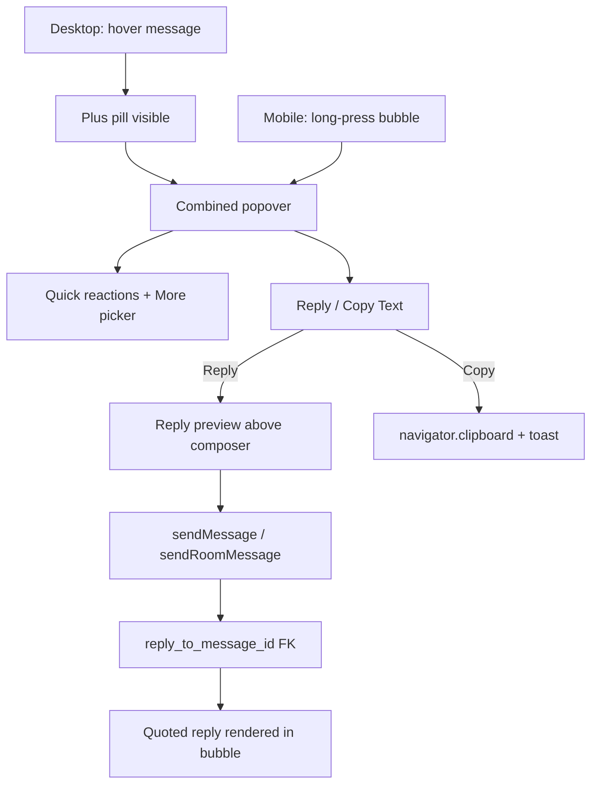

## Architecture



**Interaction flow (matches reference screenshots):**

**Desktop**

1. Hover message → Plus pill appears beside bubble (same position as current reaction trigger).
2. Click Plus → popover opens above with emoji row, action sheet directly underneath (left-aligned within popover).

**Mobile (touch)**

1. Long-press message bubble (~400ms) → same combined popover opens, anchored to the bubble.
2. Optional haptic feedback via `navigator.vibrate(10)` when supported.
3. Suppress native text-selection / context menu during long-press (`touch-action`, `-webkit-touch-callout: none` on bubble wrap).
4. Only one message popover open at a time; tapping outside or selecting an action dismisses it.

**Both platforms** 3. **Reply** → popover closes, composer shows "Replying to {name}" banner with snippet + dismiss (X); input focuses. 4. Send → message renders with quoted preview above reply body (Instagram/WhatsApp pattern). 5. **Copy Text** → copies display preview to clipboard, toast confirmation, popover closes.

---

## Task 1: Save Spec Documentation

Create `agent-os/specs/2026-07-29-1808-message-reply/` with:

- **plan.md** — this plan
- **shape.md** — scope, Plus-trigger decision, all-types reply, visual references
- **standards.md** — full text of `css/shadcn-ui` + `css/design-tokens`
- **references.md** — reaction bubble, thread composers, member-share snapshot pattern
- **visuals/** — copy the 6 provided screenshots from workspace assets
- **smoke-check.md** — manual QA checklist

---

## Task 2: Database — Reply FK + RPC

New migration (e.g. `supabase/migrations/20260729180000_message_replies.sql`):

```sql
alter table public.dm_messages
  add column reply_to_message_id uuid
    references public.dm_messages (id) on delete set null;

alter table public.room_messages
  add column reply_to_message_id uuid
    references public.room_messages (id) on delete set null;

create index dm_messages_reply_to_idx on public.dm_messages (reply_to_message_id);
create index room_messages_reply_to_idx on public.room_messages (reply_to_message_id);
```

Update `get_dm_thread` and `get_room_thread` RPCs to left-join the parent message and return reply metadata per row:

- `reply_to_message_id`
- Parent `body`, `job_id`, job denormalized fields, `shared_profile_id`, member share snapshot
- Parent sender display name (DM: other participant name; room: author profile name)

When parent is deleted (`reply_to_message_id` becomes null via FK), UI shows **"Message unavailable"** in the quote block.

---

## Task 3: Types + Reply Helpers

Extend [`lib/messages-data.ts`](lib/messages-data.ts):

```typescript
export type MessageReplyPayload = {
  messageId: string;
  authorName: string;
  preview: string;
  unavailable?: boolean;
};

export interface ThreadMessage {
  // ...existing fields
  replyTo?: MessageReplyPayload;
}
```

Add [`lib/messages/reply.ts`](lib/messages/reply.ts):

- `buildReplyPreview(message: ThreadMessage): string` — delegates to `messageDisplayPreview`
- `mapRpcReply(row): MessageReplyPayload | undefined`
- `copyMessageText(message: ThreadMessage): string` — same preview logic for clipboard

---

## Task 4: Server Actions — Send with Reply

Extend [`lib/messages/actions.ts`](lib/messages/actions.ts) and [`lib/rooms/actions.ts`](lib/rooms/actions.ts):

- `sendMessage(conversationId, body, options?: { jobId?, sharedProfileId?, replyToMessageId? })`
- `sendRoomMessage(roomId, body, options?: { jobId?, replyToMessageId? })`

Validation:

- `replyToMessageId` must reference a message in the same conversation/room
- Sender must be a participant / room member
- Reply does not change existing body/share validation (text, job, or member share still required for non-reply sends; reply sends require trimmed body text)

Map RPC rows → `ThreadMessage.replyTo` in both thread fetchers.

---

## Task 5: Combined Popover + Action Sheet UI (+ Mobile Long-Press)

Refactor [`message-reaction-picker.tsx`](components/messages/message-reaction-picker.tsx):

- Rename trigger conceptually to **message actions**; swap `Smile` → `Plus` in [`MessageReactionTrigger`](components/messages/message-reaction-picker.tsx)
- Extend `PopoverContent` to a vertical stack:
  - **Top:** existing quick emoji row + More button (keep [`QUICK_REACTIONS`](lib/messages/reactions.ts))
  - **Divider**
  - **Bottom:** left-aligned action sheet with two rows:
    - `CornerUpLeft` + **Reply**
    - `Copy` + **Copy Text**
- New props: `onReply?: () => void`, `onCopy?: () => void`, `messagePreview?: string` (for aria labels)
- Support **controlled `open` state** so long-press can open the popover programmatically (not only via trigger click)
- Selecting emoji or action closes popover (same as today for reactions)

Add [`components/messages/message-action-sheet.tsx`](components/messages/message-action-sheet.tsx) — small vertical menu using shadcn `Button variant="ghost"` rows inside the shared `message-reaction-surface` styling.

Add [`lib/messages/use-long-press.ts`](lib/messages/use-long-press.ts) — lightweight hook:

- `onPointerDown` starts timer (~400ms); cancel on `pointerup`, `pointerleave`, or `pointercancel`
- Ignore if pointer moved beyond small threshold (prevents firing during scroll)
- Callback receives the event; caller opens popover
- Use `{ passive: true }` on touch listeners where `preventDefault` is not needed

Update [`message-bubble-with-reactions.tsx`](components/messages/message-bubble-with-reactions.tsx):

- Lift popover `open` / `onOpenChange` to bubble wrap level
- **Desktop:** keep hover-revealed Plus trigger (`group-hover/bubble-wrap`); click opens popover
- **Mobile:** hide hover-only Plus pill on coarse pointers (`@media (pointer: coarse)` or `(hover: none)`); attach `useLongPress` to bubble wrap instead
- Long-press opens popover anchored to bubble (`side="top"`, `align="start"`)
- Prevent text selection during long-press on bubble wrap

Wire through [`MessageReactionSurface`](components/messages/message-bubble-with-reactions.tsx) → all three bubble wrappers (`MessageBubbleWithReactions`, `MessageJobShareWithReactions`, `MessageMemberShareWithReactions`).

**Copy feedback:** use existing `sonner` toast (`toast.success("Copied")`) — same pattern as [`share-to-messages-flyout.tsx`](components/messages/share-to-messages-flyout.tsx).

---

## Task 6: Reply Composer Banner

Add [`components/messages/message-reply-composer.tsx`](components/messages/message-reply-composer.tsx):

- Mirrors pending attachment previews (job/member share) already above the composer in both threads
- Shows: "Replying to {authorName}" + truncated preview + dismiss (X)
- Uses semantic tokens (`bg-muted`, `border-l-2 border-primary`) inspired by WhatsApp/Instagram references

Thread state in both [`message-thread.tsx`](components/messages/message-thread.tsx) and [`room-thread.tsx`](components/rooms/room-thread.tsx):

```typescript
const [pendingReply, setPendingReply] = useState<ThreadMessage | null>(null);
```

- Reply action sets `pendingReply`, clears on send or dismiss
- Focus composer textarea after Reply
- Pass `replyToMessageId: pendingReply.id` to send actions; clear `pendingReply` on successful send
- Optimistic messages include `replyTo` built from `pendingReply`

---

## Task 7: Quoted Reply Rendering in Thread

Add [`components/messages/message-reply-quote.tsx`](components/messages/message-reply-quote.tsx):

- Compact quoted block rendered **inside** the message bubble, above reply text
- Shows author name (primary color in rooms; "You" / contact name in DMs) + one-line truncated preview
- Unavailable state: muted "Message unavailable"
- For share-only originals, preview uses share text (e.g. `Shared a job · LD`)

Integrate into all bubble variants in [`message-bubble-with-reactions.tsx`](components/messages/message-bubble-with-reactions.tsx) — quote appears above `BubbleContent` / share cards when `replyTo` is set.

Optional small label above quote for sent replies: **"You replied"** (DM) / **"{author} replied"** (room) — match Instagram reference screenshot 6.

---

## Task 8: Thread Wiring (DM + Room)

Update [`message-thread.tsx`](components/messages/message-thread.tsx):

- Pass message object + `onReply` / `onCopy` handlers into bubble components
- Render `MessageReplyComposer` above `InputGroup` when `pendingReply` is set
- Include `replyTo` in optimistic + server-refreshed messages

Update [`room-thread.tsx`](components/rooms/room-thread.tsx) — same wiring; room author names come from `message.author`.

Ensure mock/local threads (non-persisted) also support reply state locally for dev parity.

---

## Task 9: Smoke Check

Create `smoke-check.md` and verify:

- [ ] Plus trigger appears on hover for text, job share, and member share messages (DM + room, desktop)
- [ ] Long-press on message bubble opens popover on mobile / touch devices
- [ ] Long-press does not fire while scrolling; native text-selection menu suppressed
- [ ] Popover shows emoji row + Reply/Copy sheet below, left-aligned
- [ ] Copy copies correct text for text-only, share-only, and text+share messages
- [ ] Reply banner appears in composer with correct name + preview
- [ ] Sent reply shows quoted block; persists after refresh
- [ ] Reply to share-only message works
- [ ] Deleted original message shows "Message unavailable" in quote
- [ ] Emoji reactions still work from same popover
- [ ] Popover closes after Reply, Copy, or emoji select

---

## Key Files

| Area          | Files                                                                                                                                                                                                                                                                                                                                           |
| ------------- | ----------------------------------------------------------------------------------------------------------------------------------------------------------------------------------------------------------------------------------------------------------------------------------------------------------------------------------------------- |
| DB            | New migration; update RPCs in latest thread migrations                                                                                                                                                                                                                                                                                          |
| Types/helpers | [`lib/messages-data.ts`](lib/messages-data.ts), new [`lib/messages/reply.ts`](lib/messages/reply.ts)                                                                                                                                                                                                                                            |
| Server        | [`lib/messages/actions.ts`](lib/messages/actions.ts), [`lib/rooms/actions.ts`](lib/rooms/actions.ts)                                                                                                                                                                                                                                            |
| UI            | [`message-reaction-picker.tsx`](components/messages/message-reaction-picker.tsx), new `message-action-sheet.tsx`, `message-reply-composer.tsx`, `message-reply-quote.tsx`, [`message-bubble-with-reactions.tsx`](components/messages/message-bubble-with-reactions.tsx), new [`lib/messages/use-long-press.ts`](lib/messages/use-long-press.ts) |
| Threads       | [`message-thread.tsx`](components/messages/message-thread.tsx), [`room-thread.tsx`](components/rooms/room-thread.tsx)                                                                                                                                                                                                                           |

---

## Deferred (out of scope)

- Tap quoted reply to scroll/highlight original message
- Forward, Delete, Star, Report actions (shown in reference screenshots but not requested)
- Push notifications for replies
- Nested reply threads / reply counts
- Reply snapshot JSON column (use FK join + unavailable fallback for MVP)
