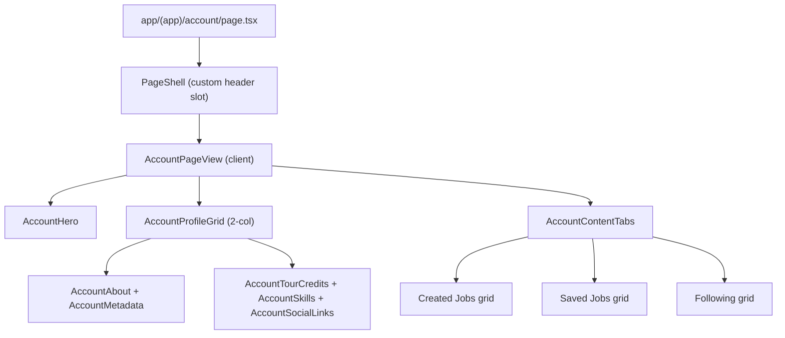

# My Account Page — UI Shell (Placeholder Data)

## Shaping Summary

**Scope:** `/account` becomes the member hub for viewing (and eventually editing) profile identity, tour credits, skills, social links, metadata, and three content lists: created jobs, saved jobs, and members they follow. This pass is **UI only** with static placeholder data to inform future Supabase schema work.

**Decisions (confirmed):**

- Hero actions: **Edit Profile** + link to **Settings** (`/settings`)
- Profile sections: **two-column layout above tabs** (main info left, credits/skills/social right)
- Tabs: **Created Jobs | Saved Jobs | Following** (underline style)
- Visual references: [Tailwind page heading with banner](https://tailwindcss.com/plus/ui-blocks/application-ui/headings/page-headings), [Tabs with underline](https://tailwindcss.com/plus/ui-blocks/application-ui/navigation/tabs)
- No database/migration work in this pass

**Product alignment:** Maps to P2 "Profile + settings" in [feature-migration-inventory.md](agent-os/product/notes/feature-migration-inventory.md) §3F — rich touring identity, tour credits, skills, saved/created content. Settings remains the preferences/avatar entry point; Account is the identity hub.

---

## Page Architecture



---

## Task 1: Save Spec Documentation

Create `agent-os/specs/2026-07-30-1807-my-account-page/` with:

| File            | Contents                                                                 |
| --------------- | ------------------------------------------------------------------------ |
| `plan.md`       | This plan                                                                |
| `shape.md`      | Scope, decisions, visuals, product alignment                             |
| `standards.md`  | Full text of page-shell, shadcn-ui, design-tokens, board-pattern         |
| `references.md` | Pointers below                                                           |
| `visuals/`      | Copy provided screenshots from `.cursor/projects/.../assets/image-*.png` |

**Reference implementations to document:**

- [app/(app)/account/page.tsx](<app/(app)/account/page.tsx>) — stub to replace
- [components/people/person-profile-drawer.tsx](components/people/person-profile-drawer.tsx) — tour credits, skills, bio, hero overlap pattern
- [components/jobs/job-card.tsx](components/jobs/job-card.tsx) + [components/people/person-card.tsx](components/people/person-card.tsx) — tab list cards
- [components/ui/tabs.tsx](components/ui/tabs.tsx) — already has `variant="line"` underline tabs
- [app/(app)/settings/page.tsx](<app/(app)/settings/page.tsx>) — Edit Profile / Settings link target
- [lib/people-data.ts](lib/people-data.ts) + [lib/jobs-data.ts](lib/jobs-data.ts) — reuse types and sample entities

---

## Task 2: Placeholder Data Module

Add [lib/account-data.ts](lib/account-data.ts):

- Export `AccountProfile` type covering: identity (name, role, company, bio, avatar, banner), availability/home base, member-since, verified/founding flags, `skills[]`, `tourCredits[]`, `socialLinks[]`, `metadata[]` (handle, department, work auth, union, day rate, etc.)
- Export `getAccountProfile()` returning a rich static profile for the signed-in member
- Slice subsets from existing mock data:
  - `createdJobs` — 2–3 jobs from `lib/jobs-data.ts` (mark as authored by current user in placeholder)
  - `savedJobs` — 2–3 jobs with `saved: true`
  - `following` — 4–6 people from `lib/people-data.ts` with `followed: true`
- Use a placeholder banner image (local asset in `public/` or `bg-muted` gradient fallback if no asset exists yet)

This module becomes the contract sketch for future Supabase tables/relations.

---

## Task 3: Extend PageShell for Custom Hero

Update [components/page-shell.tsx](components/page-shell.tsx):

- Add optional `header?: ReactNode` prop
- When `header` is provided, **skip** the default title/description block and render `header` instead
- Keep outer padding wrapper; hero uses `-mx-4 md:-mx-6 -mt-4 md:-mt-6` (or similar) to bleed banner to shell edges without breaking the standard

This satisfies [page-shell.md](agent-os/standards/global/page-shell.md) — one shell, no duplicate page chrome.

---

## Task 4: Account Feature Components

Create `components/account/`:

### `account-hero.tsx`

Tailwind "With banner image" pattern adapted to AWN tokens:

- Full-width banner (`aspect-[3/1]` or fixed `h-32 md:h-40`) with cover image or muted fallback
- Overlapping avatar (`-mt-10 size-20 ring-4 ring-background`) using shadcn `Avatar`
- Bottom bar: name (`font-heading`), role/company subtitle, action buttons on the right:
  - **Edit Profile** — `Button variant="outline"` (placeholder `onClick` or link stub)
  - **Settings** — `Button` linking to `/settings`

### `account-profile-grid.tsx` + section components

Two-column responsive grid (`grid gap-6 lg:grid-cols-2`):

**Left column — `account-about.tsx`**

- Bio paragraph
- Availability badge (reuse dot pattern from person-profile-drawer)
- Meta chips: home base, member since, venue tiers, work auth
- `account-metadata.tsx`: description list using shadcn `Card` + label/value rows for handle, department, day rate, union, passport, etc.

**Right column**

- `account-tour-credits.tsx` — reuse card styling from person-profile-drawer tour credit list (read-only, "Vouch for this" as disabled/placeholder)
- `account-skills.tsx` — `Badge variant="secondary"` chips
- `account-social-links.tsx` — outline buttons with `ExternalLink` icon per link (website, Instagram, LinkedIn, etc.)

Extract shared `SectionLabel` from person-profile-drawer into a small shared helper **only if** duplication exceeds ~5 lines; otherwise inline to keep scope minimal.

### `account-content-tabs.tsx`

Client component using existing shadcn tabs:

```tsx
<Tabs defaultValue="created">
  <TabsList
    variant="line"
    className="w-full justify-start border-b rounded-none"
  >
    <TabsTrigger value="created">Created Jobs</TabsTrigger>
    <TabsTrigger value="saved">Saved Jobs</TabsTrigger>
    <TabsTrigger value="following">Following</TabsTrigger>
  </TabsList>
  ...
</Tabs>
```

Tab panels:

- **Created / Saved:** responsive grid of `JobCard` (reuse as-is with placeholder jobs)
- **Following:** responsive grid of `PersonCard` (reuse as-is)
- Each tab gets an `Empty` state component when its list is empty (for easy testing, keep non-empty placeholders initially)

No filters/view-toggle in this pass — simplified board pattern per [board-pattern.md](agent-os/standards/global/board-pattern.md).

### `account-page-view.tsx`

Client orchestrator accepting serialized profile data props; composes hero, grid, and tabs.

---

## Task 5: Wire Account Page Route

Update [app/(app)/account/page.tsx](<app/(app)/account/page.tsx>):

- Server component: optionally read session user name/avatar via `getSessionUser()` to merge into placeholder profile (nice-to-have overlay on static data)
- Render:

```tsx
<PageShell header={<AccountHero profile={profile} />}>
  <AccountPageView profile={profile} />
</PageShell>
```

Remove generic "Manage your account details" PageShell title — the hero replaces it.

---

## Styling Notes

- Use semantic tokens (`bg-card`, `text-muted-foreground`, `border-border`, `font-heading`) per [design-tokens.md](agent-os/standards/css/design-tokens.md)
- Tabs: shadcn `TabsList variant="line"` — already implements underline active indicator via `after:` pseudo-element in [components/ui/tabs.tsx](components/ui/tabs.tsx); add `border-b border-border` on list for the base line from reference
- Do **not** add new shadcn components unless a primitive is missing (Tabs, Avatar, Button, Badge, Card, Empty all exist)

---

## Out of Scope (Future Passes)

- Supabase schema/migrations for profile fields, saved jobs, follows, tour credits
- Inline edit forms / server actions
- Profile strength meter, public profile link, visitors, referrals
- Applications tab (mentioned in migration inventory under Jobs, not in this scope)
- Moving avatar upload from Settings into Account

---

## Verification

- Navigate to `/account` from nav user menu
- Banner hero renders with overlapping avatar and Edit Profile + Settings actions
- Two-column profile sections visible above tabs on desktop; stack on mobile
- Underline tabs switch between Created Jobs, Saved Jobs, Following grids
- All data is static/placeholder — no API calls
- Page respects dark theme and existing design tokens
