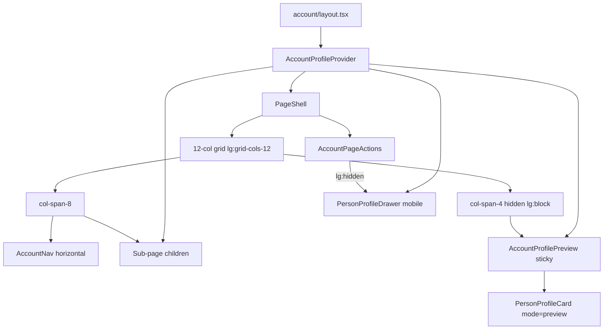

# Account Profile Preview Layout

## Shaping Summary

**Scope:** Rework [`app/(app)/account/layout.tsx`](<app/(app)/account/layout.tsx>) from a 2-column sidebar layout into a **12-column grid**: left **8 cols** (horizontal nav + sub-page content), right **4 cols** (live profile card preview). Convert vertical `AccountNav` to a **left-aligned horizontal tab bar** above sub-pages. Remove **Contact Card** from desktop header actions; keep it on mobile to open the existing drawer.

**Decisions:**

- **Preview mode:** Full WYSIWYG card as others see it; footer actions (Message, Follow, Share, etc.) render but are **disabled/non-functional** in the desktop preview column
- **Live updates:** Shared client state lifts profile-relevant fields from Profile, Tour Credits, and Social sections so the preview reacts as the user edits
- **Breakpoint:** `lg` (1024px) — preview visible and Contact Card hidden at `lg+`; inverse below `lg`
- **Visual references:** User-provided screenshots (contact card, current account form, current sidebar layout)

**Product alignment:** Extends the in-progress My Account hub ([`agent-os/specs/2026-07-30-1807-my-account-page/plan.md`](agent-os/specs/2026-07-30-1807-my-account-page/plan.md)) with a WYSIWYG editing experience before backend wiring.

---

## Architecture



---

## Task 1: Save Spec Documentation

Create `agent-os/specs/2026-07-30-2017-account-profile-preview-layout/` with:

| File            | Contents                                                         |
| --------------- | ---------------------------------------------------------------- |
| `plan.md`       | This plan                                                        |
| `shape.md`      | Scope, WYSIWYG decision, breakpoints, product alignment          |
| `standards.md`  | Full text of `page-shell.md`, `shadcn-ui.md`, `design-tokens.md` |
| `references.md` | Pointers to files below                                          |
| `visuals/`      | Copy the 3 user-provided screenshots from workspace assets       |

**Reference implementations:**

- [`components/people/person-profile-drawer.tsx`](components/people/person-profile-drawer.tsx) — card UI to extract
- [`app/(app)/account/layout.tsx`](<app/(app)/account/layout.tsx>) — current layout to replace
- [`components/account/account-nav.tsx`](components/account/account-nav.tsx) — nav to convert
- [`components/account/account-page-actions.tsx`](components/account/account-page-actions.tsx) — responsive Contact Card toggle
- [`components/ui/tabs.tsx`](components/ui/tabs.tsx) — underline active indicator pattern for horizontal nav
- [`lib/people-data.ts`](lib/people-data.ts) — `Person`, `TourCredit`, `getPersonProfile()` types

---

## Task 2: Extract `PersonProfileCard`

Refactor [`components/people/person-profile-drawer.tsx`](components/people/person-profile-drawer.tsx):

- Extract the card body (hero, meta chips, bio, tour credits, skills, website link, footer actions) into a new **`PersonProfileCard`** at [`components/people/person-profile-card.tsx`](components/people/person-profile-card.tsx)
- Props: `person: Person`, optional `tourCredits?: TourCredit[]` override, `mode: "interactive" | "preview"`, optional `online?: boolean`, optional `className`
- **`mode="preview"`:** footer buttons render with `disabled` + `aria-disabled`; no navigation/share side effects; optional `title="Preview only"` tooltips on action buttons
- **`mode="interactive"`:** current drawer behavior (follow toggle, message routing, share drawers)
- `PersonProfileDrawer` becomes a thin wrapper: `Drawer` shell + `FlyoutDrawerClose` + `PersonProfileCard mode="interactive"`

This avoids duplicating the card markup and ensures mobile drawer and desktop preview stay visually identical.

---

## Task 3: Shared Account Profile State

Add [`components/account/account-profile-provider.tsx`](components/account/account-profile-provider.tsx):

- Client `AccountProfileProvider` wrapping account layout children
- State seeded from `people[0]` (Jordan Reyes) matching existing mocks
- Export `useAccountProfile()` hook returning `{ draft, updateDraft, tourCredits, setTourCredits }`
- `draft` holds editable `Person` fields (name, role, company, homeBase, bio, availability, dates, venueTiers, workAuth, skills, website, avatar, etc.)
- `tourCredits` holds the explicit credits list (from Tour Credits section), passed to `PersonProfileCard` to override `getPersonProfile()` derivation

Add a small helper [`lib/account-profile.ts`](lib/account-profile.ts) with `createInitialAccountDraft()` to centralize seed data (replacing scattered `MOCK` constants over time).

---

## Task 4: Horizontal `AccountNav`

Update [`components/account/account-nav.tsx`](components/account/account-nav.tsx):

**Desktop (`md+`):** Replace vertical `<ul>` with a **horizontal, left-aligned** link row above sub-page content:

- `flex flex-wrap items-center gap-1 border-b border-border pb-0`
- Active link: underline indicator matching shadcn line tabs (`after:` pseudo or `border-b-2 border-primary` on active item)
- Icons + labels retained; `justify-start` (not centered)

**Mobile:** Keep existing `NativeSelect` dropdown (unchanged behavior)

Nav moves **inside** the left 8-col column (above the bordered content card), not in a separate sidebar column.

---

## Task 5: Restructure Account Layout

Update [`app/(app)/account/layout.tsx`](<app/(app)/account/layout.tsx>):

```tsx
// Conceptual structure
<AccountProfileProvider>
  <PageShell title="My Account" ... actions={<AccountPageActions />}>
    <div className="grid grid-cols-1 gap-8 lg:grid-cols-12">
      <div className="flex flex-col gap-4 lg:col-span-8">
        <AccountNav />
        <div className="rounded-xl border ... p-6">{children}</div>
      </div>
      <aside className="hidden lg:col-span-4 lg:block">
        <AccountProfilePreview />
      </aside>
    </div>
  </PageShell>
</AccountProfileProvider>
```

Add [`components/account/account-profile-preview.tsx`](components/account/account-profile-preview.tsx):

- `sticky top-6` wrapper
- `max-h-[calc(100vh-8rem)]` + internal `ScrollArea` so long cards scroll within the sticky column
- Renders `PersonProfileCard mode="preview"` fed from `useAccountProfile()`
- Optional small label above card: "Preview" in muted uppercase (matches section label pattern)

Remove the old `md:grid-cols-[200px_1fr]` sidebar grid and the `lg:max-w-5/6` width constraint on content (full 8-col width is intentional).

---

## Task 6: Responsive Contact Card Button

Update [`components/account/account-page-actions.tsx`](components/account/account-page-actions.tsx):

- **Contact Card button:** add `className="lg:hidden"` — visible only below `lg`
- **PersonProfileDrawer:** read `draft` from `useAccountProfile()` instead of static `people[0]`, so mobile drawer reflects current edits
- **My Profile button:** unchanged (still disabled with tooltip)

---

## Task 7: Wire Form Sections to Shared State

Convert uncontrolled mocks to controlled context updates:

### [`components/account/profile-section.tsx`](components/account/profile-section.tsx)

- Replace local `MOCK` with `useAccountProfile()`
- Controlled `Input`/`Textarea` for name, role, company, homeBase, bio, dates
- Toggle buttons for availability, venue tiers, work auth update `draft` on click
- Skills chips read/write `draft.skills`

### [`components/account/tour-credits-section.tsx`](components/account/tour-credits-section.tsx)

- Replace `MOCK_CREDITS` with `tourCredits` from context
- Add/edit/remove credit actions update `setTourCredits` (keep UI minimal — existing list + add button wired to state)

### [`components/account/social-section.tsx`](components/account/social-section.tsx)

- Wire website field to `draft.website` (shown on card footer link)

Sections that don't affect the card (Jobs, Network, Settings) remain unchanged.

---

## Styling Notes

- Use existing semantic tokens per [`agent-os/standards/css/design-tokens.md`](agent-os/standards/css/design-tokens.md)
- Horizontal nav active state should visually align with shadcn `TabsList variant="line"` underline pattern in [`components/ui/tabs.tsx`](components/ui/tabs.tsx)
- Preview card gets `rounded-xl border border-border bg-background overflow-hidden` to match the form content card
- No new shadcn primitives needed

---

## Verification

- **Desktop (`lg+`):** 8/4 layout; horizontal nav above form; preview updates live when editing Profile fields, tour credits, and website; Contact Card button absent from header; footer actions visible but disabled in preview
- **Mobile (`<lg`):** Single column; no preview column; Contact Card button opens drawer with current draft data
- **Nav:** All 6 routes work; active section highlighted with underline; mobile select unchanged
- **Visual parity:** Desktop preview matches mobile drawer content (same `PersonProfileCard` component)

---

## Out of Scope

- Supabase persistence / server actions
- Avatar upload wiring
- Jobs, Network, Settings affecting the card
- Sticky save-bar or auto-save
