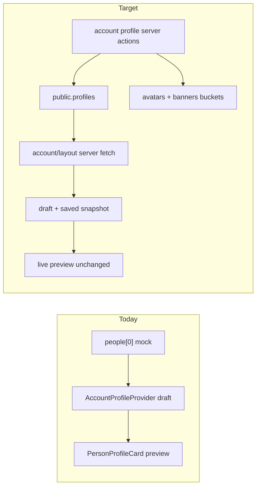

# Account Profile — Supabase Wiring

## Shaping Summary

**Scope:** Persist all Profile form fields to Supabase for the signed-in member. Tour credits shown in the preview panel remain mock data until the Tour Credits sub-page is wired in a later pass.

**Decisions (confirmed):**

- **All Profile fields:** photos, basic info, availability window, venue tiers, work auth, skills
- **Schema:** extend existing [`public.profiles`](supabase/migrations/20260720140000_create_profiles.sql) (1:1 with `auth.users`)
- **Standards:** page-shell, design-tokens, shadcn-ui
- **UX gate:** run a manual smoke checklist after implementation before moving to the next sub-page

**Visual reference:** User screenshot + existing spec at [`agent-os/specs/2026-08-03-1619-profile-photo-banner-upload/`](agent-os/specs/2026-08-03-1619-profile-photo-banner-upload/)

**Current state:**

- Form: [`components/account/profile-section.tsx`](components/account/profile-section.tsx) — edits `draft` via `useAccountProfile()`, Save/Cancel are no-ops
- State: [`components/account/account-profile-provider.tsx`](components/account/account-profile-provider.tsx) — seeded from mock `people[0]`
- DB: `profiles` has `full_name`, `email`, `avatar_url`, `title`, RBAC fields only
- Avatar upload already works via [`lib/users/avatar-actions.ts`](lib/users/avatar-actions.ts) + `avatars` bucket (used on `/settings`, not yet wired to account editors)

---

## Task 1: Save Spec Documentation

Create `agent-os/specs/2026-08-03-1827-account-profile-supabase/` with:

| File             | Contents                                                                     |
| ---------------- | ---------------------------------------------------------------------------- |
| `plan.md`        | This plan                                                                    |
| `shape.md`       | Scope, schema decision, UX gate, product alignment                           |
| `standards.md`   | Full text of page-shell, design-tokens, shadcn-ui                            |
| `references.md`  | Pointers below                                                               |
| `visuals/`       | Copy user screenshot from `.cursor/projects/.../assets/image-1ee39051-*.png` |
| `smoke-check.md` | Manual verification checklist (Task 10)                                      |

**Reference implementations:**

- [`lib/users/avatar-actions.ts`](lib/users/avatar-actions.ts) — storage upload + profile column update pattern
- [`components/users/avatar-upload-field.tsx`](components/users/avatar-upload-field.tsx) — immediate upload + toast + `router.refresh()`
- [`lib/auth/get-session-user.ts`](lib/auth/get-session-user.ts) — server-side profile fetch
- [`lib/auth/require-profile-editor.ts`](lib/auth/require-profile-editor.ts) — self-or-admin auth gate
- [`agent-os/specs/2026-07-20-1356-admin-users-profiles/smoke-check.md`](agent-os/specs/2026-07-20-1356-admin-users-profiles/smoke-check.md) — migration + manual test format

---

## Task 2: Database Migration — Extend Profiles

Add new migration: `supabase/migrations/20260803190000_extend_profiles_member_fields.sql`

**New enums** (snake_case DB values, mapped to UI labels in app code):

| Enum                  | Values                                                            |
| --------------------- | ----------------------------------------------------------------- |
| `member_availability` | `available_now`, `between_tours`, `on_tour`                       |
| `venue_tier`          | `stadium`, `arena`, `festival`, `theater`, `club`                 |
| `work_auth`           | `passport`, `usa`, `canada`, `uk`, `eu`, `australia`, `worldwide` |

**New columns on `public.profiles`:**

| Column               | Type                  | Notes                             |
| -------------------- | --------------------- | --------------------------------- |
| `company`            | `text`                |                                   |
| `home_base`          | `text`                | e.g. "Nashville, TN"              |
| `city`               | `text`                | normalized city for filters/chips |
| `bio`                | `text`                |                                   |
| `years_experience`   | `integer`             | check `>= 0`                      |
| `availability`       | `member_availability` | default `between_tours`           |
| `available_from`     | `date`                | nullable                          |
| `available_to`       | `date`                | nullable                          |
| `venue_tiers`        | `venue_tier[]`        | default `'{}'`                    |
| `work_auth`          | `work_auth[]`         | default `'{}'`                    |
| `skills`             | `text[]`              | default `'{}'`                    |
| `banner_url`         | `text`                | nullable                          |
| `banner_position_y`  | `smallint`            | default `50`, check 0–100         |
| `is_verified`        | `boolean`             | default `false`, admin-set        |
| `is_founding_member` | `boolean`             | default `false`, admin-set        |

**RLS update:** add `profiles_update_own` policy so authenticated users can update their own row. Server actions will only write member-editable columns; `role`, `status`, `email`, `is_verified`, `is_founding_member` remain admin-only (enforced in action code + optional trigger guard).

**Important:** Migration is manual-only (paste into Supabase SQL Editor). Agents must never auto-apply.

---

## Task 3: Database Migration — Banners Storage Bucket

Add `supabase/migrations/20260803191000_create_banners_bucket.sql`

Mirror [`20260728170000_create_avatars_bucket.sql`](supabase/migrations/20260728170000_create_avatars_bucket.sql):

- Public bucket `banners`, 2 MB, JPEG/PNG/WebP
- Path pattern: `{userId}/banner.{ext}`
- Same own-folder + admin policies via `is_admin()`

---

## Task 4: Types and DB ↔ UI Mappers

Add [`lib/account/profile-data.ts`](lib/account/profile-data.ts) (or extend [`lib/users-data.ts`](lib/users-data.ts)) with:

- `MemberProfileRow` — typed select shape for extended profile columns
- `toPersonFromProfile(row)` — maps DB row → [`Person`](lib/people-data.ts) for preview/form
- `toProfileUpdate(draft: Partial<Person>)` — maps form patch → DB update payload (whitelist member-editable fields only)
- Enum mappers: `"Available Now"` ↔ `available_now`, `"Stadium"` ↔ `stadium`, etc.

Keep [`Person`](lib/people-data.ts) as the UI contract so preview components stay unchanged.

---

## Task 5: Server Actions

Add [`lib/account/profile-actions.ts`](lib/account/profile-actions.ts):

| Action                                    | Purpose                                                |
| ----------------------------------------- | ------------------------------------------------------ |
| `getMemberProfile()`                      | Fetch current user's extended profile (used by layout) |
| `updateMemberProfile(payload)`            | Save text/multi-select fields on Save                  |
| `uploadMemberBanner(userId, formData)`    | Upload banner file, update `banner_url`                |
| `removeMemberBanner(userId)`              | Delete storage object, null `banner_url`               |
| `updateBannerPosition(userId, positionY)` | Persist drag reposition                                |

Reuse existing [`uploadUserAvatar`](lib/users/avatar-actions.ts) / [`removeUserAvatar`](lib/users/avatar-actions.ts) for profile photo (already updates `avatar_url`).

**Patterns to follow:**

- Auth via `requireProfileEditor(userId)` (extend error message from "profile photo" to "profile")
- Storage mutations via `createAdminClient()` (matches avatar actions)
- Profile field updates via admin client with explicit column whitelist
- `revalidatePath("/account/profile")`, `revalidatePath("/account", "layout")`, `revalidatePath("/", "layout")`
- Return `{ ok: true } | { ok: false, error: string }` result types

---

## Task 6: Server-Side Data Loading

Update account layout to fetch real profile server-side:

1. Convert [`app/(app)/account/layout.tsx`](<app/(app)/account/layout.tsx>) to async server component
2. Call `getMemberProfile()` (redirect to `/login` if unauthenticated — middleware should already gate)
3. Pass `initialProfile: Person` and `userId: string` into [`AccountLayoutShell`](components/account/account-layout-shell.tsx)

Update [`AccountProfileProvider`](components/account/account-profile-provider.tsx):

- Accept `initialProfile` and `userId` props
- Track `saved` (last persisted) and `draft` (in-progress edits)
- `updateDraft()` unchanged for live preview
- Add `resetDraft()` for Cancel
- Add `commitSaved(next: Person)` after successful save/upload
- Tour credits: keep `createInitialTourCredits()` mock for now

**Empty profile UX:** New users with sparse DB rows get sensible defaults (empty strings, `between_tours`, empty arrays) — not Jordan Reyes mock data.

---

## Task 7: Wire Profile Form Save / Cancel

Update [`components/account/profile-section.tsx`](components/account/profile-section.tsx):

- **Save changes:** call `updateMemberProfile(draft)`, toast on success/error, `commitSaved()` on success, disable button while pending
- **Cancel:** call `resetDraft()` to revert to last saved snapshot
- Use `useTransition` for pending state (per React best practices)
- No layout/visual changes — form structure stays identical

---

## Task 8: Wire Photo Uploads to Supabase

**Avatar** — update [`components/account/avatar-upload-editor.tsx`](components/account/avatar-upload-editor.tsx):

- Accept `userId` prop
- After crop: upload blob via `uploadUserAvatar` (FormData)
- On remove: call `removeUserAvatar`
- Toast + update draft with returned public URL
- Keep crop dialog UX intact

**Banner** — update [`components/account/banner-upload-editor.tsx`](components/account/banner-upload-editor.tsx):

- Accept `userId` prop
- Upload/replace via `uploadMemberBanner`
- Reposition: debounced `updateBannerPosition` on drag end (avoid spamming server)
- Remove via `removeMemberBanner`

Photos persist immediately (matches `/settings` avatar behavior). Text fields persist on Save.

---

## Task 9: Preview Panel Integrity

Verify these still work with real data (no code changes expected if mappers are correct):

- [`AccountProfilePreview`](components/account/account-profile-preview.tsx) — desktop sticky preview
- [`AccountPageActions`](components/account/account-page-actions.tsx) — mobile "Profile Card" drawer
- [`PersonProfileCard`](components/people/person-profile-card.tsx) — `mode="preview"`, disabled actions
- `memberSince` derived from `profiles.created_at`
- `verified` / `founding` read from DB (display-only; admin sets via SQL for now)
- Tour credits section in preview: still mock (`createInitialTourCredits`)

---

## Task 10: UX Smoke Checklist

Add `smoke-check.md` to spec folder. **Stop here and run manually** before Tour Credits pass.

Checklist covers:

1. Apply both migrations in Supabase SQL Editor
2. Sign in as test user; open `/account/profile`
3. **Load:** form shows your real name/title from DB (not Jordan Reyes mock)
4. **Edit basic info:** change name, bio, company → Save → refresh page → values persist
5. **Cancel:** edit fields → Cancel → reverts to saved values
6. **Avatar:** upload, crop, remove — persists after refresh; preview updates live
7. **Banner:** upload, drag reposition, replace, remove — persists after refresh
8. **Availability / tiers / auth / skills:** edit → Save → refresh → persist; preview badges match
9. **Preview UX:** desktop right panel + mobile drawer unchanged; tour credits still show mock data
10. **Regression:** `/settings` avatar upload still works; admin `/users` table unaffected

---

## Out of Scope (Later Passes)

- Tour Credits sub-page persistence
- Jobs, Network, Social, Settings sub-pages
- Sidebar [`AvailabilityCard`](components/availability-card.tsx) toggle (still local mock)
- Public crew profile route (`/crew/[handle]`)
- Admin UI for `is_verified` / `is_founding_member`
- Auto-generated Supabase TypeScript types

---

## Field Mapping Reference

| UI (`Person`)     | DB (`profiles`)                  |
| ----------------- | -------------------------------- |
| `name`            | `full_name`                      |
| `role`            | `title`                          |
| `company`         | `company`                        |
| `homeBase`        | `home_base`                      |
| `city`            | `city`                           |
| `yearsExperience` | `years_experience`               |
| `bio`             | `bio`                            |
| `availability`    | `availability`                   |
| `availableFrom`   | `available_from`                 |
| `availableTo`     | `available_to`                   |
| `venueTiers`      | `venue_tiers`                    |
| `workAuth`        | `work_auth`                      |
| `skills`          | `skills`                         |
| `avatar`          | `avatar_url`                     |
| `banner`          | `banner_url`                     |
| `bannerPositionY` | `banner_position_y`              |
| `verified`        | `is_verified` (read-only)        |
| `founding`        | `is_founding_member` (read-only) |
| `memberSince`     | `created_at` (formatted)         |
