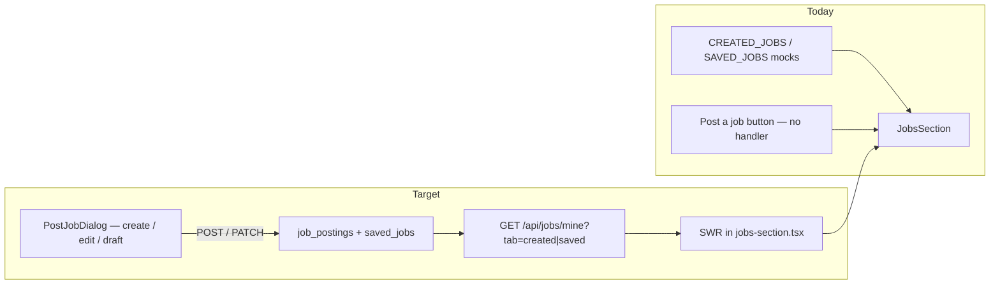

# Account Jobs — Supabase Wiring

## Shaping Summary

**Scope:** Replace mock data on `/account/jobs` with live Supabase data. Wire **Created** (jobs the member posted) and **Saved** (bookmarked jobs) tabs, connect **Post a job** to the existing [`PostJobDialog`](components/jobs/post-job-dialog.tsx), add **Edit** for own postings, and support **Unsave** on the Saved tab.

**Decisions (confirmed):**

- Full pass: Created + Saved + Post + Edit + Unsave
- Add **`draft`** to `job_status` enum; show raw DB status labels in UI (`open`, `draft`, `filled`, `expired`) — not the mock's Active/Closed aliases
- Reuse existing REST + SWR jobs stack (not server actions) for consistency with [`lib/jobs/fetch.ts`](lib/jobs/fetch.ts)
- Reuse `PostJobDialog` on account page with a custom outline trigger matching the mock

**Visuals:** User-provided screenshots (Created tab, Saved tab, Post a role dialog) — saved to spec `visuals/`

**Product alignment:** Jobs are core to AWN's employer/crew marketplace ([`agent-os/product/mission.md`](agent-os/product/mission.md)). Account Jobs completes the "my content" hub started in [`agent-os/specs/2026-07-30-1807-my-account-page/`](agent-os/specs/2026-07-30-1807-my-account-page/).

**Current state:**

| Layer             | Status                                                                                                                                          |
| ----------------- | ----------------------------------------------------------------------------------------------------------------------------------------------- |
| DB                | `job_postings`, `saved_jobs`, RLS — done ([`20260726100000_create_jobs_tables.sql`](supabase/migrations/20260726100000_create_jobs_tables.sql)) |
| Public jobs board | Wired via `/api/jobs` + SWR                                                                                                                     |
| Account page      | Mock-only ([`components/account/jobs-section.tsx`](components/account/jobs-section.tsx))                                                        |
| PostJobDialog     | Wired on `/jobs` only; always publishes as `open`                                                                                               |
| PATCH/DELETE API  | Exist on [`app/api/jobs/[id]/route.ts`](app/api/jobs/[id]/route.ts) but no client helpers or account UI                                         |



---

## Task 1: Save Spec Documentation

Create `agent-os/specs/2026-08-03-2100-account-jobs-supabase/` with:

| File            | Contents                                                             |
| --------------- | -------------------------------------------------------------------- |
| `plan.md`       | This plan                                                            |
| `shape.md`      | Scope, decisions, visuals, product alignment                         |
| `standards.md`  | Full text of page-shell, shadcn-ui, design-tokens, board-pattern     |
| `references.md` | Pointers below                                                       |
| `visuals/`      | Copy user screenshots from `.cursor/projects/.../assets/image-*.png` |

**Reference implementations:**

- [`components/account/jobs-section.tsx`](components/account/jobs-section.tsx) — UI to wire
- [`components/jobs/post-job-dialog.tsx`](components/jobs/post-job-dialog.tsx) — form to reuse
- [`app/api/jobs/route.ts`](app/api/jobs/route.ts) — list/create pattern
- [`app/api/jobs/[id]/route.ts`](app/api/jobs/[id]/route.ts) — PATCH for edit
- [`app/api/jobs/[id]/save/route.ts`](app/api/jobs/[id]/save/route.ts) — unsave toggle
- [`lib/jobs/map.ts`](lib/jobs/map.ts) + [`lib/jobs/fetch.ts`](lib/jobs/fetch.ts) — mapper + client API
- [`agent-os/specs/2026-07-26-2207-jobs-backend/`](agent-os/specs/2026-07-26-2207-jobs-backend/) — original jobs backend spec

---

## Task 2: Migration — Add `draft` Status

Add [`supabase/migrations/20260803210000_add_job_draft_status.sql`](supabase/migrations/20260803210000_add_job_draft_status.sql):

```sql
ALTER TYPE public.job_status ADD VALUE IF NOT EXISTS 'draft';
```

No RLS changes needed — poster already sees own rows regardless of status; public board filters `status = 'open'`; `is_job_open()` excludes drafts from applications.

---

## Task 3: Extend Types and Mapper

Update [`lib/jobs-data.ts`](lib/jobs-data.ts):

- Add `"draft"` to `JobStatus` union
- Add `status: JobStatus` and optional `savedAt?: string` to `Job` interface
- Add optional `status?: JobStatus` to `CreateJobInput`

Update [`lib/jobs/map.ts`](lib/jobs/map.ts):

- Pass through `status` from row
- Accept optional `savedAt` in options for saved-tab rows

Add status badge helper in [`lib/jobs/format.ts`](lib/jobs/format.ts) (or inline in jobs-section):

| Status    | Label   | Style                       |
| --------- | ------- | --------------------------- |
| `open`    | open    | green (matches mock Active) |
| `draft`   | draft   | amber                       |
| `filled`  | filled  | muted                       |
| `expired` | expired | muted                       |

---

## Task 4: Account Jobs API

Add [`app/api/jobs/mine/route.ts`](app/api/jobs/mine/route.ts):

**`GET ?tab=created|saved`**

- Auth via existing [`requireApiUser`](lib/jobs/api-auth.ts)
- **`tab=created`:** `job_postings` where `poster_id = user.id` and `status != 'deleted'`, ordered by `created_at desc`, join poster profile
- **`tab=saved`:** `saved_jobs` joined to `job_postings` where `user_id = user.id` and posting `status != 'deleted'`, ordered by `saved_jobs.created_at desc`; include `saved_at` timestamp per row
- Return `{ jobs: Job[] }` using `mapJobPostingRow`

Add SWR key in [`lib/jobs/swr-keys.ts`](lib/jobs/swr-keys.ts):

```typescript
export function accountJobsKey(tab: "created" | "saved") {
  return `/api/jobs/mine?tab=${tab}`;
}
```

Add client helpers in [`lib/jobs/fetch.ts`](lib/jobs/fetch.ts):

- `fetchMyJobs(tab)` — GET mine endpoint
- `updateJob(jobId, payload)` — PATCH existing route
- Extend `createJob` payload with optional `status: "draft" | "open"`

Update [`app/api/jobs/route.ts`](app/api/jobs/route.ts) POST:

- Accept optional `status` (`draft` | `open`; default `open`)
- Drafts: relax validation to role-only (dates optional); open/urgent: keep current required-field validation
- Urgent posts always publish as `open` (never draft)

---

## Task 5: Refactor PostJobDialog for Reuse

Update [`components/jobs/post-job-dialog.tsx`](components/jobs/post-job-dialog.tsx):

**Composable trigger:**

- Add optional `trigger?: React.ReactNode` prop; fall back to current primary `Button` for `/jobs` board
- Account page passes outline `Button` matching mock

**Edit mode:**

- Add optional `job?: Job` + controlled `open` / `onOpenChange` for Edit flow from account cards
- Prefill form from `job` on open
- Submit calls `updateJob()` instead of `createJob()`
- Title: "Edit role" when editing

**Draft support:**

- Footer actions: **Save draft** (creates/updates with `status: "draft"`, minimal validation) + **Post role →** (creates/updates with `status: "open"`, full validation)
- Editing a draft: **Post role →** publishes (`status: "open"`)

**Cache revalidation:**

- Extend `revalidateJobs()` to also mutate keys matching `/api/jobs/mine`

---

## Task 6: Wire JobsSection

Replace mock data in [`components/account/jobs-section.tsx`](components/account/jobs-section.tsx):

- SWR fetch `accountJobsKey("created")` and `accountJobsKey("saved")` (fetch on tab mount or both upfront — prefer both for tab counts)
- Replace local `Job` interface with shared `Job` from `lib/jobs-data`
- Map card fields from real data:
  - **Title:** `job.role`
  - **Company:** `job.production` (fallback `job.postedBy.name`)
  - **Location:** `job.location`
  - **Date:** Created → `Posted {job.postedAt}`; Saved → `Saved {job.savedAt}`
  - **Badge:** `job.engagement` (replaces mock type badge)
  - **Tier label:** `job.department` uppercase (replaces mock venueTier)
  - **Status pill:** raw DB status on Created tab only
- **Post a job:** render `<PostJobDialog trigger={outline Button} />`
- **Edit:** opens `PostJobDialog` in edit mode for that job
- **Unsave:** calls `toggleSaveJob(job.id)` + revalidates saved tab key; optimistic UI with toast on error
- **Empty states:** dashed border message when tab has 0 jobs
- Loading skeletons while SWR pending

Keep the account-specific card layout (distinct from [`components/jobs/job-card.tsx`](components/jobs/job-card.tsx)) — only swap data source and wire actions.

---

## Task 7: Smoke Check

Manual checklist (document in `smoke-check.md`):

- [ ] Created tab lists jobs posted by signed-in user (all non-deleted statuses)
- [ ] Saved tab lists bookmarked jobs with saved date
- [ ] Post a job opens dialog; Post role creates open listing visible on `/jobs` board
- [ ] Save draft creates draft visible on Created tab but NOT on public board
- [ ] Edit opens prefilled dialog; saving publishes draft or updates fields
- [ ] Unsave removes job from Saved tab
- [ ] Tab counts update after create/save/unsave
- [ ] Status badges show raw DB values with correct colors

---

## Out of Scope (Deferred)

- Applicant review / management UI
- Jobs I applied to tab
- Soft-delete UI for own postings
- Venue tier field (not in schema; using `department` as display substitute)
- Server actions layer for jobs
