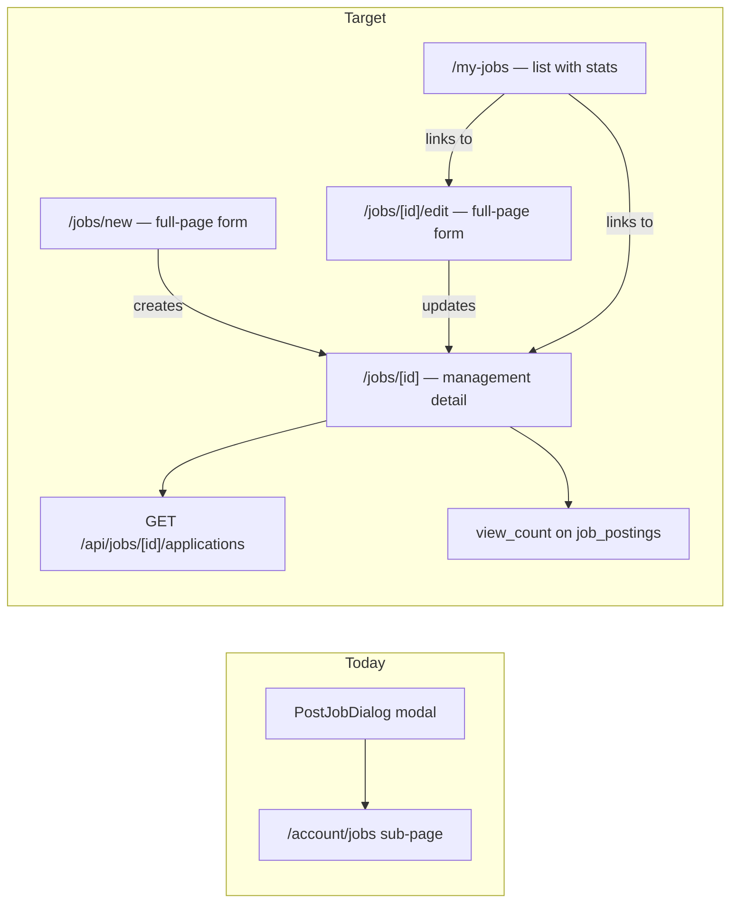

# My Jobs Management Pages

## Shaping Summary

**Scope:** Replace the `/account/jobs` sub-page and `PostJobDialog` modal with three proper full-page routes — a My Jobs list, a full-page Create/Edit form, and a poster-only Job Detail page — all using the two-column shell layout from the Account section.

**Decisions (confirmed):**

- Three new routes: `/my-jobs`, `/jobs/new`, `/jobs/[id]/edit`, `/jobs/[id]`
- Two-column layout (7-col content + 5-col preview) matching `account-layout-shell.tsx`
- `PostJobDialog` modal retired; all "Post a job" CTAs navigate to `/jobs/new`
- `/account/jobs` sub-page deleted; Jobs tab removed from `AccountNav`
- Add `view_count` to `job_postings` for analytics display on the detail page
- New `GET /api/jobs/[id]/applications` endpoint (poster-only)
- Pause = PATCH `{ status: "draft" }`; Duplicate = POST new draft copy → redirect to edit

**Product alignment:** Moves job management from a modal-and-tab flow to first-class full pages, matching the richness of the account profile experience and enabling future analytics expansion.

**Current state:**

| Layer             | Status                                                                                                            |
| ----------------- | ----------------------------------------------------------------------------------------------------------------- |
| DB                | `job_postings`, `job_applications`, `saved_jobs`, RLS — done; no `view_count` yet                                |
| Public jobs board | Wired via `/api/jobs` + SWR ([`components/jobs/jobs-board.tsx`](components/jobs/jobs-board.tsx))                 |
| PostJobDialog     | Modal on `/jobs` board; wired to `createJob`                                                                      |
| Account jobs      | Sub-page at `/account/jobs`; SWR-wired Created + Saved tabs                                                      |
| PATCH/DELETE API  | Exist on [`app/api/jobs/[id]/route.ts`](app/api/jobs/[id]/route.ts)                                             |
| Applications API  | Missing — no `GET /api/jobs/[id]/applications` endpoint                                                           |



---

## Task 1: Save Spec Documentation

Create `agent-os/specs/2026-08-04-1556-my-jobs-management-pages/` with:

| File            | Contents                                                         |
| --------------- | ---------------------------------------------------------------- |
| `plan.md`       | This plan                                                        |
| `shape.md`      | Scope, decisions, product alignment                              |
| `standards.md`  | Full text of page-shell, shadcn-ui, design-tokens, board-pattern, sidebar-nav |
| `references.md` | Pointers to relevant files                                       |
| `visuals/`      | Directory for screenshots (placeholder)                          |

---

## Task 2: DB Migration — Add `view_count`

Add [`supabase/migrations/20260804155600_add_job_view_count.sql`](supabase/migrations/20260804155600_add_job_view_count.sql):

```sql
ALTER TABLE public.job_postings
  ADD COLUMN IF NOT EXISTS view_count integer NOT NULL DEFAULT 0;
```

Update [`lib/jobs-data.ts`](lib/jobs-data.ts):

- Add `view_count: number` to `JobPostingRow`
- Add `viewCount: number` to `Job` interface

Update [`lib/jobs/map.ts`](lib/jobs/map.ts):

- Pass through `view_count` → `viewCount` in `mapJobPostingRow`

---

## Task 3: Applications API

Add [`app/api/jobs/[id]/applications/route.ts`](app/api/jobs/[id]/applications/route.ts):

**`GET /api/jobs/[id]/applications`**

- Auth via `requireApiUser`; verify `poster_id = user.id` on the job (403 if not poster)
- Query `job_applications` joined with `profiles` where `job_id = params.id`
- Return `{ applications: JobApplication[] }` with fields: `id`, `applicantId`, `name`, `avatarUrl`, `appliedAt`, `status`

Add SWR key in [`lib/jobs/swr-keys.ts`](lib/jobs/swr-keys.ts):

```typescript
export function jobApplicationsKey(jobId: string) {
  return `/api/jobs/${jobId}/applications`;
}
```

Add client helper in [`lib/jobs/fetch.ts`](lib/jobs/fetch.ts):

- `fetchJobApplications(jobId)` — GET applications endpoint

---

## Task 4: Job Form Page (Create + Edit)

### Component: `components/jobs/job-form-page.tsx`

Shared two-column layout for both create and edit:

- **Left column (lg:col-span-7):** All form fields from [`components/jobs/post-job-dialog.tsx`](components/jobs/post-job-dialog.tsx) — role, production, department, location, engagement type, compensation, description, dates, urgency toggle, etc.
- **Right column (lg:col-span-5):** Live-updating `<JobCard>` preview, sticky inside the aside
- Submit: `createJob()` (new) or `updateJob(id, payload)` (edit) from [`lib/jobs/fetch.ts`](lib/jobs/fetch.ts) → redirect to `/jobs/[id]`
- Footer actions: **Save draft** (`status: "draft"`) + **Post role →** (`status: "open"`)

### Routes

`app/(app)/jobs/new/page.tsx`:

```tsx
import { JobFormPage } from "@/components/jobs/job-form-page"

export default function NewJobPage() {
  return <JobFormPage mode="create" />
}
```

`app/(app)/jobs/[id]/edit/page.tsx`:

```tsx
import { JobFormPage } from "@/components/jobs/job-form-page"

export default async function EditJobPage({ params }: { params: { id: string } }) {
  // Fetch job server-side; 404 or 403 if not poster
  return <JobFormPage mode="edit" jobId={params.id} />
}
```

---

## Task 5: My Jobs Page

### Component: `components/jobs/my-jobs-board.tsx`

Client board for `/my-jobs`:

- SWR fetch from `GET /api/jobs/mine?tab=created`
- Header: "My Jobs" title + "Post a job" button → `/jobs/new`
- List of `<MyJobListItem>` per job
- Loading skeletons; empty state with dashed border + "No jobs yet" + "Post your first job" CTA

### Component: `components/jobs/my-job-list-item.tsx`

Row/card for each job showing:

- **Role** (title), **Production** (subtitle), **Status badge** (open/draft/filled/expired)
- **Engagement type** badge, **view_count** (👁 N), **application count** (👤 N), **posted date**
- Action row: **Edit** → `/jobs/[id]/edit` | **Pause** (PATCH `{ status: "draft" }`) | **Duplicate** (POST copy as draft → redirect to `/jobs/[id]/edit`)

### Route: `app/(app)/my-jobs/page.tsx`

```tsx
import { MyJobsBoard } from "@/components/jobs/my-jobs-board"

export default function MyJobsPage() {
  return <MyJobsBoard />
}
```

---

## Task 6: Job Detail Management Page

### Component: `components/jobs/job-management-detail.tsx`

Left column for `/jobs/[id]` (poster-only view):

- Stat cards: **Views** (`view_count`), **Applications** (count), **Status** badge
- Applicant list: SWR fetch from `GET /api/jobs/[id]/applications`
  - Each row: avatar, name, applied date, application status badge
- Action bar: **Edit** → `/jobs/[id]/edit` | **Pause/Unpause** | **Duplicate**

### Route: `app/(app)/jobs/[id]/page.tsx`

Two-column layout — left: `<JobManagementDetail>` (poster) or redirect to public drawer (non-poster), right: `<JobCard>` preview.

Increment `view_count` on non-poster fetch (PATCH to dedicated increment endpoint or on `GET /api/jobs/[id]` with poster exclusion).

---

## Task 7: Navigation

- Add `My Jobs` to `mainNav` in [`lib/nav.ts`](lib/nav.ts), pointing to `/my-jobs`, icon `Briefcase`
- Remove Jobs tab entry from `components/account/account-nav.tsx`

---

## Task 8: Cleanup

- Delete `app/(app)/account/jobs/page.tsx`
- Update `app/(app)/jobs/page.tsx` — "Post a job" button navigates to `/jobs/new` (remove `PostJobDialog` import)
- Update `components/account/jobs-section.tsx` — remove `PostJobDialog` usage; repurpose as saved-jobs-only view or retire entirely
- Remove unused `PostJobDialog` trigger from account shell if no longer needed

---

## Out of Scope (Deferred)

- Soft-delete UI for own postings
- Application status management (accept/reject)
- Jobs I applied to tab on `/my-jobs`
- Analytics charts / time-series views
- Email notifications on new applications
