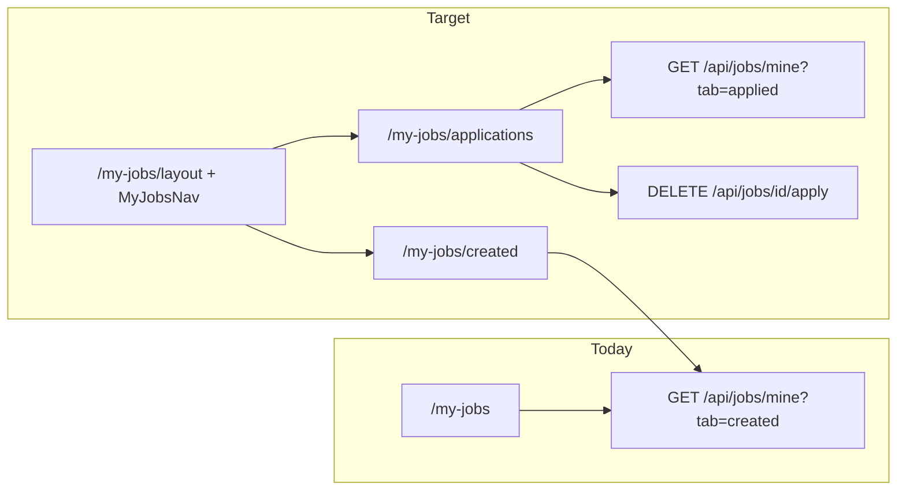

# My Jobs — Created + Applications Tabs

## Shaping Summary

**Scope:** Extend `/my-jobs` with two tabbed sections so users can see jobs they've posted and jobs they've applied to. Follow the My Account tabbed navpage pattern ([`components/account/account-nav.tsx`](components/account/account-nav.tsx)).

**Decisions (confirmed):**

- Tab labels: **My Jobs** (`/my-jobs/created`) and **My Applications** (`/my-jobs/applications`)
- Routing: path-based sub-routes; `/my-jobs` redirects to `/my-jobs/created`
- Application cards: job details + application status badge + **Withdraw** action
- View job: open existing `JobDetailDrawer` (not `/jobs/[id]`, which is poster-only management)

**Visuals provided:**

- Current My Jobs page (created jobs grid)
- My Account tab nav pattern (pill buttons, active = `secondary`, inactive = `outline`)

**Product alignment:** Roadmap lists "apply with profile, employer shortlist" — applicants need a place to track submissions. Deferred in prior spec ([`agent-os/specs/2026-08-04-1556-my-jobs-management-pages/plan.md`](agent-os/specs/2026-08-04-1556-my-jobs-management-pages/plan.md)) as out of scope; now in scope.

**Gap today:**



---

## Task 1: Save Spec Documentation

Create `agent-os/specs/2026-08-11-2005-my-jobs-applications-tabs/` with:

| File            | Contents                                                  |
| --------------- | --------------------------------------------------------- |
| `plan.md`       | This plan                                                 |
| `shape.md`      | Scope, routing/tab decisions, withdraw + drawer decisions |
| `standards.md`  | Full text of `page-shell`, `board-pattern`, `shadcn-ui`   |
| `references.md` | AccountNav, MyJobsBoard, apply route, job-detail-drawer   |
| `visuals/`      | Copy provided screenshots                                 |

---

## Task 2: Extend API — Fetch User's Applications

Extend [`app/api/jobs/mine/route.ts`](app/api/jobs/mine/route.ts) to accept `tab=applied`:

- Query `job_applications` where `applicant_id = user.id` and `status != 'withdrawn'`
- Join `job_postings` + poster profile (reuse existing `JOB_SELECT`)
- Order by `job_applications.created_at DESC`
- Return `{ jobs: AppliedJob[] }` where each job includes nested `application: { id, status, appliedAt, note }`

Add types in [`lib/jobs/fetch.ts`](lib/jobs/fetch.ts):

```typescript
export type AppliedJob = Job & {
  application: {
    id: string;
    status: ApplicationStatus;
    appliedAt: string;
    note: string;
  };
};
```

Add client helper `fetchMyApplications()` and SWR key `myApplicationsKey` in [`lib/jobs/swr-keys.ts`](lib/jobs/swr-keys.ts).

---

## Task 3: Add Withdraw Client Helper

Add to [`lib/jobs/fetch.ts`](lib/jobs/fetch.ts):

```typescript
export async function withdrawFromJob(jobId: string): Promise<void>;
```

Calls existing `DELETE /api/jobs/[id]/apply` ([`app/api/jobs/[id]/apply/route.ts`](app/api/jobs/[id]/apply/route.ts)). No API changes needed.

---

## Task 4: My Jobs Layout Shell + Nav

Create [`components/jobs/my-jobs-nav.tsx`](components/jobs/my-jobs-nav.tsx) — clone [`AccountNav`](components/account/account-nav.tsx):

| Tab             | Route                   | Icon                 |
| --------------- | ----------------------- | -------------------- |
| My Jobs         | `/my-jobs/created`      | `Briefcase`          |
| My Applications | `/my-jobs/applications` | `FileText` or `Send` |

Same responsive pattern: `NativeSelect` on mobile, `Button` + `Link` pill nav on desktop, `usePathname()` for active state.

Create [`components/jobs/my-jobs-layout-shell.tsx`](components/jobs/my-jobs-layout-shell.tsx):

- `PageShell` with title "My Jobs", shared description, and **Post a job** action (visible on both tabs)
- `MyJobsNav` below header
- `{children}` content area (no Account-style preview column)

Add [`app/(app)/my-jobs/layout.tsx`](app/(app)/my-jobs/layout.tsx) wrapping children in `MyJobsLayoutShell`.

Update [`app/(app)/my-jobs/page.tsx`](app/(app)/my-jobs/page.tsx) to redirect to `/my-jobs/created`.

---

## Task 5: Split Created Jobs into Sub-route

- Add [`app/(app)/my-jobs/created/page.tsx`](app/(app)/my-jobs/created/page.tsx) rendering `CreatedJobsSection`
- Refactor [`components/jobs/my-jobs-board.tsx`](components/jobs/my-jobs-board.tsx) → extract `CreatedJobsSection` (grid, skeletons, empty state, count). Remove `PageShell` wrapper (now in layout shell).
- Keep [`MyJobListItem`](components/jobs/my-job-list-item.tsx) unchanged; update SWR `mutate(myJobsKey)` references if key path changes.

---

## Task 6: Build Applications Section + Card

Add [`app/(app)/my-jobs/applications/page.tsx`](app/(app)/my-jobs/applications/page.tsx) rendering `ApplicationsSection`.

Create [`components/jobs/my-application-list-item.tsx`](components/jobs/my-application-list-item.tsx):

- Reuse job card visual language from `MyJobListItem` / `JobCard` (badges, role, production, location, pay, dates)
- Show **application status badge** using existing [`applicationStatusStyles`](lib/jobs/format.ts)
- Show "Applied {relative date}" timestamp
- **Withdraw** button with confirm dialog → `withdrawFromJob()` → `mutate(myApplicationsKey)` + toast
- Card click opens `JobDetailDrawer` for read-only job details (applicant view)

Create [`components/jobs/applications-section.tsx`](components/jobs/applications-section.tsx):

- SWR fetch via `fetchMyApplications()`
- Same responsive grid as created jobs
- Empty state: dashed border, icon, "You haven't applied to any jobs yet" + link to `/jobs` board
- Loading skeletons matching created tab

---

## Task 7: Update Nav Links

Ensure existing `/my-jobs` links still work via redirect. No changes required to [`lib/nav.ts`](lib/nav.ts) or [`components/nav-user.tsx`](components/nav-user.tsx) (both point to `/my-jobs`).

Update back-links in [`components/jobs/job-form-page.tsx`](components/jobs/job-form-page.tsx) from `/my-jobs` → `/my-jobs/created` if desired for consistency (optional, redirect handles either).

---

## Out of Scope

- Application status updates by poster (accept/reject) — read-only badge for applicants
- Saved jobs tab (API supports `tab=saved` but not requested)
- Re-apply flow after withdraw (API supports it; no special UI beyond applying again from jobs board)

---

## Test Plan

- Visit `/my-jobs` → redirects to `/my-jobs/created`; existing created jobs grid loads
- Tab to **My Applications** → URL is `/my-jobs/applications`; applied jobs list loads with status badges
- Click application card → `JobDetailDrawer` opens with job details
- Withdraw an application → card removed from list; job shows as not-applied on public board
- Mobile: tab dropdown switches sections correctly
- Empty states render for both tabs when user has no jobs/applications
