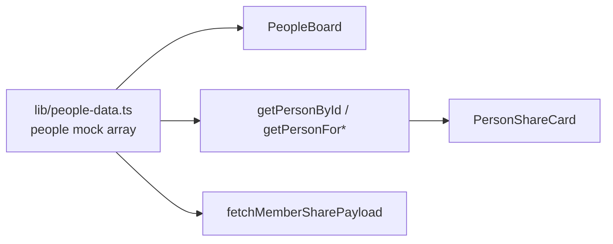
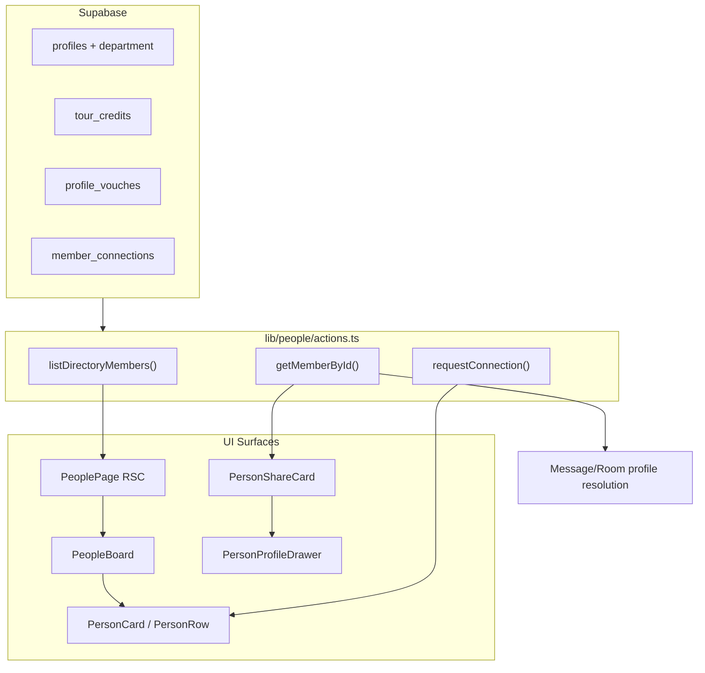

# Wire People Directory to Real User Base

## Shaping Summary

| Decision       | Choice                                                                                                                                  |
| -------------- | --------------------------------------------------------------------------------------------------------------------------------------- |
| Data source    | Supabase `profiles` table (active members only)                                                                                         |
| Missing fields | **Add schema now**: `department`, `tour_credits`, `profile_vouches`, `member_connections`                                               |
| Mock data      | **Remove entirely** — no `people[]` fallback anywhere                                                                                   |
| Card surfaces  | Grid `PersonCard`, list `PersonRow`, `PersonProfileCard` drawer, `PersonShareCard` (preview + message), message/room profile resolution |
| Fetch pattern  | RSC initial load (like [app/(app)/users/page.tsx](<app/(app)/users/page.tsx>)) + server actions returning `{ ok, data, error }` unions  |
| Migrations     | Manual-only — paste into Supabase SQL Editor (project convention)                                                                       |

**Visuals provided:** Find people grid, share card in chat, card variant comparison (compact/list/full drawer) — save to spec `visuals/`.

**Product alignment:** Supports P1 **People + trust graph** from [agent-os/product/mission.md](agent-os/product/mission.md) — real availability, peer vouches, and connections on member cards.

---

## Current State



- [components/people/people-board.tsx](components/people/people-board.tsx) imports static `people[]` and filters client-side
- [lib/account/profile-data.ts](lib/account/profile-data.ts) already maps DB rows → `Person` via `toPersonFromProfile()`, but hardcodes `department: ""`, `credits: 0`, `vouches: 0`, `followed: false`
- [lib/messages/actions.ts](lib/messages/actions.ts) `fetchMemberSharePayload` only selects 4 profile columns and falls back to mock
- [lib/people-data.ts](lib/people-data.ts) `getPersonProfile()` synthesizes bio/tour credits from `topTours` mock fields

---

## Target Architecture



---

## Task 1: Save Spec Documentation

Create `agent-os/specs/2026-08-15-1440-people-directory-supabase/` with:

- **plan.md** — this plan
- **shape.md** — scope, decisions (full schema, remove all mock), product alignment
- **standards.md** — [board-pattern](agent-os/standards/global/board-pattern.md), [page-shell](agent-os/standards/global/page-shell.md), server-action conventions from prior specs
- **references.md** — pointers to account profile wiring, users page RSC pattern, member share spec
- **visuals/** — copy the 4 provided screenshots
- **smoke-check.md** — manual verification checklist

---

## Task 2: Database Migration

New migration e.g. `supabase/migrations/20260815160000_people_directory_fields.sql`:

**Extend `profiles`:**

- `department text` — matches job department taxonomy (Production, Audio, Lighting, etc.)

**New tables:**

```sql
-- Tour credits (card "credits" count = row count)
tour_credits (
  id uuid PK,
  profile_id uuid FK → profiles,
  title text NOT NULL,
  artist text,
  role text NOT NULL,
  venue_tier venue_tier,
  years text,
  sort_order int DEFAULT 0,
  created_at timestamptz
)

-- Profile-level vouches ("I'd work with this person again")
profile_vouches (
  id uuid PK,
  vouchee_id uuid FK → profiles,
  voucher_id uuid FK → profiles,
  created_at timestamptz,
  UNIQUE (vouchee_id, voucher_id)
)

-- Connections (Connect / Connected / Follow state)
member_connections (
  id uuid PK,
  requester_id uuid FK → profiles,
  recipient_id uuid FK → profiles,
  status connection_status ('pending' | 'accepted' | 'ignored'),
  created_at timestamptz,
  UNIQUE (requester_id, recipient_id)
)
```

**RLS policies:**

- `tour_credits`: owner CRUD own rows; all authenticated can SELECT active members' credits
- `profile_vouches`: authenticated INSERT (self as voucher); SELECT all; DELETE own vouch
- `member_connections`: requester INSERT; either party SELECT; recipient UPDATE status (accept/ignore)

**Indexes:** `profile_id` on tour_credits, `vouchee_id` on profile_vouches, `(requester_id, recipient_id)` on connections

**Optional backfill:** derive `department` from existing `title` using `departmentByRole` mapping in [lib/jobs-data.ts](lib/jobs-data.ts) (app-side backfill script or one-time SQL CASE)

---

## Task 3: Types and Mapping Layer

**Extend** [lib/account/profile-data.ts](lib/account/profile-data.ts):

- Add `department` to `MemberProfileRow`, `MemberProfileUpdate`, `MEMBER_PROFILE_SELECT`
- Add `DirectoryMemberRow` type with joined aggregates:
  - `tour_credit_count`, `vouch_count`
  - `connection_status` relative to session user (`none | pending_sent | pending_received | connected`)
- Update `toPersonFromProfile()` to accept optional counts + connection state instead of hardcoding zeros
- Add `toTourCreditsFromRows()` mapping DB tour credit rows → `TourCredit[]`
- Add `departmentFromTitle(title)` helper using `departmentByRole` as fallback when `department` column is null

**Refactor** [lib/people-data.ts](lib/people-data.ts):

- **Remove** `people[]` mock array and per-person mock profile data
- **Keep** shared types (`Person`, `Availability`, filter constants, `availabilityConfig`, `initials`)
- Update `getPersonProfile(person, tourCredits?)` to use real `tourCredits` param; remove `topTours`-based synthesis; keep bio fallback only when `person.bio` is empty

---

## Task 4: People Server Actions

New [lib/people/actions.ts](lib/people/actions.ts):

| Action                           | Purpose                                                                                                       |
| -------------------------------- | ------------------------------------------------------------------------------------------------------------- |
| `listDirectoryMembers()`         | SELECT active profiles with `MEMBER_PROFILE_SELECT` + department + counts + connection state for current user |
| `getMemberById(id)`              | Single member with tour credits, counts, connection state — used by drawers and share card hydration          |
| `requestConnection(recipientId)` | Insert pending connection or accept if reciprocal pending                                                     |
| `removeConnection(recipientId)`  | Delete accepted connection                                                                                    |

Follow existing patterns from [lib/messages/actions.ts](lib/messages/actions.ts) and [lib/users/actions.ts](lib/users/actions.ts):

- `"use server"` + `createClient()` + session check
- Return `{ ok: true, ... } | { ok: false, error: string }`

**Query approach:** Supabase select with embedded counts via `.select('*, tour_credits(count), profile_vouches(count)')` or a small RPC if joins get unwieldy.

---

## Task 5: Wire People Page (RSC + Board)

**Update** [app/(app)/people/page.tsx](<app/(app)/people/page.tsx>):

```tsx
const result = await listDirectoryMembers()
return (
  <PageShell ...>
    <PeopleBoard
      initialPeople={result.ok ? result.people : []}
      loadError={result.ok ? null : result.error}
    />
  </PageShell>
)
```

**Update** [components/people/people-board.tsx](components/people/people-board.tsx):

- Accept `initialPeople: Person[]` prop instead of importing mock
- Keep existing client-side filter logic (search, department, availability, city, date window, venue tier, work auth)
- Derive dynamic `cityOptions` from loaded people (union with existing preset list) so "Other" filter works with real data
- Show error banner when `loadError` is set

---

## Task 6: Wire All Card Variations

### Grid + List cards

[components/people/person-card.tsx](components/people/person-card.tsx) and [components/people/person-row.tsx](components/people/person-row.tsx):

- Connect/Connect button calls `requestConnection()` server action instead of local-only toggle
- Initialize `followed`/`connected` from `person.followed` (mapped from DB connection state)

### Profile drawer

[components/people/person-profile-card.tsx](components/people/person-profile-card.tsx):

- Accept `tourCredits` from parent (fetched with member)
- Follow/Connect button wired to server action
- Remove dependency on mock `getPersonProfile()` tour credit synthesis

[components/people/person-profile-drawer.tsx](components/people/person-profile-drawer.tsx):

- Optionally lazy-fetch full profile via `getMemberById()` when opened if list payload is slim

### Share card (preview + message)

[lib/messages/actions.ts](lib/messages/actions.ts) — expand `fetchMemberSharePayload` / `resolveMemberShareForInsert`:

- Select full directory fields: department, home_base, availability, skills, years_experience, counts
- Map via extended `personToSharePayload()`
- **Remove** `people.find()` mock fallback

[components/people/person-share-card.tsx](components/people/person-share-card.tsx):

- Remove `getPersonById` mock lookup
- Include `skills` in `MemberSharePayload` (extend type in [lib/messages-data.ts](lib/messages-data.ts))
- On drawer open, fetch full profile via `getMemberById()` for complete tour credits + bio

### Messages / Rooms profile resolution

[lib/messages-data.ts](lib/messages-data.ts):

- Remove `people` import and `getPersonById()`
- Replace `getPersonForConversation()` / `getPersonForRoomMessage()` synthetic fallbacks with async profile fetch (move to server action or pass resolved person from thread loader)

Update thread loaders in [components/messages/message-thread.tsx](components/messages/message-thread.tsx) and [components/rooms/room-thread.tsx](components/rooms/room-thread.tsx) to call `getMemberById()` when opening profile drawer.

---

## Task 7: Account Profile Alignment

**Update** [lib/account/profile-actions.ts](lib/account/profile-actions.ts) and account form:

- Persist `department` on profile save (dropdown from job department list)
- Load tour credits from `tour_credits` table in account layout or tour-credits page

**Update** [lib/account-profile.ts](lib/account-profile.ts):

- Remove `createInitialAccountDraft()` mock copy from `people[0]`
- Remove mock `createInitialTourCredits()` — load from DB

---

## Task 8: Remove Mock Dependencies

Delete or refactor all remaining imports of mock `people`:

| File                                                                           | Change                                       |
| ------------------------------------------------------------------------------ | -------------------------------------------- |
| [lib/people-data.ts](lib/people-data.ts)                                       | Remove `people[]`; keep types/constants      |
| [lib/messages-data.ts](lib/messages-data.ts)                                   | Remove mock resolution helpers               |
| [lib/messages/actions.ts](lib/messages/actions.ts)                             | Remove mock fallback in share payload        |
| [lib/account-profile.ts](lib/account-profile.ts)                               | Remove mock initializers                     |
| [components/messages/messages-view.tsx](components/messages/messages-view.tsx) | Use `getMemberById` for `?person=` deep link |

Grep for `from "@/lib/people-data"` and `people.find` to verify zero mock references remain.

---

## Task 9: Smoke Check

Manual verification checklist:

- [ ] Find people page shows real active profiles (not 12 mock names)
- [ ] Grid and list views render real avatars, roles, locations, availability, skills
- [ ] Department filter works against real `department` values
- [ ] Credits/vouches/years stats reflect DB counts
- [ ] Connect button persists connection state across refresh
- [ ] Profile drawer shows real bio, tour credits, skills
- [ ] Share card in DM thread shows full member data (not sparse fallback)
- [ ] Share card click opens drawer with real profile
- [ ] Message thread header profile drawer loads real data
- [ ] Account profile department saves and appears on own card
- [ ] No console errors referencing missing mock person IDs

---

## Key Files

| Area      | Files                                                                                   |
| --------- | --------------------------------------------------------------------------------------- |
| Migration | `supabase/migrations/20260815160000_people_directory_fields.sql`                        |
| Actions   | `lib/people/actions.ts` (new)                                                           |
| Mapping   | `lib/account/profile-data.ts`, `lib/people-data.ts`                                     |
| Page      | `app/(app)/people/page.tsx`, `components/people/people-board.tsx`                       |
| Cards     | `person-card.tsx`, `person-row.tsx`, `person-profile-card.tsx`, `person-share-card.tsx` |
| Messages  | `lib/messages/actions.ts`, `lib/messages-data.ts`, `message-thread.tsx`                 |

## Risks and Notes

- **Empty directory in dev:** If few profiles have filled member fields, cards may look sparse until members complete profiles — acceptable; empty state already exists
- **Connection UX scope:** Full request/accept/ignore inbox is deferred; this pass wires the Connect button to persist `member_connections` with accepted state for mutual connects
- **Tour credit vouches:** Per-credit vouch buttons in profile drawer can remain UI-only until a follow-up pass; profile-level `profile_vouches` drives the card count
- **Migration execution:** Agent creates SQL file only; user runs manually in Supabase Dashboard
