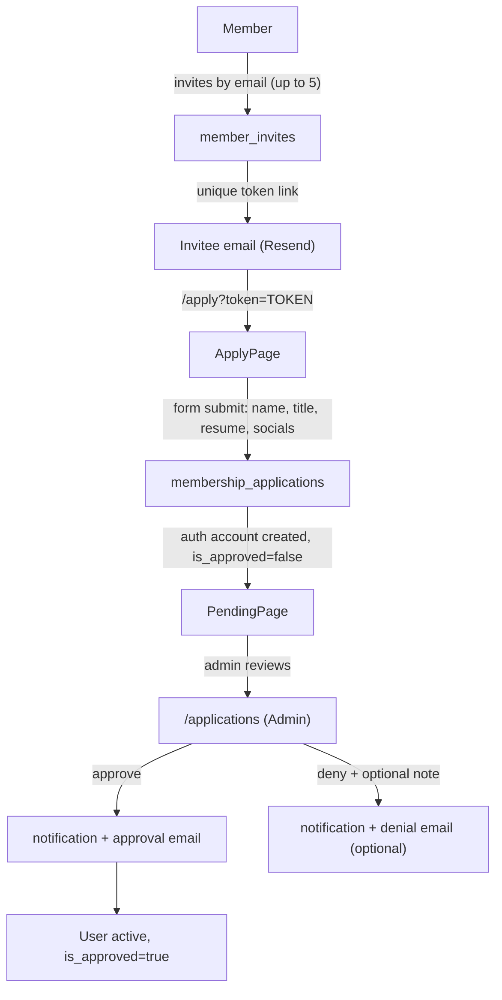

# Member Invites — Plan

## What We're Building

A complete invite-only membership onboarding loop:

1. **Members** invite specific people by email (up to 5 slots) — managed via a drawer on the People page.
2. **Invitees** receive an email, complete a credential + application form (name, title, resume, social links), and can check their status while they wait.
3. **Admins** review applications in the `/applications` page — see the inviter, click social links, view the resume, and approve or deny with an optional note.
4. **Notifications** are bootstrapped from static mock data to a real Supabase-backed system, starting with invite-accepted and application-denied events.

## Shaping Decisions (Locked)

- **Invite mechanism:** Direct email invites only — unique token link per invite (`/apply?token=TOKEN`). Personal shareable codes deferred.
- **Invite limit:** 5 email slots per member; rescinding returns the slot
- **Member UI:** Drawer on People page, triggered from PageShell `actions`
- **Signup:** Password credentials at apply time; magic link login-only
- **Approval gate:** `is_approved` on profiles; unapproved users → `/pending`
- **Email:** Resend for transactional emails
- **Notifications:** Full DB infrastructure, invite events first

## Visuals

- `visuals/admin-invites-placeholder.png` — current `/invites` placeholder
- `visuals/admin-applications-placeholder.png` — current `/applications` placeholder
- `visuals/people-page-header.png` — People page where Invite button will live

## Architecture Overview



## Database Migrations

Three new tables + changes to `profiles`:

### `member_invites`

Tracks per-email invites sent by members:

- `id`, `inviter_id` (FK → `profiles`), `invitee_email`, `token` (unique URL token), `status` (`pending | accepted | rescinded | expired`), `application_id` (FK → `membership_applications`, set on submit), `sent_at`, `rescinded_at`, `accepted_at`
- Unique constraint: `(inviter_id, invitee_email)` — one active invite per email per member
- RLS: member can read/update own rows; admin can read all

### `membership_applications`

Invitee's application form data:

- `id`, `invite_id` (FK → `member_invites`), `invitee_user_id` (FK → `auth.users`, set on auth account creation), `full_name`, `email`, `title`, `resume_url` (Supabase Storage), `social_links` (JSONB: `{linkedin, instagram, twitter, youtube, website}`), `status` (`pending | approved | denied`), `admin_note` (text, nullable), `note_visibility` (`invitee_only | both`, nullable), `reviewed_by` (FK → `profiles`), `reviewed_at`, `created_at`, `updated_at`
- RLS: invitee can read own row; admin can read/update all

### `notifications`

Real backend for the existing notifications panel:

- `id`, `user_id` (FK → `profiles`), `kind` (text — extends existing `NotificationKind`), `title`, `body`, `data` (JSONB for links/IDs), `read` (boolean, default false), `created_at`
- RLS: user can only read/update own notifications
- Index on `(user_id, read, created_at DESC)`

### `profiles` changes

- Add `is_approved boolean not null default false`
- Backfill migration: set `is_approved = true` for all currently `active` profiles
- Add `pending` to the `user_status` enum (used for invited-not-yet-approved state)

## Key Files to Create / Modify

### New server actions

- `lib/invites/actions.ts` — `sendInvite`, `rescindInvite`, `listMyInvites`, `getInviteByToken`
- `lib/applications/actions.ts` — `submitApplication`, `approveApplication`, `denyApplication`, `getApplicationStatus`
- `lib/notifications/actions.ts` — `listNotifications`, `markRead`, `markAllRead`, `createNotification`

### New email utilities (after Resend install)

- `lib/email/send.ts` — Resend client wrapper
- `lib/email/templates/` — invite email, application confirmation, approval, denial

### New public routes (outside `(app)` layout)

- `app/apply/page.tsx` — invite landing + credential + application form (token via query param)
- `app/pending/page.tsx` — application status view for authenticated-but-unapproved users

### Modified routes

- `app/(app)/people/page.tsx` — add `InviteDrawer` trigger button to `PageShell` actions
- `app/(app)/invites/page.tsx` — replace placeholder with admin invites overview
- `app/(app)/applications/page.tsx` — replace placeholder with `ApplicationsTable`
- `middleware.ts` / `lib/supabase/middleware.ts` — add `is_approved` gate; redirect unapproved-but-authenticated users to `/pending`
- `components/notifications.tsx` — replace static mock data with `listNotifications` server fetch + SWR

### New components

- `components/invites/invite-drawer.tsx` — member invite management drawer (email form + invite list + rescind)
- `components/applications/applications-table.tsx` — admin review table
- `components/applications/application-review-panel.tsx` — slide-over with social links, resume view, approve/deny form
- `components/applications/deny-dialog.tsx` — denial note + note visibility toggle

## Auth / Middleware Flow Change

Current: unauthenticated → `/login`. No other checks.

New:

```
authenticated + is_approved = false → /pending
  (allow through: /pending, /apply/*, /auth/callback, /api/*)
```

Supabase account for the invitee is created at form submission time (`admin.auth.admin.createUser` with `email_confirm: true`). Profile stub is created immediately with `is_approved = false`. This lets them log back in to check status at `/pending`.

## Notifications Infrastructure

Existing `components/notifications.tsx` is fully built UI-only with static data from `lib/notifications-data.ts`. Changes:

- `notifications` DB table (see above)
- `lib/notifications/actions.ts` replaces the static array
- Panel switches from local state to SWR-based fetch (following the pattern in `lib/messages/`)
- Add `invite` to `NotificationKind`; add icon mapping

Notification events wired in this spec:

- `invite_accepted` → sent to the member when their invitee's application is **approved**
- `application_denied` → sent to the member when their invitee's application is **denied** (only if `note_visibility` includes inviter)

## Email (Resend)

Resend is listed in the tech stack doc but not installed. Install it as part of this spec. Four transactional emails:

| Trigger | Recipient | Content |
|---------|-----------|---------|
| Member sends invite | Invitee | Invite email with CTA button → `/apply?token=TOKEN` |
| Invitee submits application | Invitee | Confirmation email with link to `/pending` |
| Admin approves | Invitee | Approval email with login link (→ `/login`) |
| Admin denies (note visible) | Invitee + optionally inviter | Denial email with admin note |

## Member Invites Drawer

Triggered by an "Invite" button in the `PageShell` actions slot on the People page.

Drawer contents:

1. **Invite by email** — input field + send button; shows remaining slots (e.g. "3 of 5 remaining"); disabled when all 5 slots are used
2. **Your invites list** — each invite shows invitee email, status badge (`Pending / Accepted / Rescinded`), sent date, and a "Rescind" button for pending invites that haven't resulted in an accepted application

## Admin Applications Page

Replaces the placeholder at `/applications`.

Table columns: invitee name, email, title, invited by (member name), submitted date, status badge.

Clicking a row opens `ApplicationReviewPanel`:

- Invitee info (name, title, email)
- Social links — each rendered as a clickable icon that opens in a new tab
- Resume — rendered in an iframe or using `<object>` for PDF view (Supabase Storage signed URL)
- Invited by — member name + avatar
- Approve button
- Deny button → opens `DenyDialog`:
  - Textarea for optional note
  - Visibility toggle: "Notify invitee only" / "Notify invitee and inviter"

## Admin Invites Page

Replaces the placeholder at `/invites`. Admin-only view showing all member invites across the network:

- Table: inviter name, invitee email, status, sent date, application link (if submitted)
- Filter by status
- No create/manage here (this is admin visibility; members manage from the drawer)

## Phasing Notes

Everything in this spec is **Phase 1** (MVP for the invite loop). These are explicitly deferred:

- Personal shareable invite codes (`/apply?code=CODE`)
- Waitlist (`/apply` without a token)
- Employer path (`/hire`)
- Onboarding wizard post-approval
- Resend application (admin re-send magic link)
- Push/browser notifications
- Full `/notifications` page

---

## Tasks

### Task 1: Save spec documentation ✅

Create `agent-os/specs/2026-08-26-1710-member-invites/` with plan.md, shape.md, standards.md, references.md, visuals/.

### Task 2: Database migrations

`member_invites`, `membership_applications`, `notifications` tables; profiles changes (`is_approved`, `pending` status). Write SQL only — do not run.

### Task 3: Notifications infrastructure

`lib/notifications/actions.ts`; update `components/notifications.tsx` from mock to real DB + SWR fetch; add `invite` kind.

### Task 4: Email setup

Install Resend; `lib/email/send.ts`; email templates (invite, confirmation, approval, denial).

### Task 5: Invite server actions

`lib/invites/actions.ts` — `sendInvite`, `rescindInvite`, `listMyInvites`, `getInviteByToken`.

### Task 6: Invitee apply flow

`app/apply/page.tsx` (token validation, credential form, application form, resume upload, social links); `app/pending/page.tsx`; middleware `is_approved` gate.

### Task 7: Member Invites Drawer

`components/invites/invite-drawer.tsx`; wire to People page PageShell actions button.

### Task 8: Admin Applications page

`ApplicationsTable`, `ApplicationReviewPanel` (social links, resume view, inviter info), `DenyDialog` with note visibility toggle, approve/deny actions.

### Task 9: Admin Invites page

Replace placeholder with all-invites overview table.

### Task 10: Wire notification events

`invite_accepted` fires on approval; `application_denied` fires on denial when `note_visibility` includes inviter.
