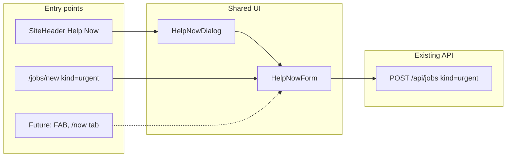

# Help Now Form and Header Dialog

## Assumptions (questionnaire skipped)

- **TTL:** Keep **48 hours** (current backend + product docs). Dialog copy will say 48h; mockup showed 24h — easy to adjust later in one constant.
- **Form surfaces:** Reusable `HelpNowForm` used in **header dialog** and when **Urgent Help** is selected on [`components/jobs/job-form-page.tsx`](components/jobs/job-form-page.tsx).
- **Date & Time storage:** Map free-text **Date & Time** → `production` column (already rendered as the subtitle under role on cards/detail). No DB migration.

## Scope

**In scope**

- Simplified Help Now form fields (all text inputs + optional textarea)
- Reusable form component (dialog-agnostic)
- Header Help Now button + dialog
- Wire Urgent Help mode on `/jobs/new` to the same form
- Minor API/display tweaks so free-text fields work without breaking cards

**Out of scope** (deferred per prior specs)

- Push notifications / DM pre-fill response flow
- Full `/now` tab feed
- Editing urgent posts via Help Now form (edit can stay on full form for now, or follow-up)

## Help Now form spec (match mockup)

| Field       | UI           | Required              | Maps to                  |
| ----------- | ------------ | --------------------- | ------------------------ |
| Role Needed | `<Input>`    | Yes                   | `role`                   |
| Location    | `<Input>`    | Yes                   | `location`               |
| Date & Time | `<Input>`    | Yes                   | `production` (free text) |
| Rate        | `<Input>`    | No                    | `pay_rate`               |
| Details     | `<Textarea>` | No, max **280** chars | `details`                |

**Fixed on submit (not shown in form):**

- `kind: "urgent"`
- `status: "open"`
- `expires_at`: now + 48h (server-side, unchanged)
- `start_date` / `end_date`: default to today (API relaxed for urgent)
- `engagement`: default `"One-Off"`
- `department`: `"Production"` fallback when role is free text (already in [`app/api/jobs/route.ts`](app/api/jobs/route.ts))

**Dialog chrome (mockup):**

- Title: **Help Now** with amber dot accent
- Description: _Post an urgent request — visible to available members for 48 hours_
- Footer: Cancel + primary **Post urgent request →** (amber CTA using existing `urgentApplyButtonStyles`)

## Implementation tasks

### Task 1: Save spec documentation

Create [`agent-os/specs/2026-08-30-1402-help-now-form/`](agent-os/specs/2026-08-30-1402-help-now-form/) with:

- `plan.md` — this plan
- `shape.md` — scope, decisions, product alignment
- `standards.md` — shadcn-ui, page-shell, jobs API conventions
- `references.md` — job-form-page, apply-job-dialog, invite-user-dialog, urgent-wiring spec
- `visuals/` — copy the 3 provided screenshots

### Task 2: Create reusable Help Now components

New feature folder [`components/help-now/`](components/help-now/):

- **`help-now-form.tsx`** — controlled form with validation, character counter on details, uppercase field labels matching mockup/invite dialog pattern
- **`help-now-dialog.tsx`** — wraps form in shadcn `Dialog`; accepts `open` / `onOpenChange`; on success: toast, SWR revalidation (`urgentJobsKey` + jobs list), close dialog
- **`help-now-header-button.tsx`** — compact header trigger (visible sm+) that opens the dialog

Add a small payload helper in [`lib/jobs/help-now.ts`](lib/jobs/help-now.ts):

- `helpNowFormToCreatePayload()` — maps form values → `CreateJobPayload`
- `HELP_NOW_DETAILS_MAX = 280`

### Task 3: Relax API validation for urgent posts

Update [`app/api/jobs/route.ts`](app/api/jobs/route.ts) POST handler:

- When `kind === "urgent"`: **skip** start/end date requirement; default both to `todayDateOnly()`
- Require `location` trim non-empty for urgent
- Require `production` (date/time text) trim non-empty for urgent
- PATCH in [`app/api/jobs/[id]/route.ts`](app/api/jobs/[id]/route.ts): allow updating urgent posts with same field semantics when `resolvedKind === "urgent"`

### Task 4: Update urgent job display

Urgent posts will have placeholder `start_date`/`end_date` — hide misleading date badges:

- [`components/jobs/job-metadata-badges.tsx`](components/jobs/job-metadata-badges.tsx): skip `formatDateRange` badge when `job.kind === "urgent"`; keep location + engagement badges
- [`components/jobs/job-detail-content.tsx`](components/jobs/job-detail-content.tsx): for urgent, show production subtitle without "Production / tour name" placeholder when empty; optional label tweak (show datetime text as-is)
- [`components/jobs/job-card-preview.tsx`](components/jobs/job-card-preview.tsx): when previewing urgent Help Now form, pass production as date/time subtitle

### Task 5: Replace Urgent Help fields on job form page

Update [`components/jobs/job-form-page.tsx`](components/jobs/job-form-page.tsx):

- When `form.kind === "urgent"`, render `<HelpNowForm />` instead of role Select, date pickers, engagement pills, etc.
- Keep the **Posting Type** toggle (Full Role / Urgent Help) at top
- Map existing job → form when editing urgent (role, location, production→dateTime, payRate, details)
- Publish still calls `createJob` / `updateJob` via shared payload helper

### Task 6: Add Help Now button to site header

Update [`components/site-header.tsx`](components/site-header.tsx):

- Insert `<HelpNowHeaderButton />` in the right-side action cluster (before `Rooms` / `Messages`, per screenshot intent)
- Button: amber-accent outline or solid small button labeled **Help Now**; opens dialog without navigation

### Task 7: Smoke check

Manual checklist in spec folder:

1. Header **Help Now** opens dialog; all fields are text inputs
2. Submit creates urgent job; appears in jobs board + urgent carousel with correct role/location/datetime/rate/details
3. `/jobs/new` → Urgent Help shows same simplified fields (not role dropdown / date pickers)
4. Full Role form unchanged (Select, dates, deadline, draft)
5. Expired urgent still filtered; apply blocked after expiry
6. Details capped at 280 chars with counter

## Key files to leverage

| Reference                                                                                                    | Why                                   |
| ------------------------------------------------------------------------------------------------------------ | ------------------------------------- |
| [`components/jobs/apply-job-dialog.tsx`](components/jobs/apply-job-dialog.tsx)                               | Dialog + form submit pattern          |
| [`components/users/invite-user-dialog.tsx`](components/users/invite-user-dialog.tsx)                         | Uppercase field labels, dialog footer |
| [`lib/jobs/kind.ts`](lib/jobs/kind.ts)                                                                       | 48h TTL, kind transitions             |
| [`components/jobs/jobs-panel/urgent-jobs-carousel.tsx`](components/jobs/jobs-panel/urgent-jobs-carousel.tsx) | Revalidate target after post          |
| [`agent-os/specs/2026-08-13-1830-jobs-urgent-wiring/`](agent-os/specs/2026-08-13-1830-jobs-urgent-wiring/)   | Prior urgent wiring decisions         |

## Product alignment

- Matches [`agent-os/product/notes/feature-migration-inventory.md`](agent-os/product/notes/feature-migration-inventory.md) §3A: modal with role, location, date, rate, description; 48h live window
- Reuses unified `job_postings.kind = urgent` model (no new table)
- Sets foundation for future FAB on `/now` and quick-create flows — they import the same `HelpNowForm` / `HelpNowDialog`

## Risks / follow-ups

- **Free-text role** won't match department filters reliably (falls back to Production) — acceptable for urgent callouts; revisit if role-based push targeting is added
- **Edit urgent** via full form may still show old fields until a follow-up wires edit → `HelpNowForm`
- **24h vs 48h** copy: confirm with product if mockup TTL should win
