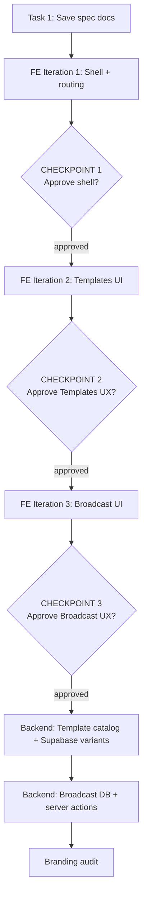

# Admin Emails Page — Shape Spec & Plan

**Spec folder:** `agent-os/specs/2026-09-01-1419-admin-emails/`

## Approach: Front-end first, approval gates

We build **UI/UX in three iterations** using **mock/static fixture data**. Each iteration ends with a **hard stop** so you can review and approve flows before we continue. **No backend wiring** (real catalog, Resend sends, DB) until Checkpoint 3 is approved.



### What counts as "front-end only"

| Included in FE iterations                    | Deferred to backend phase                         |
| -------------------------------------------- | ------------------------------------------------- |
| Layout, nav, routing, admin page guard       | `email_broadcasts` migration                      |
| Split 7/5 grid + preview panel/drawer        | `broadcast-actions.ts` server actions             |
| All form fields, buttons, dialogs, toasts    | Real Resend sends (test + broadcast)              |
| Mock template catalog + sample HTML previews | `lib/email/catalog.ts` wired to real template fns |
| Mock recipient counts + mock send history    | Live recipient query from profiles                |
| Copy-to-clipboard (uses fixture HTML)        | Supabase `config.toml` / local template files     |

Mock data lives in **`lib/email/fixtures/`** (clearly labeled, swapped out during backend phase).

---

## Shaping Summary

### Scope (locked)

| Sub-page                           | Purpose                                                                                                                                                                                        |
| ---------------------------------- | ---------------------------------------------------------------------------------------------------------------------------------------------------------------------------------------------- |
| **Templates** (`/email/templates`) | Catalog of all AWN emails (Resend app + Supabase Auth). Left: searchable list grouped by source. Right: live HTML preview. Supabase templates include **Copy template** with Go template tags. |
| **Broadcast** (`/email/broadcast`) | Compose subject + body, preview, send test to self, send to filtered audience, view send history.                                                                                              |

### Decisions (from shaping)

- **Build order:** Front-end UX first → approve → backend wiring
- **Broadcast audience:** All active members by default, with optional **role** and **status** filters
- **Broadcast workflow:** Compose → preview → test to self → send + **persist send history** (no drafts/scheduling in v1)
- **Supabase catalog:** All 6 auth templates — Magic Link, Password Recovery, Confirm Signup, Invite User, Email Change, Reauthentication
- **Design pattern:** Reuse the 7/5 split from [`components/account/account-layout-shell.tsx`](components/account/account-layout-shell.tsx) and [`components/jobs/job-page-layout.tsx`](components/jobs/job-page-layout.tsx)
- **Standards:** page-shell, sidebar-nav, design-tokens, shadcn-ui

### Visual references (provided)

- Account profile edit + preview (split layout, tab nav)
- Job create/edit form + preview card
- Job detail management + preview card

---

## Architecture (unchanged — implemented in phases)

### Routing

```
app/(app)/email/
├── layout.tsx              # admin guard + EmailLayoutShell
├── page.tsx                # redirect → /email/templates
├── templates/page.tsx
└── broadcast/page.tsx
```

### Shared layout

- **`EmailLayoutShell`** — 12-col grid, `fillViewport`, left 7 / right 5
- **`EmailNav`** — Templates / Broadcast pill nav (mirrors `AccountNav`)
- **`EmailPreviewPanel`** + **`EmailPreviewDrawer`** — iframe `srcDoc` preview, "Preview Only" label

### Preview rendering

- iframe with `srcDoc` for email HTML isolation
- Desktop: right column; mobile: Eye button → drawer (from `JobPageLayout` pattern)

### Backend (after Checkpoint 3)

- **`lib/email/catalog.ts`** — registry for all 10 templates
- **`lib/email/templates/supabase/`** — Go-tagged HTML sharing `base.ts` styling
- **`email_broadcasts`** table + `lib/email/broadcast-actions.ts`
- Wire UI to replace fixtures with real data/actions

---

## Task Breakdown

### Task 1: Save spec documentation

Create `agent-os/specs/2026-09-01-1419-admin-emails/` with `plan.md`, `shape.md`, `standards.md`, `references.md`, and copy provided visuals into `visuals/`.

---

### FE Iteration 1: Shell + routing

**Goal:** Navigate to `/email`, see correct admin chrome, sub-nav, and empty split layout.

**Build:**

- Add `/email` to `adminNav` in [`lib/nav.ts`](lib/nav.ts)
- Create `app/(app)/email/layout.tsx` (admin guard + `EmailLayoutShell`)
- Create redirect `page.tsx` → `/email/templates`
- Create `components/email/email-layout-shell.tsx`, `email-nav.tsx`, `email-preview-panel.tsx`, `email-preview-drawer.tsx`
- Stub sub-pages with placeholder left content ("Select a template" / "Compose a broadcast") and empty preview state

**Mock data:** None needed — structural only.

### CHECKPOINT 1 — Stop for approval

Review:

- Sidebar "Emails" entry and admin visibility
- Sub-nav (Templates / Broadcast) on desktop and mobile
- 7/5 split layout, aside styling, "Preview Only" chrome
- Mobile preview drawer trigger
- PageShell title/description from nav

**Do not proceed to Iteration 2 until approved.**

---

### FE Iteration 2: Templates page UI

**Goal:** Full Templates UX with realistic content, no backend.

**Build:**

- `lib/email/fixtures/template-catalog.ts` — static list of 10 templates (4 Resend + 6 Supabase) with sample subjects, descriptions, and pre-rendered HTML strings for preview
- `components/email/templates/template-list.tsx` — grouped by source, search filter, selection state
- `components/email/templates/template-detail.tsx` — metadata, Copy subject, Copy template (Supabase only) buttons
- Wire `/email/templates` — selecting a template updates right-column iframe preview
- Copy buttons use fixture HTML (Supabase fixtures include Go tags like `{{ .ConfirmationURL }}`)

**Mock data:** Fixture catalog only. Preview substitutes sample values client-side for display; Copy exports raw Go-tagged fixture HTML.

### CHECKPOINT 2 — Stop for approval

Review:

- Template list grouping, search, selection UX
- Preview fidelity and iframe rendering
- Copy subject / Copy template flows + toast feedback
- Supabase vs Resend visual distinction (badges, helper text about pasting into Supabase Dashboard)
- Empty/loading states

**Do not proceed to Iteration 3 until approved.**

---

### FE Iteration 3: Broadcast page UI

**Goal:** Full Broadcast UX with realistic interactions, no real sends.

**Build:**

- `lib/email/fixtures/broadcast-history.ts` — 3–5 mock past broadcasts
- `lib/email/fixtures/recipient-counts.ts` — static counts per filter combo (or simple client-side mock logic)
- `components/email/broadcast/broadcast-compose-form.tsx` — subject, body textarea, role/status multi-selects, recipient count badge
- `components/email/broadcast/broadcast-history-list.tsx` — past sends; click row → preview in right panel
- `components/email/broadcast/broadcast-preview.tsx` — wraps composed body in branded email card layout (client-side)
- Send test / Send broadcast buttons → **confirm dialogs** with mock recipient count; on confirm → success toast (no API call)
- Form changes update right-column preview live

**Mock data:** Fixture history + mock recipient counts. Send actions are UI-only stubs.

### CHECKPOINT 3 — Stop for approval

Review:

- Compose form layout and field UX
- Role/status filter controls and recipient count display
- Live preview updates as you type
- Send test / Send broadcast confirm dialogs
- History list + click-to-preview interaction
- Mobile preview drawer for broadcast

**Do not proceed to backend phase until approved.**

---

### Backend phase (after UX sign-off)

#### Backend Task A: Template catalog + Supabase variants

- Create `lib/email/catalog.ts` wrapping real template functions from [`lib/email/templates/`](lib/email/templates/)
- Add `lib/email/templates/supabase/*.ts` — Go-tagged HTML sharing [`base.ts`](lib/email/templates/base.ts) styling
- Replace fixture catalog in Templates page with real catalog
- Remove or slim down `fixtures/template-catalog.ts`

#### Backend Task B: Broadcast DB + server actions

- Migration: `email_broadcasts` table + RLS
- `lib/email/broadcast-actions.ts`: recipient query, test send, broadcast send, history list
- Wire Broadcast page: real recipient counts, real sends via Resend, real history
- Replace fixture history + stub send handlers

#### Final: Branding audit

- Verify all 10 templates share consistent AWN styling
- Confirm Supabase paste instructions in admin UI are accurate

---

## Out of scope (v1)

- Draft broadcasts / scheduled sends
- Resend webhook delivery analytics
- Rich WYSIWYG email editor
- Per-member manual recipient picker
- React Email migration

## Risks & mitigations

| Risk                                 | Mitigation                                                                  |
| ------------------------------------ | --------------------------------------------------------------------------- |
| Mock UX diverges from wired behavior | Fixtures mirror final catalog shape; backend phase is swap-in, not redesign |
| Rework if UX rejected at checkpoint  | Iterations are scoped small; only approved iteration proceeds               |
| Large broadcast volume               | Addressed in backend phase with batching + confirm dialog                   |
