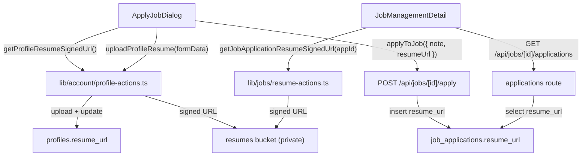

# Resume in Job Applications — Plan

## Overview

Add resume support to the job application flow: auto-attach the applicant's saved resume, allow inline upload if missing, and let employers view the resume from the applicant list.

## Architecture



## Tasks

### 1. Save spec documentation ✓
Create `agent-os/specs/2026-09-10-1819-resume-in-job-applications/`

### 2. DB migration
New file: `supabase/migrations/20260910000000_add_resume_to_profiles_and_jobs.sql`
```sql
ALTER TABLE public.profiles ADD COLUMN IF NOT EXISTS resume_url text;
ALTER TABLE public.job_applications ADD COLUMN IF NOT EXISTS resume_url text;
```

### 3. Profile resume server actions
Add to `lib/account/profile-actions.ts`:
- `uploadProfileResume(formData: FormData)` — validates PDF ≤5MB, uploads to `resumes` bucket at `users/{userId}/resume.pdf`, updates `profiles.resume_url`
- `getProfileResumeSignedUrl()` — reads `profiles.resume_url`, generates 10-min signed URL

### 4. Job resume server action
New file: `lib/jobs/resume-actions.ts`
- `getJobApplicationResumeSignedUrl(applicationId)` — verifies poster, generates signed URL

### 5. Update apply API
`app/api/jobs/[id]/apply/route.ts` — accept and store `resume_url`

### 6. Update applications list API
`app/api/jobs/[id]/applications/route.ts` — include `resume_url` in response

### 7. Update fetch types
`lib/jobs/fetch.ts` — add `resumeUrl` to `ApplyJobPayload` and `JobApplication`

### 8. Update apply dialog
`components/jobs/apply-job-dialog.tsx`:
- On open: fetch resume via `getProfileResumeSignedUrl()`
- If resume: show `<Attachment state="done">` with PDF icon and view link
- If no resume: show upload prompt; on upload call `uploadProfileResume()`
- On submit: pass `resumeUrl` in payload

### 9. Update employer view
`components/jobs/job-management-detail.tsx`:
- Add "View Resume" button per applicant row when `resumeUrl` is present
- On click: call `getJobApplicationResumeSignedUrl()`, open result in new tab

## Notes
- `resumes` bucket is private — all links go through signed URL generation (10 min TTL)
- Resume always saved to `profiles.resume_url` first, then path copied to the application
- `Attachment` UI component already installed at `components/ui/attachment.tsx`
