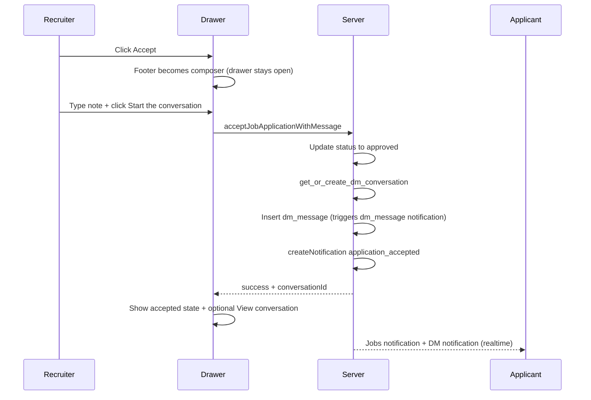

# Accept Application with DM + Notification

## Shaping decisions (confirmed)

- **Accept timing:** Status changes to `approved` only when recruiter clicks **"Start the conversation"** — accept, DM creation, first message, and notifications happen in one atomic operation.
- **Notification:** Applicant receives **both**:
  1. **Jobs tab** — `application_accepted` notification (tap opens message thread or job context)
  2. **All / Mentions tab** — standard `dm_message` notification from the existing DM trigger (tap opens the conversation)
- **Drawer behavior:** Stays open throughout; no navigation away on accept.

## Current state

| Area          | Today                                                                                                                                                |
| ------------- | ---------------------------------------------------------------------------------------------------------------------------------------------------- |
| Accept flow   | [`job-application-review-drawer.tsx`](components/jobs/job-application-review-drawer.tsx) footer calls `onStatusChange("approved")` → PATCH only      |
| API           | [`app/api/jobs/[id]/applications/[applicationId]/route.ts`](app/api/jobs/[id]/applications/[applicationId]/route.ts) updates status, no side effects |
| DM creation   | [`getOrCreateConversation`](lib/messages/actions.ts) + [`sendMessage`](lib/messages/actions.ts) (two-step, decoupled)                                |
| Notifications | Jobs tab uses empty mock data from [`jobPanelNotifications`](lib/jobs-panel-data.ts); no job-application notification kinds exist                    |
| DM trigger    | Every `dm_messages` insert fires `upsert_dm_message_notification` — will provide the DM notification automatically                                   |

## Target UX flow



### Drawer footer states

1. **Pending** — existing Accept / Maybe / Decline row
2. **Compose (after Accept click, before submit)** — textarea, Cancel (returns to step 1), primary **Start the conversation** button; Maybe/Decline hidden during compose
3. **Accepted (after success)** — status badge shows Accepted; footer shows success copy + **View conversation** link (opens `/messages?conversation={id}`); drawer remains open

Note text is **required** (trimmed non-empty) before submit.

## Architecture

### New server action: `acceptJobApplicationWithMessage`

**File:** [`lib/jobs/application-actions.ts`](lib/jobs/application-actions.ts) (new, keeps review logic separate from client fetch helpers)

```typescript
acceptJobApplicationWithMessage({
  jobId,
  applicationId,
  message: string,
});
```

**Steps (single transaction preferred, rollback on failure):**

1. Auth + verify caller is job `poster_id`
2. Verify application exists and `status === 'pending'`
3. Fetch `applicant_id`, job `role`/`production` for notification copy
4. Update `job_applications.status = 'approved'`
5. RPC `get_or_create_dm_conversation(applicant_id)`
6. Insert first `dm_messages` row with note text and optional `job_id` attachment (auto-attach the job being reviewed so thread has context). The existing `upsert_dm_message_notification` trigger fires automatically → applicant gets DM notification in All/Mentions.
7. `createNotification` to applicant:
   - `kind: "application_accepted"`
   - `title: "Application accepted"`
   - `body: "Your application for {role} was accepted."`
   - `data: { jobId, applicationId, conversationId }`

**Return:** `{ ok: true, conversationId, status: 'approved' }`

Reuse patterns from [`lib/applications/actions.ts`](lib/applications/actions.ts) (`createNotification`) and [`lib/messages/actions.ts`](lib/messages/actions.ts) (conversation + message insert logic — extract shared insert helper if needed to avoid duplication).

No migration needed — the existing DM notification trigger handles the message notification.

### Notification wiring

**[`lib/notifications-data.ts`](lib/notifications-data.ts)**

- Map `application_accepted` → display kind `"job"` in `notificationDisplayKind`
- Fix `isJobApiNotification` to check `dbKind` (e.g. `application_accepted`) not just UI `kind`
- Extend `NotificationData` with `jobId?`, `applicationId?`

**[`lib/notifications/actions.ts`](lib/notifications/actions.ts)**

- Extend `mapNotificationData` to pass through `jobId`, `applicationId`

**[`components/notifications.tsx`](components/notifications.tsx)**

- Replace mock `jobPanelNotifications` in Jobs tab with filtered API notifications: `notifications.filter(n => isJobApiNotification(n.dbKind))`
- Add click handler for job notifications → navigate to `/messages?conversation={conversationId}` (preferred) or `/my-jobs/applications` fallback
- Fix unread counts to include job API notifications instead of mock array
- DM notifications continue using existing `handleDmNotificationClick` in All/Mentions tabs

Reuse [`NotificationList`](components/notifications/notification-list.tsx) in Jobs tab (same component as All tab) rather than the mock-only [`JobsNotificationsList`](components/jobs/jobs-panel/jobs-notifications-list.tsx).

### UI changes

**[`components/jobs/job-application-review-drawer.tsx`](components/jobs/job-application-review-drawer.tsx)**

- Add local state: `footerMode: 'actions' | 'compose' | 'accepted'`
- Accept click → `setFooterMode('compose')` (do not call status change yet)
- Compose footer: `Textarea` + Cancel + **Start the conversation**
- Wire new prop `onAcceptWithMessage(message: string)` instead of direct `onStatusChange('approved')` for Accept path
- Maybe/Decline continue using existing `onStatusChange` unchanged

**[`components/jobs/job-management-detail.tsx`](components/jobs/job-management-detail.tsx)**

- Replace Accept handler with `handleAcceptWithMessage` calling new server action
- On success: optimistic SWR update, toast `"Application accepted — conversation started"`, update `selectedApplication.status`
- Pass loading state to drawer

**Remove** direct Accept → `updateJobApplicationStatus(..., 'approved')` path (Accept always goes through compose flow).

## Reference implementations

| Reference                                                                                              | Relevance                                             |
| ------------------------------------------------------------------------------------------------------ | ----------------------------------------------------- |
| [`components/applications/deny-dialog.tsx`](components/applications/deny-dialog.tsx)                   | Note textarea + submit pattern for admin review       |
| [`lib/applications/actions.ts`](lib/applications/actions.ts)                                           | `createNotification` usage on approve/deny            |
| [`lib/messages/actions.ts`](lib/messages/actions.ts)                                                   | `getOrCreateConversation`, `sendMessage` with `jobId` |
| [`components/jobs/job-share-to-messages-button.tsx`](components/jobs/job-share-to-messages-button.tsx) | Job-attached DM pattern                               |
| [`components/notifications.tsx`](components/notifications.tsx)                                         | DM notification click → `/messages?conversation=`     |

## Visuals provided

- Application review drawer with Accept/Maybe/Decline footer (recruiter view)
- Notifications sheet Jobs tab empty state (target surface for acceptance notification)

Saved to spec folder `visuals/` on Task 1.

## Standards applied

- [`agent-os/standards/css/shadcn-ui.md`](agent-os/standards/css/shadcn-ui.md) — drawer footer, textarea, button variants
- Product alignment: supports employer-to-crew hiring workflow and private messaging ([`agent-os/product/mission.md`](agent-os/product/mission.md))

## Out of scope (this spec)

- Maybe/Decline with notes
- Email notification on accept
- Notifying poster when someone applies (`new_application`)
- Replacing `JobsNotificationsList` mock types for future `saved_update` / `deadline` kinds
- Deduplicating or merging the two notification types into one

## Test plan

1. Poster opens applicant drawer → Accept → composer appears, drawer stays open
2. Cancel returns to Accept/Maybe/Decline without status change
3. Empty note → validation error, no status change
4. Start the conversation → status Accepted, DM exists with note (+ job attachment), drawer shows success
5. Applicant sees **both** notifications: Jobs tab (`application_accepted`) and All/Mentions tab (`dm_message` from recruiter)
6. Applicant taps Jobs notification → opens message thread; taps DM notification → opens same thread
7. Maybe/Decline still work as before for pending applications
8. Double-submit / race: second accept attempt on already-approved application returns error

---

## Task 1: Save spec documentation

Create [`agent-os/specs/2026-09-14-1708-accept-application-with-dm/`](agent-os/specs/2026-09-14-1708-accept-application-with-dm/) with:

- `plan.md` — this plan
- `shape.md` — scope, decisions (atomic accept, both notification types), visuals, references
- `standards.md` — shadcn-ui key points
- `references.md` — file pointers above
- `visuals/` — copy provided screenshots

## Task 2: Server action

Implement `acceptJobApplicationWithMessage` in [`lib/jobs/application-actions.ts`](lib/jobs/application-actions.ts) with auth, status guard, conversation creation, message insert (DM trigger fires naturally), and `application_accepted` notification.

## Task 3: Drawer compose UI

Update [`job-application-review-drawer.tsx`](components/jobs/job-application-review-drawer.tsx) with three footer modes and compose/cancel/success states.

## Task 4: Wire management page

Update [`job-management-detail.tsx`](components/jobs/job-management-detail.tsx) to call the new server action and handle optimistic updates.

## Task 5: Notification types + Jobs tab wiring

Update notification mapping, extend `NotificationData`, wire Jobs tab to real API notifications, add click navigation to message thread.

## Task 6: Smoke test

Manual verification per test plan above.
