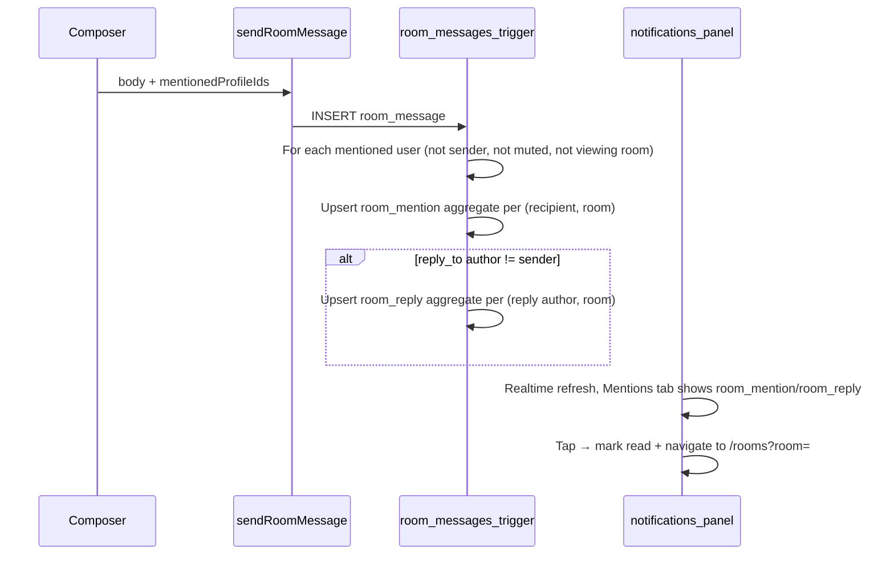

# Group @ Mentions and Reply Notifications

## Shaping Summary

| Decision                    | Choice                                                                                                                      |
| --------------------------- | --------------------------------------------------------------------------------------------------------------------------- |
| Mention surfaces            | **Group rooms only** — no @ picker in DMs                                                                                   |
| Picker contents             | Room members only — **no "all" or "team" rows**                                                                             |
| Selected mention display    | Drop `@`; show **display name as primary-colored link, no underline** (Facebook-style)                                      |
| Picker UX (desktop)         | **Popover** anchored above composer ([`invite-popover.tsx`](components/invites/invite-popover.tsx) pattern + `useIsMobile`) |
| Picker UX (mobile)          | **Bottom sheet** (`Sheet side="bottom"`)                                                                                    |
| Mention link tap            | Open **member profile drawer** (same as avatar tap in [`room-thread.tsx`](components/rooms/room-thread.tsx))                |
| DM reply notifications      | **Reuse existing `dm_message` aggregation** — no separate reply kind                                                        |
| Group reply notifications   | **New `room_reply` kind**, aggregated per group                                                                             |
| Group mention notifications | **New `room_mention` kind**, aggregated per group                                                                           |
| Mentions tab                | Show **`room_mention` + `room_reply` only** — stop treating all DMs as mentions                                             |

## Visual References

User-provided screenshots (saved to workspace assets):

- WhatsApp flow (trigger → filter → compose → sent): member list on `@`, filter-as-you-type, `@Name` in bubble
- Facebook flow: name-only link in composer and sent messages (no `@`, primary color, no underline)

**Adaptations from references:** omit WhatsApp "all"/"team" rows; drop `@` on selection (Facebook style); use AWN primary token instead of Facebook blue.

## Current State (gaps)

- **No mention implementation** — [`room-thread.tsx`](components/rooms/room-thread.tsx) renders `{message.text}` as plain string; composer is a bare `InputGroupTextarea`
- **Member source exists** — [`getRoomMembersPreview()`](lib/rooms/actions.ts) + [`useRoomMembersPreview()`](lib/rooms/hooks/use-room-members-preview.ts) return `{ id, name, avatarUrl }[]`
- **Reply UI exists** — `reply_to_message_id` / `reply_snapshot` on `room_messages`; no notification side effects
- **Notifications infra exists** — [`20260912180000_dm_message_notifications.sql`](supabase/migrations/20260912180000_dm_message_notifications.sql) is the template for write-time aggregation; [`isMentionNotification()`](lib/notifications-data.ts) is a placeholder (`kind === "message"` → DMs)

## Notification Copy (aggregated by group)

| Kind           | Count = 1                                                                    | Count > 1                                                                            |
| -------------- | ---------------------------------------------------------------------------- | ------------------------------------------------------------------------------------ |
| `room_mention` | **title:** `{Sender} mentioned you in the group` · **body:** `{Group Name}`  | **title:** `You've been mentioned {N} times in the group` · **body:** `{Group Name}` |
| `room_reply`   | **title:** `{Sender} replied to you in the group` · **body:** `{Group Name}` | **title:** `You have {N} replies in the group` · **body:** `{Group Name}`            |

Aggregation key: one unread row per `(user_id, room_id, kind)`. After dismiss/read, the next event starts a fresh aggregate (same pattern as DM notifications).

**Pause while viewing:** add `profiles.viewing_room_id` + `set_viewing_room()` RPC, synced from [`room-thread.tsx`](components/rooms/room-thread.tsx) (mirrors DM `setViewingConversation`).

**Respect mute:** skip notification upserts when recipient has `room_memberships.muted_at` set (consistent with existing room mute behavior).

---

## Task 1: Save Spec Documentation

Create [`agent-os/specs/2026-09-14-2204-group-mentions-reply-notifications/`](agent-os/specs/2026-09-14-2204-group-mentions-reply-notifications/) with:

- **plan.md** — this plan
- **shape.md** — scope, decisions above, product alignment (private group messaging per [`mission.md`](agent-os/product/mission.md))
- **standards.md** — [`shadcn-ui.md`](agent-os/standards/css/shadcn-ui.md), [`design-tokens.md`](agent-os/standards/css/design-tokens.md) (primary link styling)
- **references.md** — DM notification migration, message-reply spec, invite popover/sheet pattern, room members preview
- **visuals/** — copy the 6 user screenshots from assets into this folder

---

## Task 2: Database Migration

New file: `supabase/migrations/20260914220000_room_mentions_and_notifications.sql`

**Message schema:**

- `room_messages.mentioned_profile_ids uuid[] default '{}'` — authoritative list for triggers
- Optional `room_messages.mention_spans jsonb` — `[{ profileId, start, length }]` for stable rendering if names change (recommended)

**Notification schema:**

- `notifications.room_id uuid` FK → `community_rooms`
- Partial unique indexes:
  - `(user_id, room_id) WHERE kind = 'room_mention' AND read = false`
  - `(user_id, room_id) WHERE kind = 'room_reply' AND read = false`

**Profiles:**

- `viewing_room_id uuid` FK → `community_rooms`

**Trigger on `room_messages` AFTER INSERT:**

1. Resolve sender name + room name
2. Skip recipients who are sender, viewing this room, or muted
3. For each ID in `mentioned_profile_ids`: upsert `room_mention` (increment `data.mentionCount`, update title/body, bump `updated_at`)
4. If `reply_to_message_id` resolves to another member's message: upsert `room_reply` for that author (increment `data.replyCount`)

**RPCs:**

- `set_viewing_room(p_room_id uuid)`
- `dismiss_room_notifications(p_room_id uuid)` — mark unread `room_mention` + `room_reply` for that room read when opening thread

---

## Task 3: Types, Helpers, and Server Send Path

**[`lib/messages-data.ts`](lib/messages-data.ts):**

- Add `MessageMentionSpan` type
- Extend `ThreadMessage` with `mentions?: MessageMentionSpan[]`

**New [`lib/messages/mentions.ts`](lib/messages/mentions.ts):**

- `detectMentionTrigger(text, cursor)` — returns query after `@` at cursor
- `insertMention(draft, cursor, member)` — replaces `@query` with display name (no `@`)
- `buildMentionSpans(body, selectedMentions)` — span metadata for send
- `renderMessageWithMentions(body, spans)` — segment list for UI

**[`lib/rooms/actions.ts`](lib/rooms/actions.ts):**

- Extend `sendRoomMessage()` to accept `mentionedProfileIds` + validate each ID is a room member
- Persist to new columns; map mentions in thread RPC response

**[`lib/rooms/viewing-actions.ts`](lib/rooms/viewing-actions.ts)** (new, mirrors messages viewing):

- `setViewingRoom(roomId | null)` calling RPC

Wire `markRoomRead()` to also call `dismiss_room_notifications()`.

---

## Task 4: Mention Picker Component

New [`components/messages/mention-picker.tsx`](components/messages/mention-picker.tsx):

- Props: `members`, `query`, `open`, `onSelect(member)`, `onClose`
- Renders searchable member rows (avatar + name); highlights matching substring
- Excludes current user from list
- **Desktop:** rendered inside `PopoverContent` positioned above composer
- **Mobile:** rendered inside `Sheet side="bottom"` with search field + scrollable list

Follow [`invite-popover.tsx`](components/invites/invite-popover.tsx) for the mobile/desktop split via [`useIsMobile()`](hooks/use-mobile.ts).

---

## Task 5: Composer Integration (Room Thread)

Update [`components/rooms/room-thread.tsx`](components/rooms/room-thread.tsx):

- Track `mentionQuery`, `mentionPickerOpen`, `pendingMentions` (Map of displayName → profileId)
- On textarea `onChange` + `onSelect` (cursor): detect `@` trigger, open picker, filter members
- On member select: insert name into draft, close picker, restore focus
- On send: pass `mentionedProfileIds` derived from pending mentions; clear state
- Sync `setViewingRoom(room.id)` on mount/unmount (alongside existing `setActiveRoomId`)

Extract minimal shared logic only if needed — keep scope in room thread unless DM mention is added later.

---

## Task 6: Mention Rendering in Message Bubbles

New [`components/messages/message-text.tsx`](components/messages/message-text.tsx):

- Accept `text`, `mentions`, `onMentionClick(profileId)`
- Render plain text segments + `<button className="text-primary no-underline hover:no-underline">` for mention spans
- Wire `onMentionClick` → existing `openAuthorProfile` / profile drawer in room thread

Replace raw `{message.text}` in [`message-bubble-with-reactions.tsx`](components/messages/message-bubble-with-reactions.tsx) (and share variants when body text present) with `MessageText`.

---

## Task 7: Notifications Types and Server Mapping

Update [`lib/notifications-data.ts`](lib/notifications-data.ts):

- Add `roomId`, `mentionCount`, `replyCount`, `latestMessageId` to `NotificationData`
- Add helpers: `isRoomMentionNotification()`, `isRoomReplyNotification()`, `isMentionTabNotification()`, `getRoomNotificationRoomId()`
- Fix `isMentionNotification()` → filter by `dbKind` in `room_mention | room_reply`

Update [`lib/notifications/actions.ts`](lib/notifications/actions.ts) to map new DB kinds and expose `roomId` in client payload.

---

## Task 8: Notifications UI and Navigation

Update [`components/notifications.tsx`](components/notifications.tsx):

- Mentions tab: `notifications.filter(isMentionTabNotification)`
- Click handler for room mention/reply: mark read → navigate to `/rooms?room={roomId}` (and optionally `&message={latestMessageId}` for future scroll-to)

Update [`components/notifications/notification-list.tsx`](components/notifications/notification-list.tsx):

- Treat `room_mention` / `room_reply` as navigable (like DMs)

**Out of scope:** changing DM notification behavior; separate reply notifications for DMs.

---

## Task 9: Smoke Verification

Manual checklist:

1. Type `@` in group → member list (no all/team); desktop popover / mobile sheet
2. Filter by typing `@au` → Aubrey only
3. Select member → draft shows name link styling preview or plain name; send → bubble shows primary name link (no `@`)
4. Tap mention → profile drawer opens
5. Mentioned user receives aggregated notification; second mention increments count
6. Reply to another member's message → `room_reply` notification; aggregate on repeat
7. Open group thread → related mention/reply notifications dismissed
8. Mentions tab shows room mention/reply only (not DMs)
9. Muted room → no mention/reply notifications
10. DM reply → still only `dm_message` aggregate

---

## Key Files

| Area              | Files                                                                                                                                                                                                                        |
| ----------------- | ---------------------------------------------------------------------------------------------------------------------------------------------------------------------------------------------------------------------------- |
| Composer + thread | [`components/rooms/room-thread.tsx`](components/rooms/room-thread.tsx)                                                                                                                                                       |
| Picker            | `components/messages/mention-picker.tsx` (new)                                                                                                                                                                               |
| Rendering         | `components/messages/message-text.tsx` (new)                                                                                                                                                                                 |
| Data/helpers      | `lib/messages/mentions.ts` (new), [`lib/messages-data.ts`](lib/messages-data.ts)                                                                                                                                             |
| Server            | [`lib/rooms/actions.ts`](lib/rooms/actions.ts), `lib/rooms/viewing-actions.ts` (new)                                                                                                                                         |
| Notifications UI  | [`components/notifications.tsx`](components/notifications.tsx), [`components/notifications/notification-list.tsx`](components/notifications/notification-list.tsx), [`lib/notifications-data.ts`](lib/notifications-data.ts) |
| DB                | `supabase/migrations/20260914220000_room_mentions_and_notifications.sql` (new)                                                                                                                                               |
| Reference pattern | [`supabase/migrations/20260912180000_dm_message_notifications.sql`](supabase/migrations/20260912180000_dm_message_notifications.sql)                                                                                         |

## Risks and Mitigations

- **Name collisions in body text** — use stored `mention_spans` offsets rather than re-parsing display names
- **Edited/deleted members** — spans + IDs at send time; render fallback as plain text if profile gone
- **Large rooms** — `getRoomMembersPreview` already returns all members; add client-side filter; paginate later if needed
- **Double notify (mention + reply)** — if user mentions someone they also reply to, both notifications fire (intentional; matches separate copy strings)
