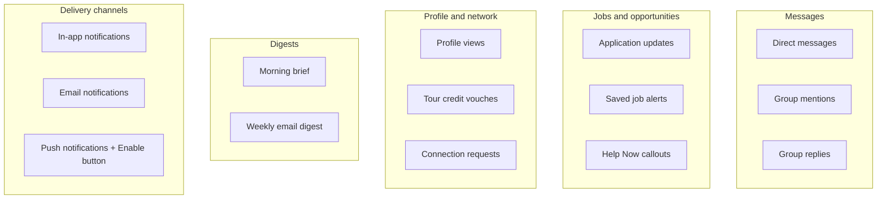
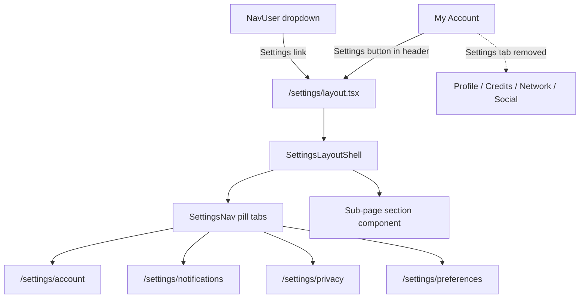

# Settings Page — Front-End Shell

## Shaping Summary

**Scope:** A standalone Settings hub at `/settings/*`, separate from My Account (`/account/*`). My Account remains the **public identity** hub (Profile, Tour Credits, Connections, Social). Settings becomes the **account mechanics & preferences** hub.

**Confirmed decisions:**

- Remove **Settings** tab from My Account nav; add **Settings** entry points in two places:
  - User dropdown ([`components/nav-user.tsx`](components/nav-user.tsx))
  - My Account page header — **Settings** icon button immediately **left of** the existing **My Profile** button ([`components/account/account-page-actions.tsx`](components/account/account-page-actions.tsx))
- Four sub-pages: **Account**, **Notifications**, **Privacy**, **Preferences**
- Quick toggles (**Available for work**, **Appear offline**) stay in the dropdown only — not duplicated in Settings
- **Front-end only** — no server actions, no persistence; placeholder values and disabled states where backend is missing
- Include all standards from [`agent-os/standards/`](agent-os/standards/)

**Visual references:** User-provided screenshots of My Account pill nav and user dropdown (saved to `.cursor/projects/.../assets/`)

---

## Recommended Settings Content (by sub-page)

Content is derived from: existing placeholder [`components/account/account-settings-section.tsx`](components/account/account-settings-section.tsx), implemented notification kinds (`dm_message`, `room_mention`, `room_reply`, `application_*`, `credit_vouched`), product inventory ([`agent-os/product/misc/feature-migration-inventory.md`](agent-os/product/misc/feature-migration-inventory.md) §3F), and UX best practices for professional networks.

### Account (`/settings/account`)

| Group                 | Setting                   | UI                        | Backend status                                  |
| --------------------- | ------------------------- | ------------------------- | ----------------------------------------------- |
| **Login credentials** | Email address             | Row + "Change"            | Placeholder (admin-only today)                  |
|                       | Password                  | Row + "Change"            | Reset-via-email exists; in-app change not built |
| **Security**          | Two-factor authentication | Switch (off)              | Column exists (`two_factor_enabled`); not wired |
|                       | Active sessions           | Row + "View"              | Not implemented                                 |
| **Danger zone**       | Delete account            | Destructive card + button | Admin-only today                                |

Reuse the existing `SettingsRow` pattern from [`account-settings-section.tsx`](components/account/account-settings-section.tsx) — extract to shared component.

### Notifications (`/settings/notifications`)

Organize toggles into **groups with section headers** (not a flat list). Each row: label, short description, `Switch` (default on for implemented kinds, off/disabled for planned).

**Info callout** at top of Messages group: _"To mute a specific room, use the room menu in Messages."_ (per-room mute via `room_memberships.muted_at` is already implemented — global toggles are future work)

**Badge labels** for planned items: subtle `"Coming soon"` on rows without backend (`Help Now`, `Profile views`, `Morning brief`, push enablement).

### Privacy (`/settings/privacy`)

Since **Appear offline** stays in the dropdown, Privacy focuses on **discoverability and data visibility** (mostly planned — UI placeholders):

| Group               | Setting                          | Description                                        |
| ------------------- | -------------------------------- | -------------------------------------------------- |
| **Discoverability** | Show in People directory         | Allow others to find you in search                 |
|                     | Show availability on profile     | Control whether availability badge is public       |
| **Profile access**  | Who can view your resume         | Dropdown: Everyone / Connections / Nobody          |
|                     | Who can send connection requests | Dropdown: Everyone / Nobody                        |
| **Blocked members** | Blocked accounts                 | Row + "Manage" (empty state: "No blocked members") |

No Appear offline row here (per decision — dropdown is the sole control).

### Preferences (`/settings/preferences`)

Client-side and display prefs (localStorage today, backend later):

| Group                 | Setting      | UI                                                                                              |
| --------------------- | ------------ | ----------------------------------------------------------------------------------------------- |
| **Display**           | Theme        | Segmented: System / Light / Dark                                                                |
| **Jobs board**        | Default view | Segmented: Grid / List (matches [`hooks/use-board-view-mode.ts`](hooks/use-board-view-mode.ts)) |
| **People board**      | Default view | Segmented: Grid / List                                                                          |
| **Language & region** | Language     | Select (disabled, "English" default)                                                            |
|                       | Time zone    | Select (disabled, placeholder)                                                                  |

All controls render with realistic defaults but **do not persist** in this pass.

---

## Architecture

**Route tree** (mirrors My Jobs pattern):

| Route                     | Component                      |
| ------------------------- | ------------------------------ |
| `/settings`               | Redirect → `/settings/account` |
| `/settings/account`       | `AccountSettingsSection`       |
| `/settings/notifications` | `NotificationsSettingsSection` |
| `/settings/privacy`       | `PrivacySettingsSection`       |
| `/settings/preferences`   | `PreferencesSettingsSection`   |

**Reference implementations:**

- Pill nav: [`components/account/account-nav.tsx`](components/account/account-nav.tsx), [`components/jobs/my-jobs-nav.tsx`](components/jobs/my-jobs-nav.tsx)
- Layout shell: [`components/jobs/my-jobs-layout-shell.tsx`](components/jobs/my-jobs-layout-shell.tsx)
- Settings row UI: [`components/account/account-settings-section.tsx`](components/account/account-settings-section.tsx)
- Page wrapper: [`components/page-shell.tsx`](components/page-shell.tsx) per [`agent-os/standards/global/page-shell.md`](agent-os/standards/global/page-shell.md)

---

## Task 1: Save Spec Documentation

Create `agent-os/specs/2026-09-17-1901-settings-page/` with:

- **plan.md** — This plan
- **shape.md** — Scope, confirmed decisions, content rationale, product alignment
- **standards.md** — Full text of all 5 standards files
- **references.md** — Pointers to AccountNav, MyJobsNav, account-settings-section, nav-user, notification kinds
- **visuals/** — Copy user-provided screenshots from `.cursor/projects/.../assets/image-*.jpg/png`

---

## Task 2: Shared Settings Components

Create reusable building blocks in `components/settings/`:

- **`settings-row.tsx`** — Extract `SettingsRow` from account-settings-section (icon, label, description, value, action slot)
- **`settings-section.tsx`** — Section header (title + description) + children wrapper
- **`settings-nav.tsx`** — Pill nav with 4 items (Account, Notifications, Privacy, Preferences); desktop pills + mobile `NativeSelect` (same pattern as AccountNav)
- **`settings-layout-shell.tsx`** — `PageShell` with title "Settings", description "Manage your account, notifications, and preferences.", renders `SettingsNav` + children in bordered card

---

## Task 3: Settings Route Structure

Create app routes under [`app/(app)/settings/`](<app/(app)/settings/>):

- `layout.tsx` — Wraps children in `SettingsLayoutShell`
- `page.tsx` — Redirect to `/settings/account`
- `account/page.tsx`, `notifications/page.tsx`, `privacy/page.tsx`, `preferences/page.tsx` — Each renders its section component

**Replace** the current avatar-only [`app/(app)/settings/page.tsx`](<app/(app)/settings/page.tsx>) and deprecate [`components/settings/profile-settings.tsx`](components/settings/profile-settings.tsx) (avatar editing lives at `/account/profile`).

---

## Task 4: Build Section Components (UI only)

- **`account-settings-section.tsx`** — Move/adapt content from [`components/account/account-settings-section.tsx`](components/account/account-settings-section.tsx); use session email as placeholder value via props from server page
- **`notifications-settings-section.tsx`** — Grouped toggles per content table above; master delivery channel section at bottom
- **`privacy-settings-section.tsx`** — Discoverability toggles + select dropdowns + blocked members empty state
- **`preferences-settings-section.tsx`** — Theme + board view segment controls + disabled locale selects

No `onCheckedChange` handlers that call server actions. Switches use `defaultChecked` or local `useState` only.

---

## Task 5: Navigation Updates

- **[`components/account/account-nav.tsx`](components/account/account-nav.tsx)** — Remove Settings item from `NAV_ITEMS`
- **[`components/nav-user.tsx`](components/nav-user.tsx)** — Add `{ label: "Settings", href: "/settings", icon: Settings }` between My Jobs and Support
- **[`components/account/account-page-actions.tsx`](components/account/account-page-actions.tsx)** — Add a **Settings** icon button to the left of **My Profile** in the page header actions row:
  - `Button variant="outline" size="icon-sm"` with `Settings` icon only (no label), linking to `/settings`
  - Wrap in `Tooltip` with label "Settings" for accessibility (matches My Profile tooltip pattern)
  - Order: `[Settings icon] [My Profile] [Profile Card (mobile only)]`
  - Outline variant to sit visually alongside the My Profile text button without competing for attention
- **Remove** [`app/(app)/account/settings/page.tsx`](<app/(app)/account/settings/page.tsx>) — Add redirect to `/settings/account` or delete route entirely
- **Remove** import of `AccountSettingsSection` from account feature (component moves to `components/settings/`)

---

## Task 6: Visual Polish & Accessibility

- Consistent spacing: `gap-8` between sections, `Separator` between rows (match existing account settings style)
- Section cards: single bordered container per sub-page (`rounded-xl border border-border bg-background p-6`)
- `aria-label` on all switches; `"Coming soon"` badges use `Badge variant="secondary"`
- Mobile: pill nav collapses to native select (proven pattern from AccountNav)

---

## Out of Scope (this pass)

- Server actions / Supabase persistence
- Notification preferences table or schema
- Email/password change flows
- 2FA enrollment
- Push notification subscription
- Wiring Preferences to localStorage (can be a fast follow-up)

---

## Product Alignment

Maps to P2 **Profile + settings** and **Notifications** in [`feature-migration-inventory.md`](agent-os/product/misc/feature-migration-inventory.md):

- Separates identity (My Account) from mechanics (Settings) — clearer IA for touring crew managing public profile vs. account security
- Lays UI foundation for planned notification preference toggles (DMs, Help Now, job matches, morning brief, profile views, vouches)
- Keeps quick availability/presence toggles in dropdown for road crew who need one-tap access between shows
