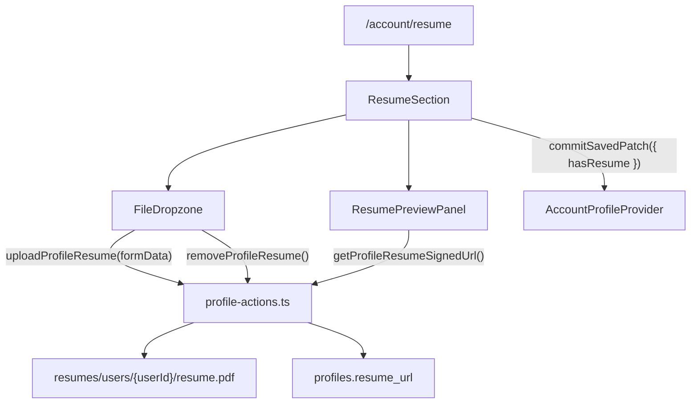

# Account Resume Sub-page

## Scope

Add a **Resume** sub-page under My Account where members can upload, preview, replace, and remove their profile resume. Backend storage already exists (`profiles.resume_url`, `profiles.resume_filename`, private `resumes` bucket, `uploadProfileResume` / `getProfileResumeSignedUrl` in `lib/account/profile-actions.ts`). This work is **UI + one new server action** (`removeProfileResume`).

**UX decision (confirmed):** Compact upload bar at top + full preview below when a resume exists. Replace via the bar or preview actions; Remove from preview actions.

**Visual references:** User-provided mockups in `visuals/`.

## Architecture

## Tasks

### 1. Save spec documentation

Create `agent-os/specs/2026-09-17-1946-account-resume-subpage/` with plan, shape, standards, references, visuals.

### 2. Add `removeProfileResume` server action

Extend `lib/account/profile-actions.ts` with remove action and revalidate `/account/resume`.

### 3. Create reusable `FileDropzone` component

New file: `components/ui/file-dropzone.tsx` with idle/uploading/error states and default/compact variants.

### 4. Create `ResumeSection` client component

New file: `components/account/resume-section.tsx` with dropzone, iframe preview, replace/remove.

### 5. Wire routing and navigation

Add `/account/resume` page and Resume tab in `AccountNav`.

### 6. Smoke check

Manual verification of upload/replace/remove/error paths.

## Out of scope

- PDF.js / custom PDF renderer
- Multi-file upload
- Download/print toolbar icons from mockup
- Changes to job application or employer review flows
