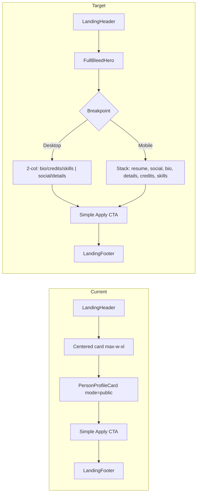

## Shaping Summary

| Decision    | Choice                                                                                                                               |
| ----------- | ------------------------------------------------------------------------------------------------------------------------------------ |
| Scope       | Visual/layout only — same route, data fetch, resume download/print, SEO metadata                                                     |
| Footer      | Ignore mockup footer CTA — keep existing [`LandingFooter`](components/landing/landing-footer.tsx) and current simple apply CTA block |
| In-app card | Unchanged — [`PersonProfileCard`](components/people/person-profile-card.tsx) stays for drawer + account preview                      |
| References  | Landing chrome + reuse public-mode data/resume logic from existing crew stack                                                        |
| Standards   | `css/design-tokens`, `css/shadcn-ui`; `global/page-shell` N/A (marketing route, not app shell)                                       |

**Visual references:** Desktop + mobile mockups (marquee layouts) — full-bleed hero, structured DETAILS section, redesigned tour credit cards, responsive section ordering.

**Product alignment:** Improves the shipped Phase 2 item from [roadmap.md](agent-os/product/roadmap.md) ("SEO crew profiles") and the "Public crew profile" story in [feature-migration-inventory.md](agent-os/product/misc/feature-migration-inventory.md).

---

## Current vs Target

**What stays the same:**

- Route: [`app/(marketing)/crew/[handle]/page.tsx`](<app/(marketing)/crew/[handle]/page.tsx>)
- Data: [`getPublicCrewProfile`](lib/crew/public-profile.ts) — no API/DB changes
- Resume: PDF download via `/api/crew/[handle]/resume` or `window.print()` + [`CrewResumeDocument`](components/crew/crew-resume-document.tsx)
- Print CSS: [`crew-print.css`](components/crew/crew-print.css)

**What changes:**

- Replace centered-card wrapper in [`public-crew-profile-page.tsx`](components/crew/public-crew-profile-page.tsx) with dedicated full-page layout components under `components/crew/`
- Do **not** modify `PersonProfileCard` public mode (in-app parity preserved separately)

---

## Layout Spec (from mockups)

### Shared hero

- Full-width banner image (reuse `person.banner`, `bannerPositionY`) with bottom gradient fade into page background
- Availability pill (reuse [`availabilityConfig`](lib/people-data.ts)) — desktop: top-right of hero; mobile: top-left
- Avatar with availability ring (reuse existing ring classes)
- Name (`font-heading`), role + home base subtitle
- Resume button (same behavior as today: download PDF if `hasResume`, else trigger print)

### Desktop (`lg+`)

- Hero content: avatar + identity left-aligned; availability + resume grouped right
- Main content: `max-w-6xl` two-column grid
  - **Left:** bio paragraph → TOUR CREDITS cards → SKILLS pills
  - **Right sidebar:** SOCIAL icon row → DETAILS key-value list
- Details rows map existing fields (no new data):
  - BASED → `homeBase`
  - SCALE → `venueTiers` joined with `•`
  - REGIONS → `workAuth` (exclude Passport from regions; show separately)
  - NEXT FREE → `availableFrom` (reuse `formatShortDate` pattern from PersonProfileCard)
  - TRAVEL → "Passport ready" when Passport in `workAuth`, else omit or show other auth
  - MEMBER SINCE → `memberSince`

### Mobile (`< lg`)

- Centered avatar + identity under hero
- Full-width primary Resume button below identity
- Social icons row
- Bio
- DETAILS section (same key-value rows, stacked with dividers)
- TOUR CREDITS cards
- SKILLS pills

### Tour credit cards (visual refresh)

- Keep read-only vouch count for public visitors (no interactive vouch)
- Card layout: title bold; role + year muted; status badge (`engagementType` or derived from `isCurrent` → "Touring" / "Completed"); vouch pill bottom-right
- Title display: use existing `credit.title` as-is (layout-only scope — no artist field mapping)

### Footer area

- Keep current minimal block in `public-crew-profile-page.tsx`:
  - "Interested in joining the network?" + Request access button → `/request-access`
- Keep [`LandingFooter`](components/landing/landing-footer.tsx) unchanged — **do not** implement mockup's expanded membership footer

---

## Task 1: Save Spec Documentation

Create `agent-os/specs/2026-09-18-1624-public-profile-redesign/` with:

- **plan.md** — this plan
- **shape.md** — scope, decisions, visuals, product alignment
- **standards.md** — full content of `css/design-tokens.md`, `css/shadcn-ui.md`, `global/page-shell.md` (with note that page-shell does not apply to marketing routes)
- **references.md** — pointers to current implementation files
- **visuals/** — copy provided mockups:
  - `public-profile-redesign-desktop.png` (from marquee-dt asset)
  - `public-profile-redesign-mobile.png` (from marquee-m asset)
  - `public-profile-current-mobile.jpg` (current centered-card state, optional reference)

---

## Task 2: Extract shared crew profile utilities

Add small shared helpers to avoid duplicating logic while keeping `PersonProfileCard` untouched:

- Move `formatShortDate` from [`person-profile-card.tsx`](components/people/person-profile-card.tsx) → `lib/crew/format-profile-date.ts` (update PersonProfileCard import — minimal 1-line change)
- Add `lib/crew/profile-details-rows.ts` — pure function building DETAILS rows from `Person` + profile metadata
- Add `components/crew/crew-resume-button.tsx` — client component encapsulating public resume download/print handler (extracted from PersonProfileCard public branch)

---

## Task 3: Build new layout components

Create under `components/crew/`:

| Component                        | Responsibility                                                                 |
| -------------------------------- | ------------------------------------------------------------------------------ |
| `crew-profile-hero.tsx`          | Banner, gradient, avatar, identity, availability, resume (responsive variants) |
| `crew-profile-details.tsx`       | SOCIAL + DETAILS sidebar/table (shared data, responsive layout classes)        |
| `crew-profile-credits.tsx`       | TOUR CREDITS section with redesigned cards                                     |
| `crew-profile-skills.tsx`        | SKILLS pill row                                                                |
| `crew-profile-section-label.tsx` | Uppercase section headings (matches mockup + existing `SectionLabel` style)    |

Compose in refactored [`public-crew-profile-page.tsx`](components/crew/public-crew-profile-page.tsx):

- Keep `LandingHeader`, apply CTA block, `LandingFooter`, `CrewResumeDocument`, `CrewAutoPrint`
- Remove `PersonProfileCard` usage and centered card wrapper
- Use semantic tokens only (`bg-background`, `text-muted-foreground`, `border-border`, `bg-success` for availability)

---

## Task 4: Responsive layout + polish

- Desktop: `lg:grid lg:grid-cols-[1fr_280px] lg:gap-12` (or similar) with hero spanning full width
- Mobile: single column per mockup section order
- Hero gradient: CSS via Tailwind `bg-gradient-to-b from-transparent to-background` overlay on banner
- Verify dark theme contrast against mockups using existing tokens (no new hex colors)
- Ensure banner/avatar alt text and section headings remain accessible

---

## Task 5: Manual verification

- Logged-out `/crew/[handle]`: desktop + mobile layouts match mockups (excluding footer)
- Resume with uploaded PDF → downloads via API
- Resume without PDF → print dialog with generated layout
- `?print=resume` auto-print still works
- In-app PersonProfileCard drawer/preview unchanged
- Account preview "Profile" link still opens new public layout in new tab
- 404 for invalid handle unchanged

---

## Key Files

| File                                                                                           | Action                             |
| ---------------------------------------------------------------------------------------------- | ---------------------------------- |
| [`components/crew/public-crew-profile-page.tsx`](components/crew/public-crew-profile-page.tsx) | Major refactor — new layout shell  |
| `components/crew/crew-profile-*.tsx`                                                           | New layout components              |
| `components/crew/crew-resume-button.tsx`                                                       | New — resume CTA                   |
| `lib/crew/format-profile-date.ts`                                                              | New — shared date formatter        |
| `lib/crew/profile-details-rows.ts`                                                             | New — details row builder          |
| [`components/people/person-profile-card.tsx`](components/people/person-profile-card.tsx)       | Import-only change for date helper |
| [`app/(marketing)/crew/[handle]/page.tsx`](<app/(marketing)/crew/[handle]/page.tsx>)           | No changes expected                |

---

## Out of Scope

- Footer redesign from mockups
- Data model changes (artist/title split on tour credits)
- PersonProfileCard / drawer / account preview layout changes
- New profile fields or privacy toggles
- SEO/metadata changes beyond what exists today
