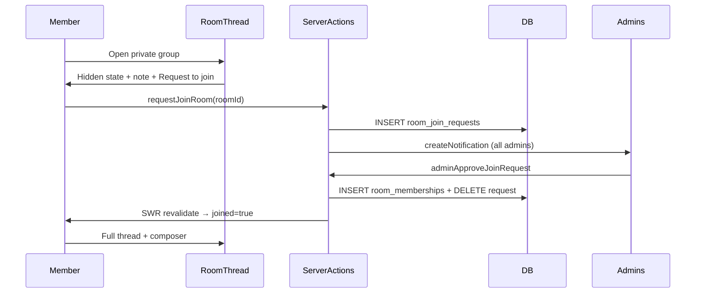

# Private Groups — Spec & Implementation Plan

## Scope

Admins can mark groups as **private** at create or edit time, optionally add a **note** shown to non-members, and manage membership through a new **Group Members** drawer. Members must **request to join** private groups; admins approve/deny in the drawer or remove existing members. Non-members see a **hidden state** (no message preview) until approved. Admins receive **in-app notifications** for new join requests.

### Shaping decisions (confirmed)

| Decision                                 | Choice                                                |
| ---------------------------------------- | ----------------------------------------------------- |
| Message visibility (private, non-member) | Hidden state only — no message preview until approved |
| Admin notifications                      | Yes — notify admins on new join requests              |
| Privacy editing                          | Create and edit — privacy + note editable anytime     |
| Auto-join + private                      | Mutually exclusive (private disables auto-join)       |

### Visual references

User provided 6 screenshots saved to workspace assets:

- Groups list + Manage Groups entry
- Manage groups table
- Create group modal (baseline)
- Public group thread join state (baseline)
- Request-to-join pending state (mobile mockup)
- Request-to-join CTA state (mobile mockup)

Adapt mobile mockup patterns to existing **right flyout drawer** conventions on web.

---

## Architecture



### Data model changes

New migration (manual SQL, per project convention):

**[`community_rooms`](supabase/migrations/20260725000000_create_room_tables.sql)** — add columns:

- `is_private boolean not null default false`
- `private_note text not null default ''` (admin-facing note for hidden state)

**New table `room_join_requests`:**

- `room_id uuid` FK → `community_rooms`
- `profile_id uuid` FK → `profiles`
- `requested_at timestamptz default now()`
- PK `(room_id, profile_id)`
- RLS: users insert/delete own pending row; admins full access

**RPC / RLS updates:**

- Extend [`list_rooms_for_user()`](supabase/migrations/20260725000000_create_room_tables.sql) to return `is_private`, `private_note`, `join_request_pending boolean`
- Update `room_messages` SELECT policy: for `is_private` rooms, require membership (via `is_room_member`)
- Update `get_room_thread()`: return empty/forbidden for non-members of private rooms
- Update `auto_join_default_rooms` trigger: skip `is_private = true` rooms

### Type extensions

[`lib/messages-data.ts`](lib/messages-data.ts) — `Room`:

```typescript
isPrivate?: boolean
privateNote?: string
joinRequestPending?: boolean
```

[`lib/rooms/actions.ts`](lib/rooms/actions.ts) — `AdminRoomRecord`:

```typescript
isPrivate: boolean;
privateNote: string;
pendingRequestCount: number; // for Members column badge
```

---

## Task 1: Save Spec Documentation

Create [`agent-os/specs/2026-09-20-1648-private-groups/`](agent-os/specs/2026-09-20-1648-private-groups/) with:

- **plan.md** — this plan
- **shape.md** — scope, decisions, visuals list, product alignment
- **standards.md** — full content of: `page-shell`, `shadcn-ui`, `design-tokens`, `board-pattern`
- **references.md** — pointers below
- **visuals/** — copy 6 provided screenshots

---

## Task 2: Database Migration

Create [`supabase/migrations/20260920170000_private_groups.sql`](supabase/migrations/20260920170000_private_groups.sql):

1. Add `is_private`, `private_note` to `community_rooms`
2. Create `room_join_requests` table + indexes + RLS policies
3. Update `list_rooms_for_user()` to expose new fields + pending request flag
4. Tighten `room_messages` RLS for private rooms
5. Guard `get_room_thread()` for private non-members
6. Exclude private rooms from auto-join trigger
7. Add `get_room_member_counts` extension or new RPC `get_room_admin_member_summary(room_id)` returning `{ members[], pending[] }` for admin drawer

---

## Task 3: Server Actions

Extend [`lib/rooms/actions.ts`](lib/rooms/actions.ts):

| Action                                       | Purpose                                                             |
| -------------------------------------------- | ------------------------------------------------------------------- |
| `requestJoinRoom(roomId)`                    | Insert pending request (private rooms only)                         |
| `cancelJoinRequest(roomId)`                  | User withdraws own pending request                                  |
| `joinRoom(roomId)`                           | Unchanged for public; delegate to `requestJoinRoom` for private     |
| `adminListRoomMembers(roomId)`               | Returns `{ members, pending }` with profile preview fields          |
| `adminApproveJoinRequest(roomId, profileId)` | Insert membership, delete request                                   |
| `adminDenyJoinRequest(roomId, profileId)`    | Delete request                                                      |
| `adminRemoveMember(roomId, profileId)`       | Delete membership (rescind access)                                  |
| `adminCreateRoom` / `adminUpdateRoom`        | Accept `isPrivate`, `privateNote`; enforce `isPrivate → !isDefault` |

**Notifications** — in `requestJoinRoom`, after insert:

- Query all profiles with `role in ('owner', 'admin')`
- Call [`createNotification`](lib/notifications/actions.ts) with kind `room_join_request`, title/body including group + requester name, `data: { roomId, profileId }`

Update [`lib/notifications-data.ts`](lib/notifications-data.ts) + [`components/notifications.tsx`](components/notifications.tsx) to route `room_join_request` clicks to `/groups/settings?room={roomId}&members=1`.

---

## Task 4: Admin Create/Edit Dialogs

**[`components/groups/create-room-dialog.tsx`](components/groups/create-room-dialog.tsx)** and **[`components/groups/edit-room-dialog.tsx`](components/groups/edit-room-dialog.tsx)**:

- Add **Private group** toggle (below auto-join)
- When private ON: show **Note** textarea (`privateNote`) with helper text explaining it appears in the hidden state
- When private ON: force `isDefault = false` and disable auto-join toggle
- Pass new fields to `adminCreateRoom` / `adminUpdateRoom`

**[`components/groups/rooms-table.tsx`](components/groups/rooms-table.tsx)**:

- Show `private` badge alongside existing `auto-join` badge
- Make **Members** cell clickable → opens Group Members drawer
- Show pending count indicator when `pendingRequestCount > 0` (e.g. badge on count)

---

## Task 5: Group Members Drawer (new)

Create **[`components/groups/group-members-drawer.tsx`](components/groups/group-members-drawer.tsx)**:

**API:**

```typescript
GroupMembersDrawer({
  room: AdminRoomRecord | null,
  open: boolean,
  onOpenChange: (open: boolean) => void,
})
```

**Layout** (follow [`FLYOUT_DRAWER_CONTENT_CLASS`](components/messages/flyout-drawer.tsx) + [`ApplicationReviewPanel`](components/applications/application-review-panel.tsx) patterns):

1. Header: group emoji + name
2. **Pending requests** section (if any): avatar, name, requested date, **Approve** / **Deny** buttons
3. **Members** section: avatar, name, joined date, **Remove** action (with confirm)
4. Row click → open nested [`PersonProfileDrawer`](components/people/person-profile-drawer.tsx) (render inside drawer content for automatic stack)
5. Use `requestAnimationFrame` first-mount pattern from [`job-management-detail.tsx`](components/jobs/job-management-detail.tsx) when opening profile

Wire into [`rooms-table.tsx`](components/groups/rooms-table.tsx) and support deep link from [`app/(app)/groups/settings/page.tsx`](<app/(app)/groups/settings/page.tsx>) via `?room=&members=1` search params.

---

## Task 6: Member Join Flow — Hidden State UI

**New component:** [`components/rooms/room-private-gate.tsx`](components/rooms/room-private-gate.tsx)

Renders the hidden state inside [`room-thread.tsx`](components/rooms/room-thread.tsx) when `room.isPrivate && !room.joined`:

- Group icon, name, description
- Member avatar preview ([`RoomMembersAvatarGroup`](components/rooms/room-members-avatar-group.tsx))
- Admin **private note** with truncated "See more" expand
- States:
  - **Not requested:** "An admin must approve your request." + **Request to join** button
  - **Pending:** "Waiting for admin approval." + **Cancel request** button
- No message scroller rendered in this state

**Update [`room-thread.tsx`](components/rooms/room-thread.tsx):**

- Replace join footer/header for private rooms with gate component
- Skip `useRoomThread` fetch when private + not joined (avoid unnecessary API calls)

**Update [`components/rooms/rooms-inbox.tsx`](components/rooms/rooms-inbox.tsx)** + [`rooms-provider.tsx`](components/rooms/rooms-provider.tsx):

- Show "Request" instead of "Join" for private unjoined groups
- `toggleJoin` routes to `requestJoinRoom` / `cancelJoinRequest` based on pending state

**Update [`lib/rooms/hooks/use-rooms-list.ts`](lib/rooms/hooks/use-rooms-list.ts)** mapping for new Room fields.

---

## Task 7: Smoke Test Checklist

- Admin creates private group with note → appears in table with private badge
- Member sees hidden state (no messages), note, Request to join
- Request creates pending row; admin notification appears
- Admin opens Members drawer from table → sees pending request → Approve
- Member gains access, sees full thread
- Admin Remove member → member returns to hidden state
- Member Cancel request works before approval
- Edit group: toggle private + update note
- Public groups unchanged (instant join, message preview)
- Auto-join incompatible with private

---

## Reference Implementations

| Feature                | Location                                                                                                                     | Reuse                       |
| ---------------------- | ---------------------------------------------------------------------------------------------------------------------------- | --------------------------- |
| Manage groups table    | [`components/groups/rooms-table.tsx`](components/groups/rooms-table.tsx)                                                     | Members column click target |
| Create/edit dialogs    | [`components/groups/create-room-dialog.tsx`](components/groups/create-room-dialog.tsx)                                       | Toggle + textarea pattern   |
| Nested drawer stack    | [`components/ui/drawer.tsx`](components/ui/drawer.tsx)                                                                       | Base UI stack behavior      |
| Profile drawer         | [`components/people/person-profile-drawer.tsx`](components/people/person-profile-drawer.tsx)                                 | Nested member detail        |
| Approve/deny review    | [`components/applications/application-review-panel.tsx`](components/applications/application-review-panel.tsx)               | Pending section actions     |
| Notifications          | [`lib/notifications/actions.ts`](lib/notifications/actions.ts)                                                               | Admin notify on request     |
| Room join (current)    | [`lib/rooms/actions.ts`](lib/rooms/actions.ts) `joinRoom`                                                                    | Public path unchanged       |
| Prior rooms admin spec | [`agent-os/specs/2026-07-30-1510-rooms-settings-admin/plan.md`](agent-os/specs/2026-07-30-1510-rooms-settings-admin/plan.md) | Settings page patterns      |

## Product Alignment

From [`agent-os/product/mission.md`](agent-os/product/mission.md): AWN is a **private, invite-only** network where trust is the moat. Private discipline-specific rooms with admin-gated access aligns with "private rooms that don't exist yet" and manual vetting — extending platform-level trust to community spaces.

## Standards Applied

- **global/page-shell** — Settings page keeps `PageShell` wrapper
- **css/shadcn-ui** — Drawer, Dialog, Switch, Textarea from `@/components/ui/*`
- **css/design-tokens** — Spacing, muted text, badge variants for private/pending states
- **global/board-pattern** — Member list rows follow existing people/message picker list patterns
