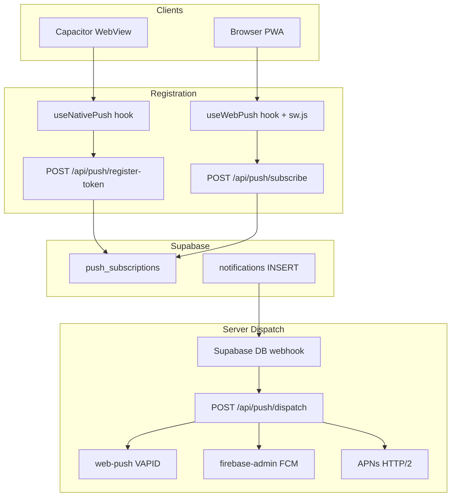

# Capacitor Phase 2 — Native + VAPID Push Notifications

## Context

Phase 1 ([capacitor.config.ts](../../../capacitor.config.ts)) wired the native shell with `@capacitor/push-notifications` config but no JS bridge, no Firebase/APNs files, and no server routes. AWN v0 has **in-app notifications fully working** (Supabase `notifications` table + Realtime UI) but **zero push delivery code**.

You confirmed:

- **Scope:** Native Capacitor push **and** browser VAPID web push (dual-path)
- **Approach:** Build fresh in awn-v0 conventions; old app (`_misc/awn-old`) is UX/reference only
- **Visuals:** Follow old app push UX patterns (auto-register on native, "Enable push" in settings)
- **Credentials on hand:**
  - `GoogleService-Info.plist` — **done** — at [ios/App/App/GoogleService-Info.plist](../../../ios/App/App/GoogleService-Info.plist) (project `awrightnetwork`, bundle `com.awrightworld.awn.app`)
  - `google-services.json` — **done** — at [android/app/google-services.json](../../../android/app/google-services.json) (gitignored; same Firebase project)

## Architecture



**Token types stored in one table** (old-app pattern, adapted):

| Platform | `endpoint` column     | `subscription` JSONB                              |
| -------- | --------------------- | ------------------------------------------------- |
| Web      | Push API endpoint URL | Full `PushSubscription` object, `{ type: 'web' }` |
| iOS      | APNs device token     | `{ token, platform: 'ios', type: 'native' }`      |
| Android  | FCM token             | `{ token, platform: 'android', type: 'native' }`  |

**Dispatch branching** in `lib/push/dispatch.ts`:

- `type: 'web'` → `web-push` (VAPID)
- `platform: 'android'` → `firebase-admin` (FCM)
- `platform: 'ios'` → APNs HTTP/2 (`.p8` auth key — Capacitor returns APNs tokens, not FCM tokens on iOS)

## Key Decisions

- **Remote URL mode stays** — native app loads `https://awn-v0.vercel.app/`; push API routes must be deployed to production before native testing works end-to-end (or temporarily override `server.url` for dev)
- **Single dispatch entry point** — Supabase Database Webhook on `notifications` INSERT → `/api/push/dispatch` covers both DB-trigger notifications (DMs, room mentions) and server-action notifications (job updates, vouches)
- **Reuse in-app notification as event source** — push payload mirrors `{ title, body, data.url }`; no duplicate business logic
- **Respect existing mute/viewing filters at dispatch time** — skip push when user is viewing the conversation/room (query `profiles.viewing_conversation_id` / `viewing_room_id`) or room is muted (`is_room_muted_for_user`)
- **Category preference toggles stay "coming soon"** — Phase 2 wires the "Enable push" delivery channel only; per-kind toggles remain deferred (matches current [notifications-settings-section.tsx](../../../components/settings/notifications-settings-section.tsx) state)
- **Deep links use Next.js paths** — e.g. `/messages?conversation=…`, `/messages?room=…`, not old app's `?tab=` nav state

## User Tasks (Required Before Full Testing)

These cannot be completed by code alone. Flagged per task below.

| Task                               | Status  | What you need to do                                                                                                                                                                                                                                                                                                                                                                            |
| ---------------------------------- | ------- | ---------------------------------------------------------------------------------------------------------------------------------------------------------------------------------------------------------------------------------------------------------------------------------------------------------------------------------------------------------------------------------------------- |
| **UT-1: google-services.json**     | ✅ Done | Already at `android/app/google-services.json`. Gradle will auto-apply the `google-services` plugin on next Android build.                                                                                                                                                                                                                                                                      |
| **UT-2: APNs Auth Key**            | Pending | Apple Developer → Keys → create APNs key (`.p8`) → note Key ID + Team ID → provide to env as `APNS_KEY_ID`, `APNS_TEAM_ID`, `APNS_KEY` (base64 or PEM content)                                                                                                                                                                                                                                 |
| **UT-3: Firebase Service Account** | Pending | Firebase Console → Project Settings → Service Accounts → generate JSON → env as `FIREBASE_SERVICE_ACCOUNT_JSON` (for server-side FCM)                                                                                                                                                                                                                                                          |
| **UT-4: VAPID keys**               | Pending | Generate key pair (`npx web-push generate-vapid-keys`) → env as `NEXT_PUBLIC_VAPID_PUBLIC_KEY` + `VAPID_PRIVATE_KEY`                                                                                                                                                                                                                                                                           |
| **UT-5: Xcode Push capability**    | Partial | Plist file is on disk at `ios/App/App/GoogleService-Info.plist` but **not yet in the Xcode target** (not referenced in `project.pbxproj`). In Xcode: add **Push Notifications** + **Background Modes → Remote notifications** capabilities, and confirm plist appears under App target → Build Phases → Copy Bundle Resources (drag in if missing). Agent can also wire pbxproj during Task 4. |
| **UT-6: Supabase webhook**         | Pending | Supabase Dashboard → Database Webhooks → `notifications` INSERT → POST to `https://awn-v0.vercel.app/api/push/dispatch` with `x-internal-secret` header                                                                                                                                                                                                                                       |
| **UT-7: Deploy + device test**     | Pending | Deploy push routes to Vercel with new env vars; test on physical iOS + Android devices (push unreliable in simulators)                                                                                                                                                                                                                                                                         |

---

## Task 2: Database Migration — `push_subscriptions`

New migration in [supabase/migrations/](../../../supabase/migrations/):

```sql
CREATE TABLE push_subscriptions (
  id uuid PRIMARY KEY DEFAULT gen_random_uuid(),
  user_id uuid NOT NULL REFERENCES profiles(id) ON DELETE CASCADE,
  endpoint text NOT NULL UNIQUE,
  subscription jsonb NOT NULL,
  created_at timestamptz DEFAULT now(),
  updated_at timestamptz DEFAULT now()
);
-- RLS: users manage own rows; service role reads all for dispatch
```

Adapt from old app schema at `_misc/awn-old/supabase/migrations/20260425_push_subscriptions.sql`.

---

## Task 3: Environment Variables

Update [.env.example](../../../.env.example) with:

```
# Web Push (VAPID)                          ← UT-4
NEXT_PUBLIC_VAPID_PUBLIC_KEY=
VAPID_PRIVATE_KEY=
VAPID_EMAIL=

# Native push — Android FCM                 ← UT-3
FIREBASE_SERVICE_ACCOUNT_JSON=

# Native push — iOS APNs                    ← UT-2
APNS_KEY_ID=
APNS_TEAM_ID=
APNS_KEY=
APNS_BUNDLE_ID=com.awrightworld.awn.app

# Internal webhook auth                     ← UT-6
INTERNAL_API_SECRET=
```

Add npm deps: `web-push`, `firebase-admin`, `apns2` (or equivalent maintained APNs client).

---

## Task 4: Native Platform Configuration

**Already done (user):**

- [android/app/google-services.json](../../../android/app/google-services.json) — Android FCM client config
- [ios/App/App/GoogleService-Info.plist](../../../ios/App/App/GoogleService-Info.plist) — iOS Firebase config file on disk

**Agent work:**

- Add `GoogleService-Info.plist` to Xcode project target (`ios/App/App.xcodeproj/project.pbxproj` → Copy Bundle Resources) — file exists but is not yet referenced in pbxproj
- Run `npx cap sync ios` and `npx cap sync android` to add `CapacitorPushNotifications` pod (currently missing from [ios/App/Podfile](../../../ios/App/Podfile))
- Add `POST_NOTIFICATIONS` permission to [android/app/src/main/AndroidManifest.xml](../../../android/app/src/main/AndroidManifest.xml) (Android 13+)
- Add `UIBackgroundModes` → `remote-notification` to iOS `Info.plist`

**Blocked on you:** UT-5 (Xcode Signing & Capabilities — Push Notifications + Background Modes; confirm or drag plist into target if agent pbxproj edit isn't sufficient)

Both Firebase client config files are in place. Gradle hook in [android/app/build.gradle](../../../android/app/build.gradle) will auto-apply `google-services` plugin on next Android build.

---

## Task 5: Server Push Library — `lib/push/`

New modules (awn-v0 conventions):

| File                      | Purpose                                                                          |
| ------------------------- | -------------------------------------------------------------------------------- |
| `lib/push/types.ts`       | Subscription row types, dispatch payload                                         |
| `lib/push/send-web.ts`    | VAPID send via `web-push`; prune 410/404 subscriptions                           |
| `lib/push/send-fcm.ts`    | FCM send via `firebase-admin` for Android tokens                                 |
| `lib/push/send-apns.ts`   | APNs HTTP/2 send for iOS tokens                                                  |
| `lib/push/dispatch.ts`    | Load user subscriptions → branch by `type`/`platform` → send all → return counts |
| `lib/push/should-send.ts` | Check viewing/mute state before dispatch                                         |

Payload shape (consistent across channels):

```json
{
  "title": "...",
  "body": "...",
  "url": "/messages?conversation=...",
  "tag": "dm_message"
}
```

---

## Task 6: API Routes

New routes under `app/api/push/`:

| Route                     | Auth                                                                        | Purpose                          |
| ------------------------- | --------------------------------------------------------------------------- | -------------------------------- |
| `register-token/route.ts` | Supabase session (Bearer or cookie via [createClient](../../../lib/supabase/server)) | Native token upsert              |
| `subscribe/route.ts`      | Same                                                                        | Web Push subscription upsert     |
| `unsubscribe/route.ts`    | Same                                                                        | Remove subscription on opt-out   |
| `dispatch/route.ts`       | `x-internal-secret` header (webhook) or service role                        | Send push for a notification row |

Auth pattern: follow [app/api/presence/offline/route.ts](../../../app/api/presence/offline/route.ts) (cookie session) for user routes; internal secret for webhook (old app pattern from `_misc/awn-old/src/app/api/push/send/route.ts`).

---

## Task 7: Client — Native Push Bridge

New client module mounted from [app/(app)/layout.tsx](../../../app/(app)/layout.tsx):

- `components/push/native-push-provider.tsx` — client component wrapper
- `lib/push/use-native-push.ts` — hook adapted from old `HomeApp.tsx` pattern:
  - Guard: `Capacitor.isNativePlatform()`
  - Dynamic import `@capacitor/push-notifications`
  - Permission flow → `register()`
  - `registration` listener → POST token to `/api/push/register-token`
  - `pushNotificationActionPerformed` → `router.push(data.url)` (Next.js navigation, not tab state)

Auto-register on authenticated app mount (old app UX). Re-register on session refresh.

---

## Task 8: Client — Web Push (VAPID)

- `public/sw.js` — push + notificationclick handlers (adapt from `_misc/awn-old/public/sw.js`; enforce relative URLs for security)
- `lib/push/use-web-push.ts` — permission request, SW registration, subscribe, POST to `/api/push/subscribe`
- Register SW from root [app/layout.tsx](../../../app/layout.tsx) or a small `WebPushRegistrar` client component
- Wire [notifications-settings-section.tsx](../../../components/settings/notifications-settings-section.tsx) "Enable push" button:
  - Native context → triggers permission flow via native hook
  - Browser context → triggers VAPID subscribe flow
  - Show enabled/disabled state based on active subscription

---

## Task 9: Notification → Push Dispatch

- Implement `/api/push/dispatch` to accept `{ notificationId }` or full notification row fields
- Look up recipient subscriptions and call `lib/push/dispatch.ts`
- Build deep-link URLs from notification `kind` + `data` jsonb (reuse mapping logic from [lib/notifications-data.ts](../../../lib/notifications-data.ts))

**Blocked on you:** UT-6 (Supabase webhook configuration in dashboard)

For server-action-created notifications ([lib/notifications/actions.ts](../../../lib/notifications/actions.ts) `createNotification`), optionally call dispatch via Next.js `after()` as a belt-and-suspenders path until webhook is verified.

---

## Task 10: Smoke Test & Verification

Checklist:

- [ ] `npx cap sync` — `CapacitorPushNotifications` pod present
- [ ] Android build with `google-services.json` — no Gradle errors (file already at `android/app/google-services.json`)
- [ ] iOS build with Push capability — no signing errors (`GoogleService-Info.plist` on disk; verify in Xcode target)
- [ ] Native app: permission prompt → token saved in `push_subscriptions`
- [ ] Browser: "Enable push" → subscription saved
- [ ] Send test DM → in-app notification + push received on device
- [ ] Tap push notification → deep link opens correct screen
- [ ] Opt-out removes subscription row

---

## Files Changed (Summary)

| Action      | Path                                                                           |
| ----------- | ------------------------------------------------------------------------------ |
| New         | `supabase/migrations/*_push_subscriptions.sql`                                 |
| New         | `lib/push/*` (6 modules)                                                       |
| New         | `app/api/push/{register-token,subscribe,unsubscribe,dispatch}/route.ts`        |
| New         | `components/push/native-push-provider.tsx`                                     |
| New         | `public/sw.js`                                                                 |
| Modified    | `app/(app)/layout.tsx` — mount NativePushProvider                              |
| Modified    | `components/settings/notifications-settings-section.tsx` — wire Enable push    |
| Modified    | `.env.example`, `package.json`                                                 |
| Modified    | `ios/App/App/Info.plist`, `android/app/src/main/AndroidManifest.xml`           |
| Done (user) | `ios/App/App/GoogleService-Info.plist` — in place (agent: add to Xcode target) |
| Done (user) | `android/app/google-services.json` — in place, gitignored                      |

## Risks & Notes

- **Production dependency:** Remote URL mode means native testing hits production API — deploy push routes before device testing, or temporarily set `server.url` to a tunnel/local IP for dev
- **iOS ≠ FCM on client:** `GoogleService-Info.plist` helps Firebase project continuity but iOS Capacitor tokens are APNs — server must use APNs HTTP/2, not FCM, for iOS delivery
- **Old app gap:** Old app registered native tokens but never sent to them — Phase 2 builds the missing server send path
- **Secrets:** Never commit `.p8`, service account JSON, or VAPID private key; plist API key in repo is low-risk but prefer env-based config long-term

## Firebase Config Note

Original source copy: [agent-os/product/misc/GoogleService-Info.plist](../../product/misc/GoogleService-Info.plist) (if present). Wired copy for the iOS app target: [ios/App/App/GoogleService-Info.plist](../../../ios/App/App/GoogleService-Info.plist).
