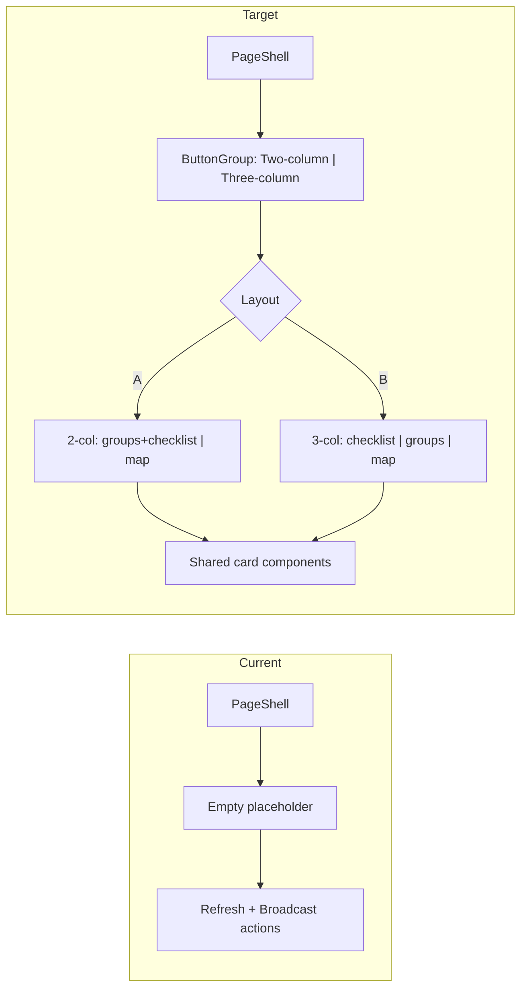

## Shaping Summary

| Decision    | Choice                                                                                                                               |
| ----------- | ------------------------------------------------------------------------------------------------------------------------------------ |
| Scope       | Design-first UI — first-login Now page with mock data; no backend wiring this pass                                                  |
| Layouts     | Two switchable arrangements (Layout A two-column, Layout B three-column) sharing one component set; header `ButtonGroup` toggle     |
| Map         | Real Mapbox GL via `react-map-gl` (dynamic import, `ssr: false`); striped CSS fallback when token missing                             |
| Gating      | Render first-login onboarding state statically as the default Now page; member detection/dismissal deferred                          |
| References  | `PageShell`, existing Help Now dialog, `lib/*-data.ts` mock pattern, groups/rooms discipline model                                  |
| Standards   | `css/design-tokens`, `css/shadcn-ui`, `global/page-shell`                                                                            |

**Visual references:** 9 mockups in `visuals/` — Layout A desktop/mobile, component crops, current empty page, map overlays.

**Product alignment:** Phase 1 **Now** tab from [roadmap.md](../../product/roadmap.md) — live availability, Help Now callouts, On The Road check-in map. Replaces placeholder at [`app/(app)/now/page.tsx`](../../../app/(app)/now/page.tsx).

---

## Current vs Target



**What stays the same:**

- Route: [`app/(app)/now/page.tsx`](../../../app/(app)/now/page.tsx)
- Nav description from [`lib/nav.ts`](../../../lib/nav.ts)
- Site header (search, Help Now button, profile) — unchanged
- Existing Help Now dialog for checklist step 3

**What changes:**

- Replace empty placeholder with onboarding UI composed from `components/now/*`
- Remove Refresh/Broadcast header actions; replace with layout toggle in `NowView`
- Add Mapbox deps + `NEXT_PUBLIC_MAPBOX_TOKEN` in `.env.example`

---

## Two Layouts, One Component Set

Same three card components in both; only arrangement/order differs. Toggle default = Layout A.

**Layout A — Two-column** (initial mockups, `visuals/layout-a-desktop.png`, `visuals/layout-a-mobile.png`):

- Desktop: left `[380px]` stacks Choose-your-groups (top) + Getting-started (bottom); right `[1fr]` is the Who's-around map.
- Mobile order: Help Now banner → Choose groups (chips) → map + "Check in here" → Getting started.

**Layout B — Three-column "accordion rail"** (follow-up mockups from shaping session):

- Desktop: three columns `[1fr_1fr_1.25fr]` — Getting-started (left) · Choose-your-groups (middle, full rows) · Who's-around map (right, hero/widest).
- Mobile order: Getting started → Choose groups (chips) → map + "Check in here" (no Help Now banner).

```
now-view (client)  ── owns layout toggle state ("A" | "B")
├─ PageShell actions → ButtonGroup [ Two-column | Three-column ]
├─ HelpNowBanner        (Layout A mobile only)
├─ ChooseGroupsCard     (shared; row vs chip variant via prop)
├─ GettingStartedCard   (shared; progress + accordion checklist)
└─ WhosAroundCard       (shared; Mapbox map + overlays)
   └─ NowMap            (dynamic, ssr:false, token→Mapbox / no token→striped fallback)
```

---

## Task 1: Save Spec Documentation

Create `agent-os/specs/2026-09-22-1726-now-onboarding/` with:

- **plan.md** — this plan
- **shape.md** — scope, decisions, visuals, product alignment
- **standards.md** — full content of `css/design-tokens`, `css/shadcn-ui`, `global/page-shell`
- **references.md** — pointers to current implementation files
- **visuals/** — 9 provided mockups (see `shape.md` for filenames)

---

## Task 2: Dependencies & Environment

- Add `mapbox-gl` + `react-map-gl` (import `Map` from `react-map-gl/mapbox`), and `mapbox-gl/dist/mapbox-gl.css`.
- Add `NEXT_PUBLIC_MAPBOX_TOKEN=` to [`.env.example`](../../../.env.example).
- Dynamic-import the map: `const NowMap = dynamic(() => import("./now-map"), { ssr: false })`.

---

## Task 3: Mock Data

Create [`lib/now/now-data.ts`](../../../lib/now/now-data.ts):

- `featuredGroups` (emoji, name, id), `totalGroupCount`, `nearbyCrew` (name, role, initials, coords), `checklistItems`, `homeBase` (Denver coords)
- Mirrors the `lib/*-data.ts` pattern (e.g. [`lib/people-data.ts`](../../../lib/people-data.ts))

Create [`lib/now/greeting.ts`](../../../lib/now/greeting.ts):

- Time-of-day greeting helper for `PageShell` title

---

## Task 4: Choose Groups Card

Build [`components/now/choose-groups-card.tsx`](../../../components/now/choose-groups-card.tsx):

- `Card` header "Choose your groups" + `0/3` counter (top-right)
- Featured discipline rows (emoji + name + `Join` button) from mock data; `Join` toggles local joined state and updates counter
- Muted link "See all N groups"
- `variant` prop: `"rows"` (default, full list) vs `"chips"` (compact pills for mobile)

---

## Task 5: Getting Started Card

Build [`components/now/getting-started-card.tsx`](../../../components/now/getting-started-card.tsx):

- `Card` header "Getting started" + subtitle; "Step 1 of 3" label + `Progress`
- `Accordion` with 3 items:
  - "Finish your profile" → `/account`
  - "Invite a crew member" → `/invites`
  - "Post a Help Now request" (orange border highlight) → existing Help Now dialog
- Circle status icons per item

---

## Task 6: Who's Around Map Card

Build [`components/now/whos-around-card.tsx`](../../../components/now/whos-around-card.tsx) + [`components/now/now-map.tsx`](../../../components/now/now-map.tsx):

- Rounded `Card` filling the map column; map + absolutely-positioned overlays:
  - Top-left search input ("Search city, venue or crew…"), top-right white `Check in here` button
  - Bottom-left nearby-crew card ("Denver · 6 checked in nearby" + 3 avatar rows)
  - Bottom-right filter chips (Everyone / My crews / Open for work) with local selected state
  - "You" marker: pulsing cyan dot; other crew as neutral pins
- `NowMap`: `react-map-gl` `Map` with `mapbox://styles/mapbox/dark-v11`, centered on mock Denver; `Marker`s for crew. If `!token`, striped-dark CSS placeholder.

---

## Task 7: Now View + Layout Toggle

Build [`components/now/now-view.tsx`](../../../components/now/now-view.tsx) (client):

- Owns layout toggle state (`"A" | "B"`)
- Renders `PageShell` with `ButtonGroup` in `actions` ("Two-column" / "Three-column")
- Arranges shared cards for both layouts; card-local state preserved across layout switches
- Layout A mobile: include `HelpNowBanner`

---

## Task 8: Page Wiring

Update [`app/(app)/now/page.tsx`](../../../app/(app)/now/page.tsx):

- Server component computes time-of-day greeting + pulls nav description
- Renders `<NowView greeting={…} description={…} />`
- No Refresh/Broadcast actions (handled inside `NowView`)

---

## Task 9: Manual Verification

- `/now` renders Layout A by default; toggle switches to Layout B without losing card state
- Desktop and mobile match mockups for both layouts
- Join buttons toggle Joined state and counter
- Checklist links navigate; Help Now step opens dialog
- Map renders with token; striped fallback without token
- Semantic tokens only — no raw hex

---

## Key Files

| File | Action |
| ---- | ------ |
| `agent-os/specs/2026-09-22-1726-now-onboarding/*` | Spec docs (Task 1) |
| `components/now/*.tsx` | New onboarding components |
| `lib/now/now-data.ts`, `lib/now/greeting.ts` | Mock data + greeting |
| `app/(app)/now/page.tsx` | Wire NowView |
| `.env.example`, `package.json` | Mapbox token + deps |

---

## Out of Scope

- Backend wiring (groups join, check-in persistence, member gating)
- Push notifications, Help Now feed, room activity on Now tab
- Real search/filter on map
- Consolidating legacy `/now-v2` or proximity components from prior experiments
