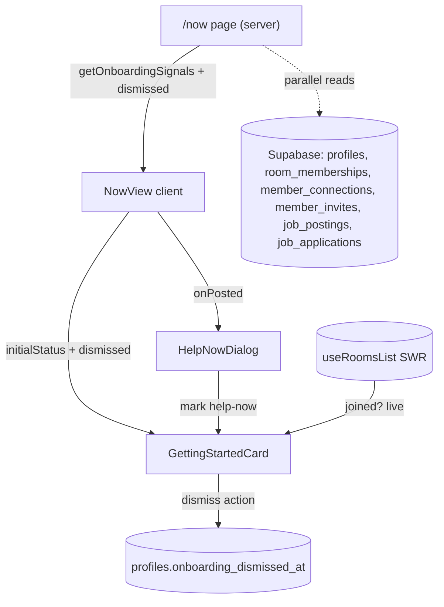

# Getting Started Task Tracking

Turn the static 3-item `GettingStartedCard` on `/now` into a 7-item tracked checklist. Completion is **derived from existing Supabase data** (no new tracking tables); same-page actions update **live**; a **Dismiss** footer hides the card per-user via a new profile column.

## Current State

- `components/now/getting-started-card.tsx` renders 3 hardcoded items from `checklistItems` with a fake `const currentStep = 1` and dashed-only status icons. No completion, no dismiss.
- `lib/now/now-data.ts` defines `ChecklistItemId = "profile" | "invite" | "help-now"` and `checklistItems` (3 items).
- `app/(app)/now/page.tsx` only fetches `getSessionUser()` for the greeting; `components/now/now-view.tsx` mounts the cards + `HelpNowDialog`.
- All 7 underlying actions already persist to Supabase; completion signals exist in the DB.

## Target Data Flow



## The 7 items (id -> signal -> CTA)

- `profile` "Finish your profile" -> `avatar_url` AND `home_base` set -> Link `/account`
- `join-group` "Join a group" -> any `room_memberships` row -> live from `useRoomsList()`; fallback Link to groups page
- `connect` "Connect with a member" -> any `member_connections` with `status='accepted'` (requester or recipient) -> Link `/people`
- `invite` "Send an invite" -> any `member_invites` where `inviter_id = user` -> Link `/people` (member invite popover lives there; `/invites` is admin-only)
- `help-now` "Post a Help Now request" -> any `job_postings` `kind='urgent'`, `poster_id=user`, not deleted -> existing Help Now dialog (`onOpenHelpNow`)
- `create-job` "Create a job" -> any `job_postings` `poster_id=user`, not deleted -> Link `/jobs/new`
- `apply-job` "Apply to a job" -> any `job_applications` `applicant_id=user`, not withdrawn -> Link `/jobs`

Progress = `completedCount / 7`; a completed item shows a filled/check icon and hides its CTA.

## Decisions (defaults chosen)

- Profile "complete" = `avatar_url` + `home_base` present (drop `availability` since it is NOT NULL with a default, so it is always set).
- Invite CTA points to `/people` (not admin-only `/invites`).
- Progress label copy changes from "Step 1 of 3" to "{completed} of 7 complete".
- Reads use the cookie-based `createClient()` under RLS (no admin client needed).

## Task 1: Save Spec Documentation

Create `agent-os/specs/2026-09-23-1528-getting-started-tracking/` with `plan.md`, `shape.md`, `references.md`, and `visuals/` (mockup).

## Task 2: Dismiss persistence (migration)

Add `supabase/migrations/20260923152800_add_onboarding_dismissed_at.sql`:

```sql
alter table public.profiles
  add column if not exists onboarding_dismissed_at timestamptz;
```

## Task 3: Server signals helper + dismiss action

- Create `lib/onboarding/progress.ts` exporting `getOnboardingSignals()` wrapped in `React.cache`, returning the 7 booleans + `dismissed`. Run all checks in one `Promise.all` using `createClient()` and `getSessionUser().id` (head+count existence checks).
- Create `lib/onboarding/actions.ts` with `"use server"` `dismissOnboarding()` -> `update profiles set onboarding_dismissed_at = now() where id = user.id` (auth-checked inside the action).

## Task 4: Expand checklist data model

Update `lib/now/now-data.ts`: widen `ChecklistItemId` to the 7 ids above and replace `checklistItems` with the 7 items.

## Task 5: Rework GettingStartedCard

- Accept `initialStatus`, `initialDismissed`, `helpNowPosted?`, and existing `onOpenHelpNow`.
- Derive live `joinedGroup` via `useRoomsList()`; merge `helpNowPosted` for `help-now`.
- Completed items show a filled check; open first incomplete item by default; hide CTA when complete.
- Per-item CTA switch for all 7.
- Progress bar + "{completed} of 7 complete" label.
- Footer: "Dismiss (Skip this)" -> optimistic hide + `dismissOnboarding()`; render `null` when dismissed.

## Task 6: Page + NowView wiring

- `app/(app)/now/page.tsx`: call `getOnboardingSignals()` in parallel with `getSessionUser()`; pass `status` + `dismissed` into `NowView`.
- `components/now/now-view.tsx`: forward props to `GettingStartedCard`; track `helpNowPosted` state and pass an `onPosted` callback to `HelpNowDialog`.
- `components/help-now/help-now-dialog.tsx`: add optional `onPosted?: () => void`.

## Task 7: Manual verification

- Fresh account: all items dashed, "0 of 7 complete".
- Join a group in the adjacent card -> "Join a group" ticks without reload.
- Post Help Now from the card -> ticks immediately.
- Complete profile / connect / invite / create job / apply -> reflected on next `/now` load.
- Dismiss hides the card and stays hidden after reload and on another device.

## Out of Scope

- Backfilling `availability` "explicitly chosen" signal.
- Reordering/animating the checklist, confetti, or "all done" celebration state.
- Changing the underlying action flows themselves.
