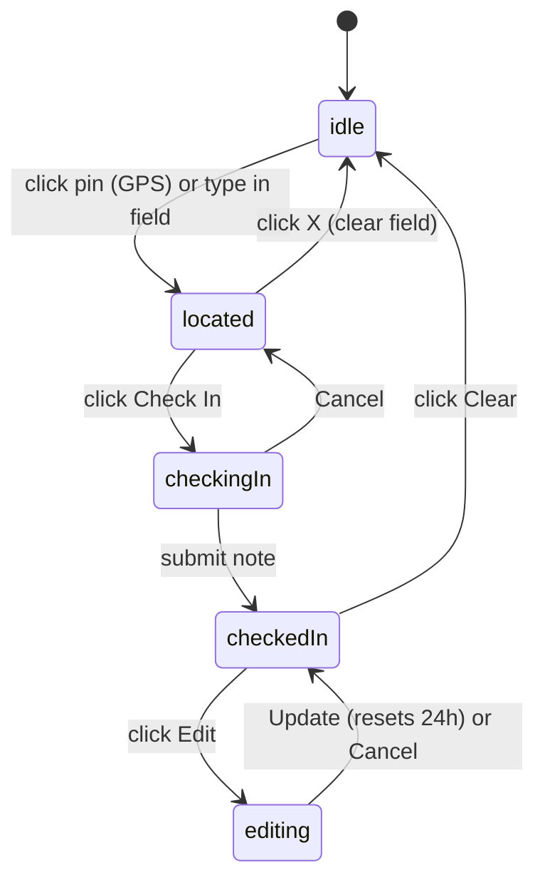

# Check-in Component Polish — Shaping Notes

## Scope

Rework the Now "Who's Around" component so the inline card and the "expand" dialog share **one state machine** and **one surface** (`CheckInSurface`). Layer on:

1. Search-based check-in (free-text place, geocoded on submit) **and** GPS check-in (pin → reverse-geocode to a city label).
2. An optional check-in `note` (<= 80 chars, live counter).
3. A checked-in header chip with **Edit** and **Clear**.
4. A **Map / List** view toggle.
5. Supercluster-style map bundles that change with zoom, with a bundle-list popover fallback when members can't be separated.

**Out of scope:** live realtime subscriptions, Everyone / My crews / Open for work filters, wave, autocomplete dropdown while typing.

## Target state machine (shared by card + dialog)

Card-specific handoffs: in `located`, Check In opens the dialog with the check-in popover open; in `checkedIn`, Edit opens the dialog; a bundle click opens the dialog zoomed (or with the bundle popover); a single-member click keeps the small `PersonCard`/`CheckInMemberPopover`. Clear works inline.

## Decisions

- **Location input:** pin button = GPS then reverse-geocode to a city label; typing = free-text place geocoded to coordinates **on check-in** (no live autocomplete dropdown).
- **Bundling:** supercluster geographic clustering that changes with zoom. Click a bundle to zoom in; if members can't be separated, show the bundle-list popover.
- **Note:** optional, trimmed, capped at 80 chars, persisted on `check_ins`.
- **Geocoding:** server-side via `geocodePlace` (`lib/now/geo.ts`) so the Mapbox token stays server-side; no raw geocode exposed to the client.
- **TTL:** unchanged — 24h from `checked_in_at` (`CHECK_IN_TTL_MS`); any edit resets the window. One active row per member (upsert).
- **Location label** shown in bundles/list/header = existing `city`.

## Shared state (lifted into `whos-around-card.tsx`)

`mapData`, `query`, `note`, `viewMode: "map" | "list"`, popover flags, `flyTo`, `dialogOpen` + `dialogIntent` — so the card and dialog stay in sync. `OnTheRoadSurface` becomes a shared `CheckInSurface` driven by props/derived `phase`.

## New components

- `components/now/check-in-form-popover.tsx` — check-in + edit popover forms.
- `components/now/check-in-bundle-popover.tsx` — "{city} · N crew" + member rows.

## Context

- **Visuals:**
  - _Current state:_ `visuals/current-card.png` (inline card default), `visuals/current-expanded-dialog.jpg` (expanded dialog default) — the disabled search bar, single "Check in here" button, and large bottom-left overlay card this spec replaces.
  - _Target mockups (card):_ `visuals/_1 Card - Default.png`, `_2 Card - User Located.png`, `_3 Card - Checked In.png`.
  - _Target mockups (dialog):_ `visuals/1 Dialog - Default.png`, `2 Dialog - User Located.png`, `3 Dialog - Check In - Popover.png`, `4 Dialog - Checked In - Far.png`, `5 Dialog - Checked In - Near.png`, `6 Dialog - Checked In - Bundle Popover.png`, `7 Dialog - Edit Check In.png`, `8 Dialog - Checked In - List.png` — these map onto the state machine (idle → located → checkingIn → checkedIn → editing, plus bundle popover and list view).
  - _Component reference:_ `visuals/view-toggle-reference.png` — the shared segmented view toggle style to reuse.
- **References:** see `references.md`.
- **Product alignment:** Roadmap Phase 1 "Now page — check-in map" polish.

## Standards Applied

- css/design-tokens — semantic Tailwind tokens, no hard-coded colors (orange ring uses a theme token / CSS variable, not one-off hex).
- css/shadcn-ui — compose from `@/components/ui/*` (`InputGroup`, `Popover`, `Textarea`, `Avatar`, `Button`); don't invent parallel systems.
- global/board-pattern — the Map/List view toggle reuses the shared `BoardViewToggle` (`@/components/board-view-toggle`), the same segmented button group Jobs and People use — no bespoke `ToggleGroup`.
- global/page-shell — `/now` stays in `PageShell`.
- global/board-pattern — reuse `PersonCard` / `PersonProfileDrawer`; do not invent a second card.
