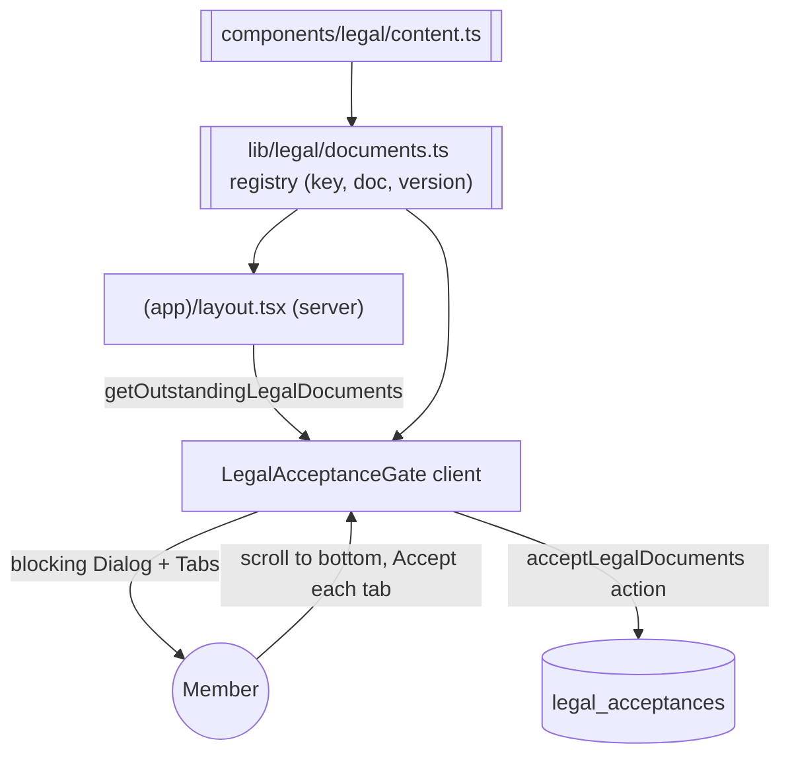

# Legal Acceptance Gate

Add a blocking, version-aware acceptance gate for the four legal/conduct documents. On entering the authenticated app, if the current user hasn't accepted the current version of every document, a large non-dismissible tabbed dialog appears. Each tab shows one document; the user must scroll to the bottom of a document before its "Accept" enables. Community Guidelines is the default/first tab. Once all outstanding documents are accepted, submitting persists acceptances and the gate disappears.

## Decisions (confirmed)

- Version-aware: store accepted `version` per document; re-prompt when a doc's version changes.
- All four documents required for every user; dialog is blocking / non-dismissible.
- Gate lives in the authenticated app layout, checked server-side.
- Show only outstanding: when a subset of docs need (re)acceptance, only those tabs render.

## Data flow

## Source content

All four docs already exist as structured `LegalDocument` objects in `components/legal/content.ts`: `communityGuidelines`, `termsOfService`, `privacyPolicy`, `jobPostingPolicy`. Reuse these directly. Each has a `lastUpdated` string used as the version.

## Task 1: Save spec documentation

Create `agent-os/specs/2026-09-29-1558-legal-acceptance-gate/` with `plan.md`, `shape.md`, `references.md`, and `visuals/`.

## Task 2: Migration - legal_acceptances table

Create `supabase/migrations/20260929160000_create_legal_acceptances.sql` (file only; run manually in the Supabase SQL Editor per repo convention - agents never execute migrations). One row per (profile, document) with the accepted `version` gives version-aware re-prompting and a light audit trail (`accepted_at`). Own-row RLS for select/insert/update.

## Task 3: Legal document registry

Create `lib/legal/documents.ts` defining the ordered, keyed registry (Community Guidelines first) mapping `key -> { document, version = lastUpdated }`, used by both server and client.

## Task 4: Server status reader + accept action

- `lib/legal/acceptance.ts`: `getOutstandingLegalDocuments()` wrapped in `React.cache`. Reads the user's `legal_acceptances` rows in a single query, builds a `Map<key, version>`, returns the subset of `LEGAL_DOCUMENTS` whose current `version` isn't matched by an accepted row. Returns `[]` when fully accepted.
- `lib/legal/actions.ts`: `"use server"` `acceptLegalDocuments(keys)` - auth-checked inside, validates keys against the registry, resolves the current version server-side, upserts rows onConflict `profile_id,document_key`, revalidates the layout.

## Task 5: Client gate component (tabbed, scroll-to-accept)

Create `components/legal/legal-acceptance-gate.tsx` (`"use client"`). Blocking non-dismissible Dialog with Tabs (Community Guidelines first). Each tab renders its document in a native scroll container with an IntersectionObserver bottom sentinel; the per-tab Accept enables only after reaching the bottom (short docs auto-qualify). Footer submit enables once all tabs accepted, persists via the action, then unmounts.

## Task 6: Mount the gate in the app layout

In `app/(app)/layout.tsx`, after the existing session/approval checks, call `getOutstandingLegalDocuments()` and render `<LegalAcceptanceGate outstanding={...} />` only when non-empty. Pass only `{ key, title, document }`.

## Task 7: Manual verification

- New/existing user with no acceptances: blocking dialog appears with Community Guidelines first.
- Accept buttons disabled until scrolled to bottom; short docs enable immediately.
- Submit enables after all outstanding accepted; gate disappears afterward.
- Reload / second device: gate does not reappear.
- Bump one doc's `lastUpdated`: only that document re-prompts.

## Out of scope

- Changing the signup form itself (the requirement is a login-time gate).
- Marketing pages at `/privacy`, `/terms`, `/community-guidelines`, `/job-posting-policy` (unchanged).
- Admin visibility/reporting of who accepted what.
