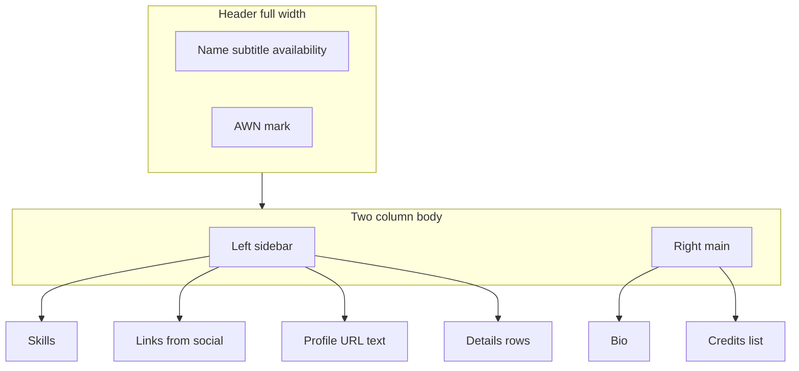

# Crew print resume — two-column layout

## Shaping summary

| Item         | Decision                                                                                                                                                                                                    |
| ------------ | ----------------------------------------------------------------------------------------------------------------------------------------------------------------------------------------------------------- |
| Scope        | Print/generated resume only (`window.print()` / `?print=resume`), not uploaded PDF downloads                                                                                                                |
| Columns      | Left ~1/3 sidebar, right ~2/3 main (align with [print-resume-layout-mockup.jpg](agent-os/specs/2026-09-17-2008-public-crew-profiles/visuals/print-resume-layout-mockup.jpg) and your reference screenshots) |
| Left sidebar | **Skills** → **Links** (from profile social fields) → **Profile** (crew URL text only) → **Details** (existing `detailsRows`, moved from current right column)                                              |
| Right column | Bio (full width of column) → **Credits** (section title stays **Credits**, not “Tour Credits”)                                                                                                              |
| Header       | Remove avatar image and initials placeholder; keep name, subtitle, availability, AWN mark                                                                                                                   |
| Data         | Existing [`buildCrewResumeData`](lib/crew/build-resume-data.ts) + [`getPersonSocialLinks`](lib/social-links.ts); no mock/example PDF data                                                                   |
| QR code      | Remove from print body (footer already shows `displayProfileUrl`)                                                                                                                                           |

**Visuals:** User-provided comparison screenshots (reference Aubrey layout vs current Roy Alnashef print) → save under spec `visuals/`.

**Product alignment:** Supports shareable crew profiles and printable career records ([mission.md](agent-os/product/mission.md)); extends [public crew profiles spec](agent-os/specs/2026-09-17-2008-public-crew-profiles/plan.md) Task 7 layout without changing download vs print behavior.

**Standards:** [`agent-os/standards/index.yml`](agent-os/standards/index.yml) is empty — no formal standards files to attach.

**Primary code touchpoint:** Single render tree today in [`components/crew/crew-resume-document.tsx`](components/crew/crew-resume-document.tsx), styled by [`components/crew/crew-print.css`](components/crew/crew-print.css), mounted from [`components/crew/public-crew-profile-page.tsx`](components/crew/public-crew-profile-page.tsx).

### Current vs target structure

**Current** ([`crew-resume-document.tsx`](components/crew/crew-resume-document.tsx)):

- Header includes avatar/initials
- Full-width bio above grid
- Grid `1.6fr / 1fr`: credits **left**, Details + Skills pills + QR **right**

**Target:**

- Header: text + brand only
- Grid ~`1fr / 2fr`: **sidebar left**, **main right**
- Main: bio then credits
- Sidebar: skills, links, profile URL, details (no QR)

---

## Task 1: Save spec documentation

Create `agent-os/specs/2026-10-01-1545-crew-print-resume-two-column/` with:

- **plan.md** — this plan
- **shape.md** — scope, sidebar order, Details placement, text-only profile link, visuals list
- **standards.md** — note empty standards index
- **references.md** — pointers to `CrewResumeDocument`, `build-resume-data`, `getPersonSocialLinks`, prior public-crew-profiles spec
- **visuals/** — copy from `.cursor/projects/.../assets/image-*.png` (both comparison screenshots)

---

## Task 2: Restructure `CrewResumeDocument`

File: [`components/crew/crew-resume-document.tsx`](components/crew/crew-resume-document.tsx)

1. **Header:** Delete the avatar `` and initials fallback block (lines 43–54); keep name/subtitle/availability and top-right branding.
2. **Body grid:** Replace single full-width bio + inverted grid with one two-column container, e.g. `grid grid-cols-[minmax(0,1fr)_minmax(0,2fr)] gap-8` (tune in CSS if print width needs fixed ratio).
3. **Left `<aside>`** (top to bottom):
   - Reuse/refactor `ResumeSkills` — prefer **stacked list with row dividers** (closer to reference PDF) instead of pills; hide section when no skills (keep department fallback logic).
   - **Links:** New subsection using `getPersonSocialLinks(person)` — each row: label (small caps via existing title class) + `link.display` as plain print text (optional accent color class for URL-like text). Omit section when array empty.
   - **Profile:** Section title e.g. **Profile** (or **Crew profile** — pick one and use consistently with footer); show `data.displayProfileUrl` as text (no `CrewResumeQr`).
   - **Details:** Move existing `<dl>` from current aside; keep `detailsRows` rendering.
4. **Right `<main>`:**
   - Bio paragraph(s) first (`whitespace-pre-line` preserved).
   - Credits list second; heading **Credits** (already correct).
5. **Footer:** Unchanged (`displayProfileUrl` + AWN tagline).
6. Remove unused `CrewResumeQr` import (component file can remain for other use).

No change to [`formatResumeCredit`](lib/crew/format-resume-credit.ts) unless visual polish is requested later (reference PDF uses artist | role | date on one row; current stacked layout is acceptable for v1).

---

## Task 3: Print CSS adjustments

File: [`components/crew/crew-print.css`](components/crew/crew-print.css)

- Add styles for sidebar link rows and skill list rows (borders, spacing) if not covered by Tailwind in print.
- Optionally style bio as italic in print to echo reference — only if it matches existing AWN print tone; otherwise keep current body style.
- Verify `.crew-resume-details-row` still reads well in narrow sidebar (may switch from label/value `justify-between` to stacked label-over-value like the live profile sidebar for narrow width).

---

## Task 4: Data layer (minimal)

[`lib/crew/build-resume-data.ts`](lib/crew/build-resume-data.ts): **No required change** — `person` and `detailsRows` already sufficient; call `getPersonSocialLinks(data.person)` inside the document component to avoid widening the serialized type.

If links are needed in tests or future PDF server rendering, optional follow-up: add `socialLinks: SocialLinkDisplay[]` to `CrewResumeData` in `buildCrewResumeData`.

---

## Task 5: Verification

Follow [smoke-check.md](agent-os/specs/2026-09-17-2008-public-crew-profiles/smoke-check.md) print sections:

- Member **without** uploaded resume → Print preview shows new layout; screen profile hidden.
- `/crew/{handle}?print=resume` auto-print still works ([`CrewAutoPrint`](components/crew/crew-auto-print.tsx)).
- Cases: no social links (Links hidden), no details rows, no credits, long bio pagination across pages.
- Confirm uploaded-resume **download** path unchanged ([`app/api/crew/[handle]/resume/route.ts`](app/api/crew/[handle]/resume/route.ts)).

---

## Out of scope

- Uploaded PDF generation or server-side PDF rendering
- Changing on-screen public profile layout ([`public-crew-profile-page.tsx`](components/crew/public-crew-profile-page.tsx))
- Renaming credit data model or “Tour Credits” elsewhere in the app UI
