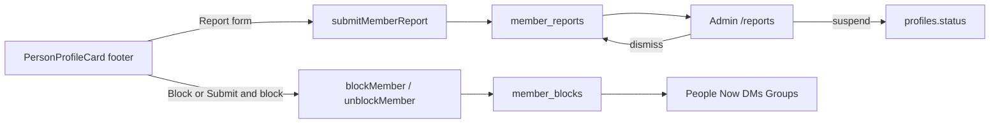

# Member Report and Block

Members can report and/or block each other from a profile card. Reports land in Admin → Users → Reports. Blocks are mutual: neither person can see or message the other, including in group member lists and group messages.

## Locked decisions

- **Report UI:** "Report member" on the default profile card footer opens a footer slide-up form (same `footerMode` + `slide-in-from-bottom-4` pattern as [`components/jobs/job-application-review-footer.tsx`](components/jobs/job-application-review-footer.tsx)).
- **Reasons** (from the attached screenshot, not the older `08_Report_Form.txt` list): Fake or misleading profile; Harassment or threatening behaviour; Spam or solicitation; Inappropriate content; Impersonating someone; Other. Reason is required. No extra details field in this pass.
- **Submit:** "Submit report" or "Submit & block". Thank-you copy from [`agent-os/product/misc/08_Report_Form.txt`](agent-os/product/misc/08_Report_Form.txt).
- **Standalone Block:** Profile footer also gets "Block member" (and Unblock when already blocked). Settings → Privacy → Blocked members becomes a real unblock list.
- **Block effect:** Mutual hide — People/Now/search, prevent DMs, hide from group member lists, and hide each other's group messages. Existing 1:1 threads are hidden from the inbox and cannot accept new messages.
- **Admin:** New Users sub-nav **Reports** at `/reports`. Table of undismissed reports. Click reporter or reportee to open [`PersonProfileDrawer`](components/people/person-profile-drawer.tsx). Actions: suspend either side (reuse [`updateUserStatus`](lib/users/actions.ts)), dismiss (soft-hide from the default table).
- **Duplicates:** One undismissed report per reporter → reportee. Later attempts show already-reported. Block/unblock is independent of the report.
- **Own profile / preview / public `/crew`:** No report or block on self, preview, or public crew pages.
- **Deferred:** Email/in-app notify on report or suspend; job-applicant visibility; Report job.

## Product alignment

Matches the invite-only trust model in [`agent-os/product/mission.md`](agent-os/product/mission.md), Phase 2 "People trust features — report member" in [`agent-os/product/roadmap.md`](agent-os/product/roadmap.md), and the unbuilt inventory rows for Report member + Reports triage.

## Architecture

## Data

New migration file only (agents never run SQL against Supabase). Follow the header comment style in [`supabase/migrations/20260920180000_room_member_blocks.sql`](supabase/migrations/20260920180000_room_member_blocks.sql).

**`member_blocks`**

- `blocker_id`, `blocked_id` (both → `profiles`), unique pair, no self-block
- One row is enough; treat the pair as bidirectional
- Helper `members_are_blocked(a, b)` used by app queries and RPCs
- RLS: either party can select; blocker can insert/delete own row

**`member_reports`**

- `reporter_id`, `reportee_id`, `reason` (text enum / check), `blocked_on_submit` bool, `dismissed_at` nullable, `created_at`
- Unique open report: partial unique index on `(reporter_id, reportee_id) WHERE dismissed_at IS NULL`
- RLS: reporter can insert own row; select/update admin-only

On block, also disconnect any `member_connections` row between the pair so Connect does not linger.

RPC updates in the same migration (replace functions, do not edit old files):

- [`list_dm_inbox`](lib/messages/actions.ts) / `get_or_create_dm_conversation` / send path — exclude or reject blocked pairs
- [`get_room_thread`](supabase/migrations/20260920180000_room_member_blocks.sql) — omit messages whose `sender_id` is blocked with `auth.uid()`
- [`list_rooms_for_user`](supabase/migrations/20260920180000_room_member_blocks.sql) last-message preview — skip blocked senders
- Group realtime inserts still need a client-side filter as a backup

## UI and enforcement (reuse these)

- Footer form: extract a `PersonProfileReportFooter` (or internal footer modes on the card) using `footerSheetClassName` from [`job-application-review-footer.tsx`](components/jobs/job-application-review-footer.tsx). Wire the default footer in [`person-profile-card.tsx`](components/people/person-profile-card.tsx) (current Report button has no `onClick`).
- Hide Report/Block when `person.id === sessionUser.id`.
- Directory: filter in [`listDirectoryMembers`](lib/people/actions.ts) / [`getMemberById`](lib/people/actions.ts).
- Now: filter in [`getNearbyCheckInsFromOrigin`](lib/now/check-in.ts).
- DMs: guard [`sendMessage`](lib/messages/actions.ts) + `get_or_create_dm_conversation`; hide threads from inbox; Message button on a blocked profile should not open a thread.
- Groups: filter [`getRoomMembersPreview`](lib/rooms/actions.ts) and admin member lists; filter thread + realtime by sender.
- Settings: replace the empty state in [`privacy-settings-section.tsx`](components/settings/privacy-settings-section.tsx) with a Manage drawer/sheet of blocked members + Unblock.
- Admin page: clone [`app/(app)/applications/page.tsx`](<app/(app)/applications/page.tsx>) — `canAccessAdmin` redirect, `PageShell` from nav. Add Reports under Users in [`lib/nav.ts`](lib/nav.ts) (`href: "/reports"`). Table like [`applications-table.tsx`](components/applications/applications-table.tsx) / [`users-table.tsx`](components/users/users-table.tsx): Reporter, Reported, Reason, Blocked on submit, Submitted, row actions (Dismiss, Suspend reporter, Suspend reportee). Name cells open `PersonProfileDrawer` the same way job applicants do in [`job-management-detail.tsx`](components/jobs/job-management-detail.tsx).

## Standards

- `global/page-shell` — `/reports` uses PageShell; title/description from nav
- `global/sidebar-nav` — add Reports in `adminNav` Users `items`, not hardcoded in the sidebar
- `css/shadcn-ui` — Table, Select, Button, AlertDialog, Drawer
- `css/design-tokens` — semantic tokens only

## Visuals to save

Copy the three attached screenshots into the spec `visuals/` folder (profile footer, reason select, admin Users nav).

---

## Task 1: Save spec documentation

Create `agent-os/specs/2026-10-01-1807-member-report-block/` with `plan.md`, `shape.md`, `standards.md`, `references.md`, and `visuals/`.

## Task 2: Migrations for reports, blocks, and hide helpers

Write the SQL migration for `member_blocks`, `member_reports`, RLS, `members_are_blocked()`, and RPC updates for DM inbox/create and group thread/preview. File only.

## Task 3: Member server actions

`lib/moderation/actions.ts` (or similar): `submitMemberReport`, `blockMember`, `unblockMember`, `listBlockedMembers`. Auth inside each action. Shared `areMembersBlocked` reader for People/Now/DM/group callers.

## Task 4: Profile footer — report slide-up + block

Wire Report and Block on the default [`PersonProfileCard`](components/people/person-profile-card.tsx) footer. Slide-up reason select + Submit / Submit & block + thank-you. Block/Unblock without a report.

## Task 5: Enforce mutual hide

Filter People, Now check-ins, DM inbox/send/create, group member lists, and group messages (RPC + realtime). Auto-disconnect on block.

## Task 6: Settings → Blocked members

Wire Privacy → Blocked members Manage to a real list with Unblock.

## Task 7: Admin Reports page

Nav item, `/reports` page + table, profile drawers on names, dismiss, suspend reporter/reportee via existing `updateUserStatus`. Cross-links from Users / Invites / Applications headers.

## Task 8: Verify in the browser

Report-only, report+block, standalone block/unblock, already-reported, own-profile hidden, People/Now/DM/group hide, admin table + drawers + dismiss + suspend. Confirm `/reports` is admin-only.
