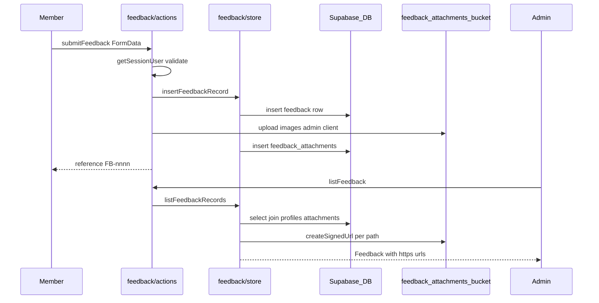

# Wire member feedback to Supabase

## What exists today (confirmed)

| Layer                | Location                                                                                                                                                                                                                         | State                                                                                                                      |
| -------------------- | -------------------------------------------------------------------------------------------------------------------------------------------------------------------------------------------------------------------------------- | -------------------------------------------------------------------------------------------------------------------------- |
| Member widget + form | [`components/feedback/feedback-widget.tsx`](components/feedback/feedback-widget.tsx), [`feedback-form.tsx`](components/feedback/feedback-form.tsx)                                                                               | Wired to `submitFeedback`; client compresses images via [`lib/feedback/compress-image.ts`](lib/feedback/compress-image.ts) |
| Admin inbox          | [`app/(app)/feedback/page.tsx`](<app/(app)/feedback/page.tsx>), [`components/feedback/feedback-inbox.tsx`](components/feedback/feedback-inbox.tsx), [`feedback-detail-sheet.tsx`](components/feedback/feedback-detail-sheet.tsx) | Gated by `canAccessAdmin`; tabs, search, type filter, detail sheet with status/note/mailto                                 |
| Server actions       | [`lib/feedback/actions.ts`](lib/feedback/actions.ts)                                                                                                                                                                             | Auth on submit; `requireAdmin` on list/update; validation matches [`lib/feedback/types.ts`](lib/feedback/types.ts)         |
| Persistence          | [`lib/feedback/store.ts`](lib/feedback/store.ts)                                                                                                                                                                                 | **In-memory global + 6 seed rows**; `listFeedbackRecords`, `insertFeedbackRecord`, `updateFeedbackRecord`                  |
| Attachments          | `persistAttachment` in actions                                                                                                                                                                                                   | **Data URLs** in memory (not suitable for production)                                                                      |
| Database             | —                                                                                                                                                                                                                                | **No migration yet** (grep over `supabase/migrations` shows no `feedback` tables)                                          |
| Nav                  | [`lib/nav.ts`](lib/nav.ts)                                                                                                                                                                                                       | Admin → Feedback at `/feedback`                                                                                            |

Product alignment: roadmap item “Feedback triage admin” in [`agent-os/product/roadmap.md`](agent-os/product/roadmap.md).

**Visuals (for spec `visuals/`):** user-provided screenshots — member “Share feedback” sheet and admin Feedback inbox (copy from [`.cursor/.../assets/image-7252adba-...png`](file:///Users/royalnashef/.cursor/projects/Users-royalnashef-Desktop-AWN-awn-v0/assets/image-7252adba-021f-4ef3-a6cc-9720ec0b0a77.png) and [`image-3a8a56bf-...png`](file:///Users/royalnashef/.cursor/projects/Users-royalnashef-Desktop-AWN-awn-v0/assets/image-3a8a56bf-70a7-4df4-ad2b-13eb5bc24fba.png)).

**Default shaping decision (questionnaire skipped):** no SQL seed rows — admin inbox shows real submissions only after migration is applied.

---

## Task 1: Save spec documentation

Create [`agent-os/specs/2026-10-03-1825-feedback-supabase/`](agent-os/specs/2026-10-03-1825-feedback-supabase/) with:

- **plan.md** — this plan
- **shape.md** — scope, decisions (no seed, store swap, private bucket + signed URLs), visuals list, product/roadmap alignment
- **standards.md** — excerpts from [`agent-os/standards/global/page-shell.md`](agent-os/standards/global/page-shell.md), [`sidebar-nav.md`](agent-os/standards/global/sidebar-nav.md); migration/RLS conventions from [`supabase/migrations/20261001190000_member_reports_and_blocks.sql`](supabase/migrations/20261001190000_member_reports_and_blocks.sql) and [`20260916180000_error_logs.sql`](supabase/migrations/20260916180000_error_logs.sql)
- **references.md** — pointers below
- **visuals/** — copy the two screenshots

### Reference implementations to follow

1. **Admin list + RLS update** — [`lib/moderation/actions.ts`](lib/moderation/actions.ts) (`listMemberReports`: `requireAdmin` + `createClient` + profile join)
2. **Private file upload via service role** — [`lib/applications/actions.ts`](lib/applications/actions.ts) (`uploadResume` with `createAdminClient`, path `{id}/resume.pdf`)
3. **Migration style** — manual SQL Editor header, `is_admin()` policies, no agent execution against live DB

---

## Task 2: Database migration (manual apply)

Add **`supabase/migrations/20261003183000_feedback.sql`** (timestamp adjusted if needed):

**Tables**

- **`public.feedback`**
  - `id` uuid PK default `gen_random_uuid()`
  - `reference` text unique not null — human id `FB-1042` (see sequence below)
  - `user_id` uuid not null → `profiles(id)` on delete cascade
  - `type` text not null — check `bug | ux | idea | praise` (matches [`FEEDBACK_TYPES`](lib/feedback/types.ts))
  - `status` text not null default `'new'` — check matches [`FEEDBACK_STATUSES`](lib/feedback/types.ts)
  - `impact` text null — check `blocking | annoying | minor` when not null
  - `area` text not null
  - `summary`, `details` text not null
  - `allow_contact` boolean not null default false
  - `context` jsonb not null default `{}` — stores [`FeedbackContext`](lib/feedback/types.ts) (`url`, `pageTitle`, `userAgent`, `viewport`, `platform`, optional `appVersion`)
  - `admin_note` text not null default `''`
  - `created_at`, `updated_at` timestamptz not null default `now()`
  - Index on `(created_at desc)`, optional on `(status)` for tab counts at scale

- **`public.feedback_attachments`**
  - `id` uuid PK
  - `feedback_id` uuid not null → `feedback(id)` on delete cascade
  - `storage_path` text not null — object key in bucket (not a public URL)
  - `file_name`, `content_type` text not null
  - `size_bytes` integer not null
  - `width`, `height` integer null (optional; client compression does not pass dimensions today — leave null unless you extend submit later)
  - `created_at` timestamptz default `now()`

**Reference numbers**

- Sequence `feedback_reference_seq` start **1008** (continues after current in-memory seed’s `nextReference`).
- `BEFORE INSERT` trigger on `feedback`: set `reference = 'FB-' || nextval('feedback_reference_seq')`.
- `updated_at` trigger on update (reuse project pattern if one exists; otherwise simple `NEW.updated_at = now()`).

**RLS**

- Enable RLS on both tables.
- **`feedback`**
  - `INSERT`: authenticated, `user_id = auth.uid()`
  - `SELECT` / `UPDATE`: `public.is_admin()` only (members do not need read-back in v1 UI)
- **`feedback_attachments`**
  - `INSERT`: authenticated and parent `feedback.user_id = auth.uid()` (or rely on server-only insert via admin — prefer **server-only insert with service role** and **no member insert policy** on attachments, matching [`error_logs`](supabase/migrations/20260916180000_error_logs.sql) insert-via-service-role pattern)

**Storage bucket** (same migration file or sibling `..._feedback_attachments_bucket.sql`)

- Bucket id: **`feedback-attachments`**, `public = false`
- `file_size_limit`: **4194304** (4 MB, matches UI copy)
- `allowed_mime_types`: png, jpeg, webp, gif (match [`FEEDBACK_ACCEPTED_IMAGE_TYPES`](lib/feedback/types.ts))
- **No broad authenticated read policy** — all reads via signed URLs from server using `createAdminClient` (same as private resumes bucket: upload in app code only)

**Ops note:** Migration header must state: run manually in Supabase SQL Editor; agents must not `db push` / MCP SQL (project convention).

---

## Task 3: Implement Supabase in `lib/feedback/store.ts`

Replace in-memory `getStore` / `seed()` with Supabase-backed implementations; keep exported function signatures unchanged so UI stays untouched.

**Dependencies:** `createAdminClient` for writes that include storage + attachment rows; `createClient` for admin list/update under RLS (mirror moderation actions).

**`listFeedbackRecords`**

- Select `feedback` ordered by `created_at desc`
- Join `profiles` as submitter (`full_name`, `email`, `avatar_url`) — map to [`FeedbackSubmitter`](lib/feedback/types.ts) using existing `initials()` from [`lib/users-data`](lib/users-data)
- Select nested `feedback_attachments`
- For each attachment, `admin.storage.from('feedback-attachments').createSignedUrl(storage_path, ttl)` (e.g. 3600s); set `FeedbackAttachment.url` to signed URL
- Map DB enums/snake_case → existing TS types (`wont_fix`, etc.)

**`insertFeedbackRecord`**

- Accept `CreateFeedbackInput` but persist **`user_id` from `input.submitter.id`** only (do not store denormalized name/email on row)
- Insert feedback row first (trigger assigns `reference`)
- Return full `Feedback` by re-fetching or mapping insert result + empty attachments, then attach files in actions layer (see Task 4) **or** accept attachment uploads inside store in one helper — either way, keep transactional cleanup if upload fails (delete feedback row)

**`updateFeedbackRecord`**

- Patch `status` and/or `admin_note`, touch `updated_at`
- Re-fetch with joins + signed URLs like list

Remove `globalThis.__awnFeedbackStore` and seed data entirely once Supabase path works.

Optional: add small **`lib/feedback/db-mapper.ts`** if `store.ts` grows too large — only if needed; prefer keeping mappers private in `store.ts` first.

---

## Task 4: Storage upload in `lib/feedback/actions.ts`

Replace `persistAttachment` data-URL behavior:

1. After validation, call store to **create feedback row** (or split: create stub row → upload → insert attachment rows).
2. For each file: path **`{userId}/{feedbackId}/{attachmentId}.{ext}`** (derive ext from MIME, sanitize `file.name` for `file_name` column only).
3. Upload with `createAdminClient().storage.from('feedback-attachments').upload(...)` (buffer from `arrayBuffer`, contentType from file).
4. Insert `feedback_attachments` row with `storage_path`.
5. On any failure after feedback insert, delete uploaded objects + feedback row (best-effort cleanup).

**Do not** pass base64 through server actions once storage works — shrinks memory and response payloads.

Submit response stays `{ ok: true, reference }` from DB trigger.

---

## Task 5: Types and edge cases

- Extend [`FeedbackAttachment`](lib/feedback/types.ts) comment: `url` is **signed URL at read time**, not stored in DB (no schema change required).
- Ensure `FeedbackContext` JSON keys in DB use the same camelCase as TS (consistent with other jsonb usage) or map snake_case in one mapper — pick one and document in `shape.md`.
- **Sample static images** under [`public/feedback/`](public/feedback/) were for in-memory seed only; safe to leave for local docs or remove in a follow-up (not blocking).

---

## Task 6: Verification

- **Manual (required):** Apply migration in Supabase SQL Editor; smoke test:
  - Signed-in member: open widget, submit bug with 1–2 screenshots → confirmation `FB-xxxx`
  - Admin: `/feedback` shows row, tabs/counts update, detail sheet images load, status + internal note persist after refresh
  - Mailto link still uses submitter email from profile join
- **Automated (optional):** unit test mapper from fake DB row → `Feedback` if you add a mapper module; otherwise skip per project test norms.
- Run `pnpm` typecheck / lint on touched files.

---

## Out of scope (defer)

- Member history (“my feedback”)
- Email notifications on new feedback
- Realtime inbox updates
- Replacing pre-existing error in [`app/(popout)/layout.tsx`](<app/(popout)/layout.tsx>) (noted by v0 agent)

---

## Risk notes

| Risk                                            | Mitigation                                                                                        |
| ----------------------------------------------- | ------------------------------------------------------------------------------------------------- |
| Partial upload leaves orphan row                | Delete feedback + storage objects on failure                                                      |
| Signed URLs expire while admin keeps sheet open | TTL ≥ 1h; refresh on `listFeedback` / re-open sheet; or revalidate on sheet open later            |
| Large server action body                        | Keep client compression + existing [`FEEDBACK_LIMITS.maxTotalUploadBytes`](lib/feedback/types.ts) |
| Empty admin inbox after cutover                 | Expected without seed; document in shape.md                                                       |
