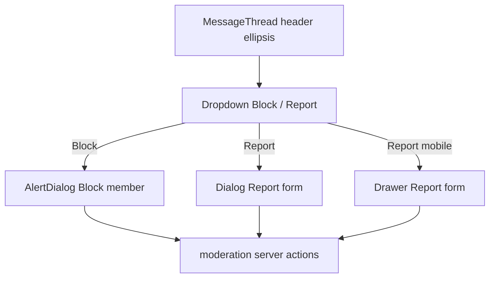

# Message thread block and report

## Shaping summary

**Scope:** Direct-message [`MessageThread`](components/messages/message-thread.tsx) header only — ellipsis on the right with **Block** and **Report** (no mute/archive/delete). **Report UI:** dialog on desktop (`md+`), bottom drawer on mobile (same pattern as [`components/nav-user.tsx`](components/nav-user.tsx): `useIsMobile`, `Drawer` + `showSwipeHandle` + `swipeDirection="down"`). Profile/job cards **unchanged** (footer slide-up stays in [`person-profile-interactive-footer.tsx`](components/people/person-profile-interactive-footer.tsx)).

**Backend:** Reuse existing [`lib/moderation/actions.ts`](lib/moderation/actions.ts) — `getMemberModerationState`, `blockMember`, `unblockMember`, `submitMemberReport` — and reason list from [`lib/moderation/report-reasons.ts`](lib/moderation/report-reasons.ts). No new migrations.

**Visuals provided:** Thread header target, inbox ellipsis reference, report form dialog, block confirmation, mobile user-nav drawer (save copies under spec `visuals/` in Task 1).

**Product alignment:** Supports invite-only trust / member safety in [`agent-os/product/mission.md`](agent-os/product/mission.md); extends entry points from [`agent-os/specs/2026-10-01-1807-member-report-block/plan.md`](agent-os/specs/2026-10-01-1807-member-report-block/plan.md) without redoing profile enforcement work.

## UI behavior (locked)

| Surface          | Behavior                                                                                                                                                        |
| ---------------- | --------------------------------------------------------------------------------------------------------------------------------------------------------------- |
| Ellipsis trigger | Match inbox [`ConversationActionsDropdown`](components/messages/conversation-actions-dropdown.tsx): `Button` ghost icon, `EllipsisVertical`, `align="end"` menu |
| Menu items       | `Ban` Block member / Unblock when `isBlocked`; `Flag` Report / disabled “Report submitted” when `hasOpenReport`                                                 |
| Block confirm    | Same copy as profile [`AlertDialog`](components/people/person-profile-interactive-footer.tsx) (lines 330–346)                                                   |
| Report form      | Same fields/copy as profile report footer: title “Report {name}”, label “Why are you reporting this member?”, reason `Select`, Cancel + Submit report           |
| After submit     | Close dialog/drawer, toast thank-you (profile uses inline thanks — thread uses toast to avoid extra step), set `hasOpenReport`                                  |
| After block      | Close dialog, toast success, set `isBlocked`, call optional `onBlocked` to refresh thread/inbox                                                                 |
| Visibility       | Render only when `conversation.otherProfileId` exists and [`isPersistedConversation`](lib/messages/format.ts) (same guard as inbox actions)                     |

## Header layout change

Today the header ends after the profile button ([`message-thread.tsx` ~786–822](components/messages/message-thread.tsx)). Add `ml-auto` wrapper for moderation actions so avatar/name stay left-aligned and ellipsis sits on the right (per mockup).

## Post-block thread state

`conversation.messagingBlocked` comes from inbox/list payload ([`lib/messages/actions.ts`](lib/messages/actions.ts)). After `blockMember`, trigger inbox SWR revalidation (e.g. `mutate(inboxKey)` from [`lib/messages/swr-keys`](lib/messages/swr-keys)) via a callback prop from [`messages-view.tsx`](components/messages/messages-view.tsx) or local mutate in thread if inbox key is already imported in thread (thread already imports `inboxKey` / `mutateSwr`).

## Standards (apply during implementation)

- [`agent-os/standards/css/shadcn-ui.md`](agent-os/standards/css/shadcn-ui.md) — compose `DropdownMenu`, `Dialog`, `Drawer`, `AlertDialog`, `Select`, `Button`
- [`agent-os/standards/css/design-tokens.md`](agent-os/standards/css/design-tokens.md) — semantic tokens, no hardcoded colors

---

## Task 1: Save spec documentation

Create [`agent-os/specs/2026-10-07-1420-message-thread-block-report/`](agent-os/specs/2026-10-07-1420-message-thread-block-report/) with:

- `plan.md` — this plan
- `shape.md` — scope, locked decisions (menu items, thread-only report shell, visuals list)
- `standards.md` — shadcn-ui + design-tokens excerpts
- `references.md` — pointers below
- `visuals/` — copy the five conversation images from `.cursor/projects/.../assets/`

## Task 2: `MessageThreadModeration` client component

New file e.g. [`components/messages/message-thread-moderation.tsx`](components/messages/message-thread-moderation.tsx):

- Props: `memberId`, `memberName`, `onModerationChange?` (after block/unblock/report)
- On mount / when `memberId` changes: `getMemberModerationState`
- Dropdown + controlled `reportOpen` / `blockDialogOpen`
- **`MemberReportFormBody`** (internal): shared JSX for dialog + drawer (reason select + actions)
- Desktop: `Dialog` / `DialogContent` with wider max-width (~sm/md) and padding matching mockup (`rounded-2xl`, generous padding)
- Mobile: `Drawer` mirroring [`nav-user.tsx`](components/nav-user.tsx) (lines 360–373) — form in `DrawerContent`, sr-only `DrawerTitle`
- Block: `AlertDialog` (reuse profile strings)

## Task 3: Wire into `MessageThread` header

In [`components/messages/message-thread.tsx`](components/messages/message-thread.tsx):

- Import moderation component
- Place in header with `ml-auto`, pass `conversation.otherProfileId`, `conversation.name`
- `onModerationChange`: revalidate inbox + optionally bump local blocked UI (parent may pass updated `conversation` from provider after mutate — verify [`messages-view`](components/messages/messages-view.tsx) / provider refresh path)

## Task 4: Verify edge cases in browser

- Persisted DM with real `otherProfileId`: open menu, report with each reason path, duplicate report disabled
- Block: composer shows existing `messagingBlocked` banner; send disabled
- Unblock from menu (if blocked)
- Mobile width: report opens drawer, not dialog
- Mock/non-persisted conversation: no ellipsis
- Regression: inbox row ellipsis unchanged

---

## References (for `references.md`)

| Reference                                                                                          | Relevance                                                  |
| -------------------------------------------------------------------------------------------------- | ---------------------------------------------------------- |
| [`conversation-actions-dropdown.tsx`](components/messages/conversation-actions-dropdown.tsx)       | Ellipsis + dropdown styling                                |
| [`person-profile-interactive-footer.tsx`](components/people/person-profile-interactive-footer.tsx) | Report form fields, block dialog copy, server action usage |
| [`nav-user.tsx`](components/nav-user.tsx)                                                          | Mobile drawer vs desktop popover split                     |
| [`message-thread.tsx`](components/messages/message-thread.tsx)                                     | Header integration point, `messagingBlocked` composer      |
